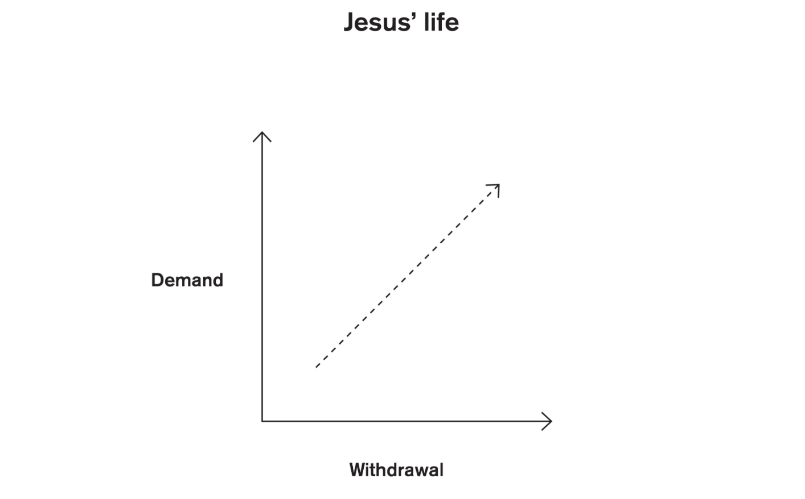
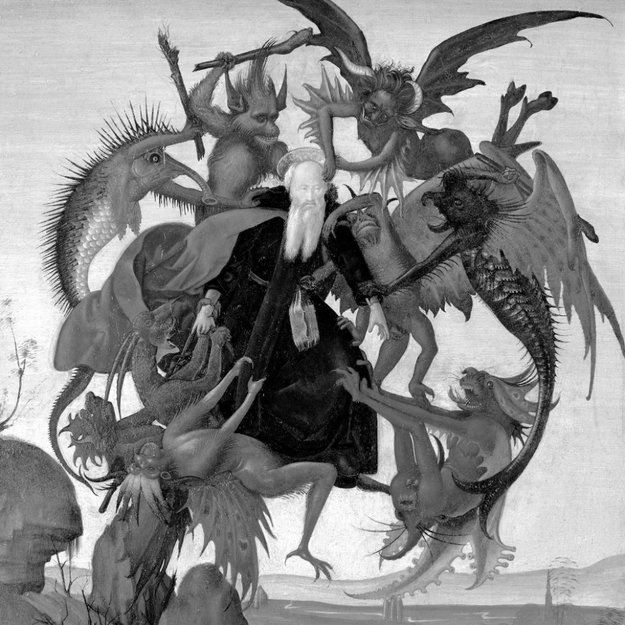
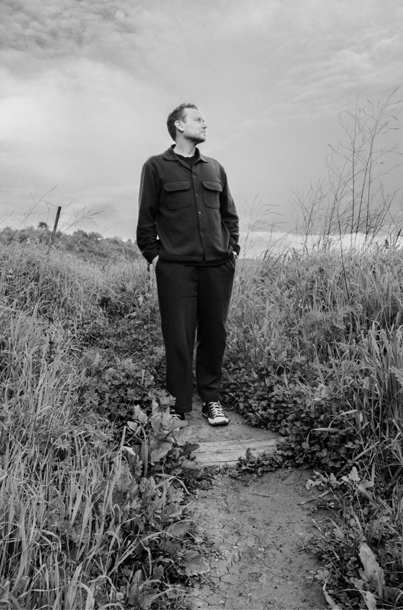

Praise for *Into the quiet*

“The noise of the world doesn’t just hurt your ears—it harms your soul. John Mark Comer shows in this wonderful book how to step back from the world and find God in stillness.”
—ARTHUR C. BROOKS, #1 New York Times bestselling author of *Build the Life You Want*

“In a world of overwhelming noise, this is a thoughtful and powerful hymn to tuning in to the precious quiet that will set you free.”
—JOHANN HARI, New York Times bestselling author of *Stolen Focus* and *Magic Pill*

“If you are like me, there is some resistance to dive headfirst into the deep of silence and truly face God and at times my own demons. John Mark Comer patiently and beautifully stands at the entrance to the cave of the deep, and not only does he speak to our fears, but he also compels us to understanding that there is no real life or healing anywhere but here with Jesus. This is the thing your soul is craving.”
—JENNIE ALLEN, New York Times bestselling author of *Get Out of Your Head*

“How can we ever strip ourselves of ego, self-image, and the trauma we carry from our wounds; of the hype, fads, and ideologies that we inhale everywhere; of our pathological busyness; and of our habitual unconscious posturing? How do we attain nakedness of soul? Into the quiet suggests a way, the way of Jesus and the way of the desert. This book transcends all denominational differences. It’s an invitation to everyone to enter a deeper part of our souls.”
—RONALD ROLHEISER, professor of spirituality at Oblate School of Theology in San Antonio, Texas, and author of *The Holy Longing*

Also by John Mark Comer

*Garden City*
*God Has a Name*
*The Ruthless Elimination of Hurry*
*Live No Lies*
*Practicing the Way*

# Contents

[Beginning: A world of noise](#)

[One: The *eremos*](#)

[Two: The encounter with ourselves](#)

[Intermission: The Gethsemane prayer](#)

[Three: The encounter with our enemy](#)

[Four: The encounter with our God](#)

[End: A quiet life](#)

[*Gratitude*](#)  
[*Notes*](#)  
[*About the Author*](#)  
[*Free Ebook for Pastors*](#)  
[*Practicing the Way*](#)  
[*Endpaper*](#)

# Beginning

A world of noise

Twenty-one days.

In an isolated cabin, tucked into a moody, coastal forest above a remote beach in Puget Sound.

All *alone*.

No phone.

No computer, email, or internet. You are required to hand over any devices upon check-in.

No *books*.

A Bible is “allowed,” but with a gentle warning not to use it as a “distraction from God.”

No alcohol, no more than one cup of coffee per day, no exercise, even—nothing to “discharge the anxiety from your body.” A daily walk along the remote coastline is fine, but nothing that will get your heart rate up.

And *no* contact with people. I pack in all my own food, do all my own cooking—totally cut off from the outside world.

My sole human interaction takes place five mornings a week, at 5:50 A.M.—“because early in the morning your mind is more open to its subconscious”—when I sit for ninety minutes of depth therapy with a clinical psychologist. In his seventies, he is a true doctor of the soul. Thin white hair cascades past his shoulders; he looks suspiciously like Gandalf from *The Lord of the Rings*.

Depth therapy is similar to regular therapy, minus the happy feelings at the end of a session. It’s aimed at identifying how your early childhood experiences created the subconscious patterns you live by today, which generally means facing a lot of your pain. I lie on a couch, feeling more than a little anxious, with Gandalf sitting behind me. We begin day one with my relationship with my father: “Let’s bring Dad into the room.” By day three, my mother. Then we trace the story of my life in concentric circles up to the present day. Over the next three weeks, we work through *all* of it.

As the sun comes up, it’s me and the wizard. We’re usually done by seven-thirty.

Then, until the sun goes down, it’s just me, the broken pieces of my soul, and God.

Each day, Gandalf gives me an assignment of some kind: to think about an aspect of my past; to journal about this, that, or the other; to occasionally do something theatrical (like the time he had me sit in the back of my car and re-create an experience of almost dying from SIDS in the car seat at six weeks old). The assignment usually takes me about an hour.

Nine A.M.: *Twelve more hours* to go.

Seven hours a week in therapy.

*One hundred sixty-one* utterly, completely alone.

This program is more than fifty years old, yet it has no name, no website, and no marketing strategy. I heard whispers of it for years but, honestly, what kind of person has time to go fully off-grid for three weeks? Not me. Until I did. After stepping down from a twenty-year run pastoring a church, I was gifted a once-in-a-lifetime sabbatical—and with it, a chance to go into monk mode for a little while.

It’s now or never.

As an isolophile (an introvert with a natural affinity for time alone in the quiet), I was betting on myself to nail it. Not only am I wired to enjoy time alone, but I’ve been teaching on solitude for years. Honestly, I was looking *forward* to it. I was bone-weary after two decades of pastoring. If nothing else, twenty-one days away from my phone would offer a much-needed digital detox. I figured the effect on my central nervous system alone would be worth the monkish austerity.

Easy, I thought.

*It was one of the most painful, harrowing, terrifying things I have ever done.*

I *barely* made it through.[1]

What did you do with all that time alone, you ask?

Reasonable question. I’m still not sure. I drew out every possible distraction—cooking, cleaning, walking-walking-*walking*, a daily cold plunge in the winter sea. But mostly I just sat there, feeling my pain, facing a life I’d been running away from, and listening—for God, and for the skittish fawn of my own soul.

By day three, I’m dying, more depressed than I’ve been in years, my dopamine levels in free fall. I realize that while I’ve spent a lot of time in “solitude, silence, and stillness,” I’ve always gone in with a bag of emotional props to keep me busy—books to read,[2] a laptop for writing and calendar planning, a to-do list of projects, the occasional bottle of wine. What I had been calling a spiritual discipline was really more like alone time for a Christian introvert to do deep work.

Sure, I would pray and read Scripture and seek God, but it’s not like I would just *sit* there.

A few days in, I’m already over it. I mean, there is *nothing* to do; the boredom is crushing. And I still don’t understand the why behind all the rules.

“Why no books?” I ask the wizard. “Books are a vital part of my spiritual life.”[3]

He is quiet for a moment, gathering his thoughts. “This program was designed to re-create the experience of Jesus in the desert. All the great ones went into the desert—Jesus, Moses, Elijah…”

Then he says a line that is still with me: “And the desert teaches by taking *away*.”

I realize, I’m used to learning by *addition*—by reading books like this one in your hand or hearing teachings or listening to podcasts or asking a mentor a flurry of important questions while scribbling down their sagacious replies in my journal.

All good things.

But the desert teaches by *subtraction*, by stripping things *away* until the soul is naked before its maker.

In the desert, all our props—our coping mechanisms, our escapist behaviors, our cultural narcotics, all the things we use to numb our pain and hide from the reality of our lives—are burned away and our souls are laid bare.

Until you go into the desert, *you don’t really know what’s in you.*

In my “desert” of the rainy Pacific Northwest, I discovered a *lot* that was in me—good, bad, and ugly.

*So many things* came up from the substrata to the surface of my heart: how much of my life was run largely by the animating energy of fear; how much I loved my family, and how much I’d hurt them, too; all my regrets, the wounds inflicted over so many years of life and leadership, both *on* me and *by* me.

It was like I finally stopped running and the accumulated pain residue of half a life finally caught up with me and had its way.

I was undone.

And yet, as the days passed, I began to learn by direct experience what I had only heard rumor of thus far: the raw power of simply being alone with God. What the Desert Father Abba Ammonas called “the power of silence.”

Yes, there were incredibly helpful insights gained in therapy sessions (thank you, Gandalf). I’m sure the lack of digital stimulation reset my neurobiology a few notches toward health, and the daily walks on the beach were good for body and soul. But the *power*—what really *changed me* and made my retreat a before/after moment in my life—was simply setting myself before God. Waiting there in the silence of the woods, deeply aware of my wounding and need, just listening for his voice, the only thread that could possibly lead me from the murky fog of my pain into the bright sun of a new day.

And he *did*.

I thought to myself, *If only people knew the power of the desert.*

If only they knew it’s available to *all* for *free*.

If only they knew what God could do if they would simply follow Jesus into the quiet.

One

The *eremos*

> *“I have shown you the power of silence, how thoroughly it heals and how fully pleasing it is to God.… Know that it is by silence that the saints grew, that it was because of silence that the power of God dwelt in them, because of silence that the mysteries of God were known to them.”*
> **—Abba Ammonas**

> *“The world of men is made of jangling noises.*  
> *With God is a great silence.*  
> *But that silence is a melody*  
> *Sweet as the contentment of love,*  
> *Thrilling as a touch of flame.*  
> *When I enter into God,*  
> *All life has a meaning.…*  
> *My fever is gone*  
> *In the great quiet of God.”*
> **—“The Little Gate to God” by Walter Rauschenbusch**

> *“Jesus often withdrew to lonely places and prayed.”*
> **—Luke the Evangelist**

1.

We live in a world of noise.

Our cities are noisy: Freeways drone, delivery trucks blare, construction piles the ground, and the undulating machinery of “civilization” turns us all into functional barbarians. Eat, sleep, commute, consume—on repeat.

As the writer Roddy Doyle sardonically opined on living in the Irish capital, “Dublin is not a place. Dublin is a sound.”[1]

Need I say more?

Even the once idyllic stillness of suburbia and the homespun charm of small-town America is noisy, too: Leaf blowers whine at seven in the morning, garbage trucks bleep all through the day, rap music travels down the hallway from your teenager’s bedroom.

Even if you escape to the pastoral calm of “the country,” highway noise carries for miles. You sit on the front porch drinking your morning tea to the distant drone of semi-trucks laundering online orders to the next town over, all hours of day and night.

A recent study by an acoustic ecologist found there are only twelve truly quiet places left in the entire United States.[2]

Is there no *escape*?

It’s like the entire modern world is a vast conspiracy against the quiet.

And it’s not just the hardscape of the modern world that’s rattled with aural clutter.

Our *culture* is noisy: Pundits opine, angry voices rage into the digital ether, news apps prophesy impending doom, and the twin demons of outrage and anxiety supercharge our feeds and feelings, all while influencers sell us their glittering lifestyles for 20 percent off.[3] From politicians scheming for your vote, to celebrities hocking their new side hustle, to recreational conspiracy theorists peddling a new “hot take,” to wellness entrepreneurs marketing their pseudoscience direct to camera: “Drink my new organic borax—it’s all natural!” Everyone has something to say, all the time, about everything.

It’s *so* exhausting.

And yet, our churches are noisy, too. We worship God to screaming electric guitar solos, our voices drowned out by the literal clanging of cymbals. We pass the hour and a half together with barely so much as a *deep breath*, much less a moment of silence. We enlist our communities in an incessant stream of activity after activity, draining their last energy reserves to bone-dry, until they quietly drift away.

Sure, there’s a time and a place to “make a joyful noise”[4] and even “raise a hallelujah.”[5] I’m pro-joy and fully in support of the worship of God.[6] But what happens when you can’t even *hear* the hallelujah over the volume of the band?

When I consider the modern, Western stream of the church I’ve spent my life in, I fear that rather than offering a refuge and shelter from the noise, we’ve simply become purveyors of a Christianized version.

And the problem here isn’t “the church”; it’s *us*. Even our prayer is noisy. We approach our devotional life with a stack of books, all brimming over with words, ideas, doctrines, and dogmas (case in point: the book you’re currently reading!). We pray with earbuds in, following the latest app or album. We scribble down our torrent of internal thoughts in our journals, trying to get the chaos out of our minds and into a semblance of order on the page.

All these practices have a good and healthy place. Truly.

But too much of a good thing quickly devolves into a *bad* thing.

What is this cultural surge in noise doing to our bodies and souls?

Leading scientific experts and mental health professionals have coined a new term to explain the deleterious effect of this emerging auditory assault: *noise pollution*. The World Health Organization named noise pollution as the second-most dangerous environmental toxin in the world, just after air pollution and beating out oil and gas.[7]

Dr. Mathias Basner is a research scientist at the University of Pennsylvania. He’s spent the past twenty-five years traveling the world to study the effects of noise on the human body. As we chat over Zoom, his still-bright blond hair and inquisitive blue eyes betray his natural curiosity.

“Noise is stress,” Basner explains. It causes our bodies to excrete hormones like cortisol, which unduly taxes our central nervous system.[8] “Silence is a pretty rare commodity these days,” he says to me, “and we’re all paying a price for it.”

Dr. Basner isn’t an auditory curmudgeon: As we talk, he’s just returned from seeing the eighties new-wave band Simple Minds in concert (though, he was careful to note, he wore earplugs). But he’s at the front of a vanguard of leading experts warning us that we may one day look back on the noise of living by freeways or in city apartments in the same way we think of our grandparents smoking a pack a day or using lead paint on the walls of the baby’s nursery—in horror.

Scientists have tied noise to a long list of societal woes: hypertension, heart disease, arrhythmia, stroke, learning difficulties, emotional difficulties, cognitive impairment, anxiety, depression, even Alzheimer’s and dementia. One study found that prescriptions for anxiety medication rise 28 percent for every ten-decibel increase in neighborhood noise.[9] If noise is stress, then the louder your neighborhood is, the more it’s going to tax your body.

In another study from the WHO, scientists found that one million years of life are lost each year in Europe alone due to noise,[10] in what they call Disability-Adjusted Life Years (DALYs). My wife and I honeymooned in Paris, and my memory of it is bathed in a lovely, romantic mystique, but it’s easy to forget how *loud* it is. One study estimates that Parisians live *three full years* less than they would in the French countryside, simply due to the noise.[11]

Tragically, noise pollution is tied to issues of systemic racism, with airports, freeways, and other necessary but noisy machinery for modern cities often being enforced upon neighborhoods without the wealth or social capital to mount a NIMBY resistance, further exacerbating the gap between rich and poor and turning quiet into a luxury of the rich.

Those of us who live in cities may feel like we’ve acclimated to this new normal, but Dr. Basner helped me understand that our bodies are simply not biologically designed for chronic noise. He explained that we evolved for quiet soundscapes, not the din and drone of cities and suburbs, and our brains are wired to equate loud noise with *danger*.

Think about it: If you’re backpacking in the wild and hear an ear-splitting sound, your body will click into fight or flight before your brain even has a chance to identify what you’re hearing. Predators, sleeper waves, earthquakes, thunderstorms, avalanches, hurricanes, tornadoes—almost anything loud in the natural world is a threat.

Loud noise travels from our ears down the bones of our spines in nanoseconds, triggering our bodies’ primal fear-based survival instincts. When noise is a rarity (like on my annual summer backpacking trip), it’s a *good* thing that our bodies respond in this way. It keeps us safe from the predator hiding in the bushes. But when noise is a daily, incessant presence? It’s a disaster.

“The body reacts immediately and powerfully to [noise], even in the middle of deep sleep,” writes the science journalist Daniel Gross. He explains,

> Noises first activate the amygdalae, clusters of neurons located in the temporal lobes of the brain, associated with memory formation and emotion. The activation prompts an immediate release of stress hormones like cortisol. People who live in consistently loud environments often experience chronically elevated levels of stress hormones.[12]

Let’s say you commute to work. PET scans done on drivers reveal that road noise activates the part of our brain housing our fight-or-flight system.[13] My mind may know it’s just the ambient roar of rush-hour traffic when I’m driving on the 405 in Los Angeles, but my central nervous system interprets the freeway as *DANGER*. That’s why you feel that strange mix of buzzed and tired when you get out of your car post-commute. You thought you were just driving home from work or your kid’s soccer game, but your body was fighting off saber-toothed tigers all the way. You walk in the door feeling edgy and drained? Yeah. We simply are not designed to live proximate to chronic noise.

And yes, I live just outside one of the loudest cities in America, but by 2050, *two-thirds* of the world will live in cities, many far worse.[14]

Even if we find a way to quiet the sonic assault of the modern city—if we move to the country or soundproof our homes or adopt a nocturnal schedule—still, we face an even more insidious problem: It is now possible to go through our entire lives and *never be alone*. We may be the only person in the room, but we’re texting with a friend or watching episode 3 or listening to a podcast or reading the news. The moment most of us are alone, we immediately reach for our digital appendage—check our texts, open social media, click on our alerts, play music, search *whatever*.

Our devices keep us tethered to the world of noise.

A growing number of people are going to almost comical lengths to escape their compulsive need to stay connected. Inspired by her lawyer husband’s one-hundred-hour workweeks, the Korea-based entrepreneur Noh Ji-Hyang converted a defunct jail into a profitable business called Prison Inside Me, where stressed-out urbanites *pay money* to be locked into a fifty-four-square-foot cell for twenty-four hours—all devices confiscated, meals delivered through a slit in the door—in full-on solitary confinement. They even don blue prisoner jumpsuits. After a recent stay, twenty-eight-year-old Park Hye-Ri, a program manager at a fast-paced start-up, said, “This prison gives me a sense of freedom.”[15] Another client said, “This is not a prison, the real prison is where we return to.”[16]

Yes, people are *paying money* to be locked in a prison cell, just to get away from their phones.

Or how about a less extreme example: You can’t go three feet in your local bookstore without seeing the latest bestseller on mindfulness prominently displayed on an endcap, often mysteriously (or strategically?) positioned next to another new release prophesying the imminent end of democracy/Western civilization/the world/etc. (the literary equivalent of a grocery store selling weight-loss magazines next to candy bars at the checkout counter). From prisons to paperbacks, the market is trying to monetize solitude as a private wellness regimen, offering us the bliss of temporary stress relief, all for a price.

The irony is, *quiet is free*.

You don’t need a subscription or an app or new gadget or expensive retreat—you just need to put away your phone and go be alone.

But our increasingly odd ploys to escape the overstimulation of our world are yet more evidence that a growing number of people, religious or not, are craving a quieter, calmer life. We’re searching for stillness in a world hurtling through space at a thousand miles an hour.

And let me name what I’m sure you’ve already concluded: The threat of all this sonic tyranny isn’t just to our minds or even to our bodies; it’s to our *souls*.

Could there be a link between all this noise and the fact that we’re living through an epidemic of mental illness? That anxiety is sweeping the Western world like an invisible plague? That after steadily falling for decades, the suicide rate has skyrocketed, especially among young people, almost certainly due to the impact of screens in general and social media in particular?[17] Or that it feels like democracy is coming apart at the seams, with people screaming past one another in rage and contempt, unable to agree on even the basic facts?

Is it any wonder that secularism is concentrated in cities—that people who live in rural areas are more likely to believe in God and live a spiritually vibrant life, while people in urban landscapes trend more skeptical?

And are we really surprised that even for those of us urbanites who *do* believe in God and greatly desire life with him, when we sit down to pray, we can barely even pay attention? Our dopamine-addled brains can barely *think* straight, much less bathe in the radiant love of the Trinity.

People have long struggled to pray, but our generation’s struggle is more existential: *Is there even a God out there listening?*

Is he really near?

Does he even care?

Or are vague, progressive nods to the benevolence of “the universe” all we’ve got?

These questions are not new, but they are exacerbated wildly by our times. Much of what we interpret as “God’s silence” or “the dark night of the soul” is simply our overloaded brains.

Is it even *possible* to have a life with God amid all this noise?

What if the greatest threat to our faith today isn't secularism but distraction?

What if the littered wreckage of Christendom we call "the West" wasn't just caused by religious wars or celebrity pastor scandals or political polarization or shopping malls but also by the sheer *noise* of modern life?[18]

I feel this in my spiritual bones. I drive the same freeways as you, carry the same phone in my pocket, breathe in the same toxicity of auditory pollution.[19]

Do you?

Can you see what it's *doing* to you?

There's a haunting paragraph in *The Screwtape Letters*, that masterpiece of satire from the Oxford don C. S. Lewis, where the fictional demon Screwtape rages against the two sounds of heaven: "Music and silence—how I detest them both!"[20] He contrasts the music and silence of heaven with their doppelgänger in hell: Noise. In hell, Screwtape boasts, "All has been occupied by Noise—Noise, the grand dynamism, the audible expression of all that is exultant, ruthless, and virile."[21]

Writing in the 1940s, Lewis imagined noise as a demonically animated tool of the evil one and hell as a place that is never, *ever* quiet.

Screwtape's tirade ends with a chilling threat: "We will make the whole universe a noise in the end."[22]

In L.A., at least, they sure are off to a good start.

## 2.

But let's back up to a time long before the noise pollution of modern machines.

In the third century A.D., a young Egyptian aristocrat named Antony is walking to church. His parents have just died, he's inherited the family estate, and mood-wise, he is feeling more than a little contemplative. He finds himself thinking of how the first followers of Jesus sold their belongings and laid the money at the apostles' feet to distribute to the poor. The text for that Sunday's reading "happens" to be Matthew 19:21, where Jesus says to another young nobleman, "If you want to be perfect, go, sell your possessions and give to the poor, and you will have treasure in heaven. Then come, follow me."

Like many of us, Antony was cut to the heart by Jesus' call.

*Unlike* many of us, he actually went out and *did* it.

That day, he divested himself of his wealth and left society behind, first living on the edge of the village in a small hut before retreating deep into the Nitrian Desert to live a solitary life of prayer.

Antony was widely considered the first monk, and a biography of his life was published in A.D. 360 by Saint Athanasius, the highly influential bishop of nearby Alexandria who was personally mentored by Antony. Hardly the kind of book you'd expect to be a bestseller, *The Life of Antony* swept the Mediterranean world like a fire, capturing the imagination of generations of young seekers with its gripping tales of life in the desert.

But Antony was *not* actually the first monk; he was one of *thousands* of young men and women who fled the crumbling edifice of the Roman Empire to commune with God in the arid wastelands of North Africa, Syria, and Judaea. They came from every walk of life: aristocrats and artisans, farmers and financiers, Roman and Hebrew and Coptic and Assyrian and more. The erudite father Arsenius had been a Roman nobleman and the emperor's personal tutor. Abba Moses had been a slave, a robber, and likely a murderer (who was converted while hiding from the law in a community of monks). Saint John Kolobos was a dwarf. Syncletica and Theodora were women, their own idiosyncrasy in a world dominated by men. Over time, this unofficial diaspora became known as the Desert Fathers and Mothers, who eventually evolved into the monastic orders that now populate every corner of the globe. Over the centuries, these eccentric devotees to prayer have preserved a vital strand of Christian spirituality, even through long centuries when the church at large has strayed far from her roots.

When you trace the literary history of these saints and sages, you quickly realize they *all* speak of what Abba Ammonas, another disciple of Saint Antony, called "the power of silence."

> I have shown you the power of silence, how thoroughly it heals and how fully pleasing it is to God.… Know that it is by silence that the saints grew, that it was because of silence that the power of God dwelt in them, because of silence that the mysteries of God were known to them.[23]

The Desert Fathers and Mothers’ lifestyle was built on the conviction that, as Teresa of Calcutta said, “We need to find God, and he cannot be found in noise and restlessness. God is the friend of silence.”[24]

We can take issue with such a dogmatic claim, but they did not. They left society behind, moved out into the desert with nothing but the clothes on their backs, built small huts from mud-baked bricks (which they called “cells”), earned a simple living weaving baskets or rope (the repetitive nature of their craft meant they could do it without stopping their prayer), working just enough to buy their food. Mostly, they prayed. In silence. Alone.

The apostle Paul urged his fellow disciples to “pray without ceasing.”[25] The Abbas and Ammas of the desert believed it could be done, and earnestly made it their aim. But they *also* believed it *required* an escape from the world of noise. As Abba Arsenius heard God say to him in prayer, “Flee from men and you will be saved.”[26]

We only have sayings like the one above because the younger novices would inevitably seek out the older, more wizened monks and badger them with questions about the path of prayer. The wisdom they preserved is still with us. Your outer life may be *nothing* like that of an eremitic desert nomad from the third century, but if you spend time with their teachings, you may be surprised to discover the similarity of your *inner* life.

It turns out, to be a human being, aching for an experience of the love of God is the most common denominator of all.

What I discovered in that isolated cabin in Puget Sound was nothing new; it was the truth of what seekers of God have been telling us since Saint Antony entered the wild—the extraordinary power of simply being quiet before God.

And before you just write me off—“Comer, you do *not* understand my life”—I’m not saying you need to pack your bags for a twenty-one-day retreat. We’ll get to what this could look like for you, but it’s likely not *that*. Just hang with me for a little while. All I’m saying is, regardless of your personality type, Enneagram number, or stage of life; whether you identify as an introvert, extrovert, or ambivert; whether you chase a two-year-old around an apartment all day or sit in the executive suite of a Fortune 500 company, nurturing a practice of solitude, silence, and stillness is utterly indispensable to a flourishing spiritual life.

And yet.

We are the first generation in the history of the world for whom it is possible—even normal—to completely banish quiet from our lives.

## 3.

We live in a time of division, strife, and vitriol, when people the world over are practically foaming at the mouth as they scream at each other across the political aisle, where our brains’ limbic fears are constantly set on fire by the manipulative algorithms of digital capitalism, where pretty much *all* of us live with the ambient hum of low-grade anxiety, and the hurry, busyness, and overstimulation of “normal” life leave the best of us feeling chronically exhausted and burned-out at a soul-deep level.

Is there a practice from the way of Jesus that could open our souls to the peace and presence of God amid the noise of the modern world?

Yes: the practice of solitude, silence, and stillness.

We can tap into a way of life that runs all the way back through the annals of church history to the life of Jesus himself.

To begin, let me lay a biblical foundation for this practice. Without that anchor, sunk deep into the library of Scripture, we’re unlikely to hold fast to our practice when the cultural currents are as fast and strong and all-pervasive as they currently are. In Luke 5, we read this summary of Jesus’ lifestyle:

> The news about him spread all the more, so that crowds of people came to hear him and to be healed of their sicknesses. But Jesus often withdrew to lonely places and prayed.

The phrase translated “lonely places” is a single word in Greek: *eremos*. It can also be translated…

The wilderness
The wild place
The desert
The deserted place
The desolate place
The remote place
The secluded place
The solitary place
The quiet place

Even though *eremos* is often translated *desert*, it doesn’t necessarily mean “hot and sandy.” It’s simply a place far from noise, from people, from stimulation of any kind. Empty, not full. Quiet, not loud. Still, not busy.

Jesus’ world was a far cry from my own on the outskirts of L.A., which is a kind of comic parody of the dystopian megacity, where people sit in traffic for an hour just to go to the grocery store. Jesus grew up in a small rural village in Galilee, home to a few hundred people. Most of his Hebrew neighbors were farmers, working a living from small plots of land, all living a short walk from the synagogue.

Just outside these small villages and occasional towns were vast, uninhabited tracts of land called “the eremos.” Wilderness. *Wild*-ness. No buildings, no roads, no infrastructure. Just wide-open spaces.

In the gospel stories, Jesus regularly disappeared into this eremos, all by himself, just to be alone and pray.

Luke writes, “Jesus *often* withdrew to lonely places.”

The text can be translated as he “frequently withdrew,” he “often slipped away,” or “as often as possible, Jesus withdrew to out-of-the-way places for prayer.”[27]

Go read the Gospels with eyes open for this pattern. You’ll see it again and again.

Immediately after his baptism, “Jesus was led by the Spirit into the wilderness,”[28] where he spent forty days in prayer and fasting.

Upon his return, right after his first day preaching in the local synagogue, “very early in the morning, while it was still dark, Jesus got up, left the house and went off to a solitary place, where he prayed.”[29]

Before choosing the twelve apostles, “Jesus went out to a mountainside to pray, and spent the night praying to God.”[30]

After feeding the five thousand, Jesus sent his own disciples away, “dismissed the crowds,” and “went up on the mountain by himself to pray. When evening came, he was there alone.”[31]

After his cousin John the Baptizer died, Jesus “withdrew by boat privately to a solitary place.”[32]

When the populist crowds tried to crown him king, he “withdrew again to a mountain by himself.”[33]

You could say that Jesus’ entire life followed a pattern of *retreat and return*.

Jesus would *retreat* into the quiet. (The word Luke uses is *withdraw*.) He would slip away—from the noise of village life, from the crowds, even from his own friends and community—just to pray and rest and listen for his Father’s voice of direction.

But he was no hermit—at least, not except for short stints.[34] The *longest* example we have is forty days. Most of his retreats were measured in hours or days, not weeks, and certainly not years. After spending the night atop a mountain or after a long morning in prayerful seclusion, he would *return* to be with his community, to preach and teach and heal and save. As the Anglican collect says, “to love and serve the world.”

I would argue that these two practices—solitude and community—are the twin pillars of Christian discipleship, the two legs by which we travel the way of Jesus.

Most of us intuitively understand our need for community. We have a built-in need for relationships, designed by God himself, who is a kind of relationship between the Father and Son and Holy Spirit. The *dominant* metaphor for the church in the New Testament is that of family.[35] Salvation itself is likened to being “adopted” by the Father; to be “children of God” is simultaneously to be “brothers and sisters” to one another.

Ergo, we’re called to follow Jesus *together*.

But we’re often less in touch with our equal and parallel need for quiet. We are *also* designed by God with a need to get away, be alone, rest and find tranquility, pray and listen for God’s nudge of direction, or even to just *be*.

Many of us are trying to find a path to God that doesn’t ever require us to be alone, silent, or untethered from our devices. But trying to follow Jesus without solitude, silence, and stillness is just as unworkable as trying to apprentice under him without a community. It’s like trying to walk an epic pilgrimage with only one leg.

Take away church, family-like community around a table, thick-stranded relationships with friends and mentors, the communion of saints and the cloud of witnesses, and what do you have?

A lone and lonely “Christian” dying out like a brand plucked from the fire.[36]

Take away quiet prayer, meditation, time alone in the beauty of nature and deep silence, long stretches of time spent listening for God and letting him work in ways only he can, and what do you have?

Basically? A semi-normal Christian in the digital age. Hollow, distracted, and frayed.

A while back, I wrote a book about the devastating effects of hurry on the spiritual life. What that book was to the *speed* of the modern world, this book is to the *noise* of it. Here’s my goal: I want you to see the challenge of noise as being *just as* dangerous as hurry.

It’s easy to blame the problem of noise on *external* factors—the highways behind our apartments or lax government regulations on car mufflers or dorm-room living, all of which are totally valid issues. The problem is, there are *internal* energies that prompt us to compulsively reach for our devices the moment we are alone (if we ever *are* alone), keep the background music playing constantly, or max out our weekly schedules with ceaseless activities.

It’s like we’re drawn to the quiet yet absolutely terrified of it as well.

Which is why your mind is likely raising all sorts of objections right now:

*Yeah, but I’m not like you; I’m an extrovert.*

*I’m not a monk.*

*This isn’t realistic for a busy twenty-first-century Christian.*

*It’s just not doable for me right now.*

*I’m a young parent; I can’t get away for twenty-one minutes, much less twenty-one days!*

*I’m an executive.*

*I have a busy life.*

*My job starts early.*

*You wouldn’t understand.*

*Isn’t this just another form of privilege?*

*Yeah, but people are dying out there!*

*I’ll do it when ______________.*

Listen, I *totally* understand. Like you, I am living a real life. I’m not a monk either; I have three kids, a dog, a mortgage, a demanding job, a phone, an endless queue of emails in need of reply. In my “spare time,” I’m a volunteer pastor at a little church, which comes with its own web of relational commitments. My life, like yours, is full of real and pressing challenges to Jesus’ call. And I’m *not* saying you need to go to a monastery or on a three-week silent retreat. But…

Let me offer again: “Jesus often withdrew into the *eremos*.”

And he was *Jesus*.

You think *you’re* busy? People were *literally* clinging to him, crowding around him, screaming from the roadside for mercy, even digging through ceilings just to touch a piece of his clothing. The stakes were high. There were people who would *die* without his touch. Mark writes, “So many people were coming and going that they did not even have a chance to eat.”

To which Jesus says to his band of disciples, “Come with me by yourselves to a quiet place [*eremos*] and get some rest.”[37]

In spite of all the demands on Jesus’ life—or could it be *because* of the demands?—he made time to regularly disappear into the quiet.

In fact, you can chart his life on an axis of demand and withdrawal. It seems that the more in demand he became, the *more* he would slip away to the eremos—exactly the *opposite* of the normal human dynamic.

It’s like his life was teaching us that the busier we are, the *more* we need time in the quiet.

The more we speak, the more we need to be silent.

The more that activity is required of us, the more necessary stillness becomes.

And not only did Jesus prove that finding quiet inside a busy, active life is possible, but in living by this rhythm of retreat and return, Jesus laid down a pattern for his apprentices to follow.

Over the many years of church history, this pattern has come to be called the practice of solitude, silence, and stillness—or what I’m referring to more broadly as “quiet.”

So now, finally, we’re ready to start asking a slew of important questions: How do we do this in the modern world, with jobs and email and Zoom fatigue? Do we have to climb a mountain (like Jesus did) and hold an all-night prayer vigil? Fly to the Nitrian Desert? Can we bring our phones? Does it “count” if we read books?

And what in the world do we do if we have *kids*?

What exactly *is* solitude?

4.

Let’s start with what this practice is *not*.

First, it’s not *loneliness*.

There is a great difference between being alone and being lonely. Loneliness is a gnawing ache in the human heart. It’s the feeling of existential pain, when our need for warmth and belonging in a loving community is unsatisfied by our real-life relationships. And it is the gaping wound of the modern soul—the dark underbelly of Western culture’s radical individualism. We can swipe right, “be true to ourselves,” chart our own paths, live pretty much anywhere we want, even choose our own genders, yet we often pay an exorbitant price for this “freedom.” Sociologists tell us that Gen Z, the first generation born into this new digital dystopia, is the loneliest generation of all time.

But solitude is *not* loneliness. Richard Foster said it well: “Loneliness is inner emptiness. Solitude is inner fulfillment.”[38] When you are lonely, you feel drained, hollow, like you’re *missing* something vital. In solitude, you feel the *filling* of God, of joy, even exuberance. You feel like, finally, you have come home.

Loneliness is a felt absence; solitude is a *presence*.

Second, solitude is not *isolation*.

Isolation is a movement away from relationships into the prison of the self. When we isolate, we distance ourselves from others out of fear or shame or wounding, whereas solitude is a movement *toward* relationships—both with God and, as we’ll cover in the book, with others.

The pastor Wayne Cordeiro of Hawaii put it like this:

> There is a difference between isolation and solitude. They contain similar characteristics, but in reality they are worlds apart. Solitude is a chosen separation for refining your soul. Isolation is what you crave when you neglect the first.[39]

Finally, it’s not *aloneness*.

When social scientists research the effects of solitude, they are careful to clarify this distinction. Aloneness is what we introverts love. It’s when we’re *not with other people*. But this doesn’t necessarily mean we’ve entered into solitude. We may be alone, but we’re *texting* other people or *watching* other people on TV or reading a book (by other people) or listening to a podcast (from other people) or folding laundry or cooking dinner or making an Amazon order (or maybe all three at the same time).

We’re “alone together,”[40] in the language of MIT professor Sherry Turkle, not in solitude. This is a crucial distinction because *many* people (including myself, up until my retreat in Puget Sound) mistakenly think of solitude as a preference-based spiritual discipline for introverts. They write it off as an optional activity for contemplative types who are “into that sort of thing” rather than embrace it as a vital pillar of the spiritual life for *all*.

This is a tragedy for extroverts because if their spiritual lives are dependent on being around other people—singing at church and hearing sermons and being in large crowds—they are completely missing out on a facet of intimacy with God that is incredibly hard to find anywhere else.

And it’s a tragedy for us introverts, too. When we degrade solitude into a spiritualized version of “a little me time,” the goal becomes to *feel* better, not *become* better. Rather than emancipating us from the prison of the self, it only *deepens* our bondage to narcissism.

This is hard to believe, but studies show that when you distinguish between solitude and aloneness, introverts have *no* higher desire for solitude than extroverts. None. Being an introvert doesn’t make sitting quietly before God with nothing to distract us from our pain *any* easier. It’s a level playing field. We are all “uncovered and laid bare before the eyes of him to whom we must give account.”[41]

So, if solitude is not loneliness, isolation, or aloneness, what is it?

Very simply, solitude is intentional time in the quiet to be with ourselves and God.

We’re not alone; we’re alone *with God*. As Saint Jerome said in the fourth century, we are “never less alone than when alone.”[42] When we withdraw from all the other sensory inputs—all the people and relational drama and noise and demands on our time and hyper-stimulation of the internet—our innate faculties for perceiving God’s presence experience a dramatic elevation. It’s like all of a sudden we can *hear* again.

Think of it like this: Your brain is a one-gallon bucket. It can hold only so much, and it’s constantly being bombarded by external inputs, all trying to fill it to overflow. To go into solitude is to empty out your brain of *all that external excess* and open it to the voice of God.

One way to describe solitude is as a place that is free from all external inputs. No people, no pundits, no opinions or op-eds, no voices of any kind, other than what we carry in our own minds. Your only inputs are (1) God and (2) your heart laid open before God.

That’s it.

As the Desert Father Abba Hor said to one of his disciples, “Take care that you never bring into this cell the words of another.”[43]

That’s why, during my retreat in Puget Sound, Gandalf forbade me from reading books. It’s easy to glean wisdom from a well-written page. (Hopefully you are now.) But he wanted me to get access to the voice of *God* and listen deeply to how God was coming to me through my own heart—the subtle, deep undercurrents of thoughts and feelings and desires that are mysteriously animated by God’s own Spirit.

This doesn’t mean it’s “bad” to take a devotional book with you on a retreat day. Not at all. But it does highlight all the ways we subtly hide from *true* solitude: the ambient noise we are scared to ever turn completely off because only God knows what is lurking underneath in the quiet.

That’s why solitude has two companions: silence and stillness.

Silence is fairly self-explanatory: no noise.

Of course, if we follow Jesus' example and retreat into the solitude of nature (which I highly recommend), we will quickly realize it's quiet outdoors but not really *silent*. There's plenty of sound: the chatter of birdsong, the rustle of wind through the trees overhead, the call of a coyote in the distance. That's okay, more than okay. It's beautiful. The world is alive with the music of common grace.

What we call “silence” is really about escaping *noise*, which Dr. Basner defined as “unwanted sound.” That's why we experience a rock anthem from our favorite band at a live show as joy but our neighbor's leaf blower on a Saturday morning as a grating nuisance.

So, silence isn't really all *silent*, but it's free of unwanted sound.

And there are two dimensions to silence: *external* and *internal*.

Getting to exterior silence is the straightforward part: You quiet the noise *outside* you. No people around you in a crowded coffee shop, no TV playing in the background, no music in your headphones, no dings from your phone, no buzz from a nearby freeway.

You put all that away.

Better yet: You leave the city and find a quiet cabin in the woods or a dirt road into the mountains, where it's *truly* quiet.

*Interior* silence is much more difficult to find. It's where you attempt (and this is easy to write about, *hard* to do) to quiet all the thoughts and emotions and anxieties and angers and rumblings *inside* you—the flow of chaotic consciousness through your mind, what the psychologist Mihaly Csikszentmihalyi called “psychic entropy.”[44] Your goal is to soothe the troubled waters of your own heart. To discipline your mind before God. To be able to say with the psalmist, “I have calmed and quieted my soul.”[45] To empty your mind, in order to fill it with God—his person, presence, and “still small voice.”[46]

As the Quaker theologian Caroline Stephen put it, “The silence we value is not the mere outward silence of the lips. It is a deep quietness of heart and mind, a laying aside of all preoccupation with passing things.”[47]

It is this *inner* noise that is so lethal to communion with God. The mystics have long said, “Silence is God's first language.” But even if we manage to quiet our surroundings—if we get up early while the house is still sleeping, or even get away to a cabin or retreat center—it can still be incredibly difficult to hear God over the roar of our own brain. We sit down to “pray,” only to have our mind hijack our practice and run amok, fuming over past hurts, catastrophizing future doomsday scenarios, or just writing our weekly grocery list or fantasizing about buying a new car.

Anybody?

You're not alone; that is totally normal. And it doesn't mean you're “bad” at prayer. It just means you're *human*, with a brain slanted toward psychic entropy, living in a world where you are bombarded with more stimuli than you could possibly process. The problem is, it's next to impossible to hear God over the cacophony of our noisy minds.

The novelist Frederick Buechner wisely observed,

> What deadens us most to God's presence within us, I think, is the inner dialogue that we are continually engaged in with ourselves, the endless chatter of human thought. I suspect that there is nothing more

crucial to true spiritual comfort . . . than being able from time to time to stop that chatter including the chatter of spoken prayer. . . . I think there is no surer way than by keeping silent.[48]

It's like there is a quiet room deep in our heart of hearts, a holy of holies, a set-apart place that is *God's* place. Saint Catherine of Siena spoke of an “inner cell”[49] in our heart of hearts, where we live in God's presence and carry on a conversational communion with him. Saint Teresa of Ávila spoke of a “garden” within, and “interior castle.”[50] Whether we seek him in these depths or avoid him by skimming along the surface of our hearts, either way, he's *just there*.

“God abides in the innermost part of every person,” wrote the African archbishop Robert Sarah. “God is silence. . . . Nothing will make us discover God better than his silence inscribed in the center of our being.” He then provocatively asked, “If we do not cultivate this silence, how can we find God?”[51]

Sarah's rhetorical implication is, we *can't*.

As one of the Desert Fathers said, “Just as it is impossible for a man to see his face in troubled water, so too the soul, unless it be cleansed of alien thoughts, cannot pray to God in contemplation.”[52]

Again: “*cannot*.”

There's a lot of mystery here. We're trying to name a phenomenon that is *beyond* words: our experience of the love of God. As Saint Isaac the Syrian said, “Speech is the organ of this present world. Silence is the mystery of the world to come.”[53] The quiet takes us where words cannot.

But here's what is perfectly clear: Silence itself is healing, even at a purely material level. One study found that two hours a day of silence led to the development of new cells in the hippocampus,[54] an area in the brain that is crucial to emotional regulation, the processing of emotional pain, and the healing of memories. It's the neural hub of what scientists call “neurogenesis,” which is a fitting name; it's literally the process of creating new neurons in the brain, giving a person's inner core new life and vitality and strength.

And that's just silence, apart from God.

*How much more* so when you are immersed in the God of silence?

Ultimately, the combination of exterior silence (quieting the noise of our environment) and a deep, inner silence (quieting the noise of our own minds) is designed to lead us to an even deeper place of *stillness*.

The Eastern Orthodox bishop Kallistos Ware defined stillness as “a state of inner tranquillity or mental quietude and concentration. Not simply silence, but an attitude, of listening to God and of an openness to God.”[55] It's coming to a place where the troubled waters of your heart calm and settle, like a glassy lake early in the morning. And you're just there, quietly, peacefully waiting.

Once when I was teaching on this practice in Portland, I stopped by a local forest on the way to church and filled up a glass jar with muddy creek water. At the beginning of my teaching, I shook up the jar until all the water was murky with dirt and sediment and whatever else is in an Oregon stream. Then I set it down on the pulpit and began to talk. Over the next forty minutes, the churning waters settled down and all the silt slowly sank to the bottom. By the end of my teaching, there was a thick layer of sediment along the bottom of the jar and remarkably clear, perfectly still water above.

This is a kind of visual parable for what happens in the quiet. We go in churned up, chaotic, confused. But over time, if we stay with the process, we settle down. Our minds begin to relax. Clear. Come to stillness.

But stillness is not just a state of mindfulness; it’s deeper than that. It’s a heart posture of surrender, openness, a yielded will. A true offering of your whole life to God, for whatever his plans and purposes are. A praying of the words of Christ, “Not my will, but yours be done.”[56]

And this deep, internalized stillness is, like silence, a precondition for knowing God in an intimate way. It’s very hard to hear the “still small voice”[57] of God unless you are first still and small before God.

Ancient monks living near the Mediterranean Sea had a saying: “Dolphins only surface in calm waters,”[58] which meant there are certain aspects of the spiritual life we can only get access to away from the noise and chaos of the world.

Of course, this is easier said than done in a world that never stops spinning. Our family is always looking for little ways to resist the churn of modern living. Every morning as my wife and I drive our teenage kids to school, our family begins the day by listening to a prayer app. Each day opens with this simple invocation: “As I enter prayer now, I pause to be still; to breathe slowly, to re-center my scattered senses upon the presence of God.”[59]

The author of this daily collect is my friend Pete Greig, founder of the organization 24-7 Prayer. In his book on hearing God’s voice, he said this about the ripple effect of stillness:

> Stillness, especially in a culture as frenzied as ours, amounts to nothing less than a counterintuitive act of defiant trust in the sovereignty of God. The deceptively simple act of pausing, even just for a few minutes each day, can be a form of peace-making with our own battle-weary souls. Those rare people who learn to do this—who carry a quality of stillness with them through life—are attractive and authoritative because they are modeling something, whether they know it or not, of God’s own non-anxious presence in the world.[60]

He’s right: These people are rare. Tragically so. Yet we find their non-anxious presence to be utterly beautiful. As Evagrius the Solitary (possibly my favorite Desert Father) put it, “The practice of stillness is full of joy and beauty.”[61] And when we give time to stillness, we become more joyful and beautiful, which is exactly what our busy, hurried, noisy world needs.

Without stillness, all we do is discharge our own anxiety and anger onto the toxic heap of the world’s, pouring more gasoline onto the fire, with predictable results. But when we get alone, and we breathe, and we re-center our scattered senses upon the presence of God, we emerge from stillness utterly transformed. In turn, we change the atmosphere in every room we enter.

We become living, breathing portals to the peace of heaven itself.

Temples of the Holy Spirit.

5.

This summer, my wife and I celebrated our twenty-fifth wedding anniversary — no small feat in our culture of easy divorce, especially for two wildly opposite personalities who said “I do” at ages nineteen and twenty-one. Mercy.

My wife’s ancestry is Basque, so I whisked her away to San Sebastián, Spain, to mark a quarter of a century as man and wife. We did not bring along our kids or our family or friends, as lovely as they are. Why? Because we wanted to be alone. Intimacy doesn’t scale; it’s 1:1. That’s the beauty of it. There is a place for a community-wide celebration: a Sabbath feast, a Christmas dinner, a family outing. But there’s also a need to slip away for an anniversary, to close the door and quiet the noise, to be lovers.

And so it is with God.

Can you imagine if my wife and I were never alone? Always on the go, in a crowd, perpetually in a loud, noisy environment? Or if anytime we were alone, we were watching TV or scrolling on our phones? We could be friends in that scenario, but not lovers. We could do a lot of fun things together, but we would never be intimate.

The more intimate a relationship, the more time alone in the quiet is required for it to flourish and not flounder. Our relationships with God, and with our own souls, are no different.[62]

The Dutch spiritual writer Henri Nouwen boldly claimed that “without solitude it is virtually impossible to live a spiritual life.”[63] He then clarified, “We do not take the spiritual life seriously if we do not set aside some time to be with God and to listen to him.”[64]

When you’re Henri Nouwen, you can get away with being that direct. But there’s no escaping his bold claim with nuance or “Yeah, but . . .” Some things are just true, universally.

That is why, when asked by his disciples for advice on prayer, Jesus said, “Go into your room, close the door and pray to your Father, who is unseen. Then your Father, who sees what is done in secret, will reward you.”[65]

Notice that his first advice on prayer has nothing to do with what to pray but rather where to pray:[66] “Go into your room” and “close the door.” He calls this praying “in secret.” In fact, the word secret can also be translated “the secret place.”[67] It’s like Jesus is telling his followers to build an eremos right in the privacy of their home—a quiet place to hide from the world and open all they are to God.

Jesus does not clarify what he means by reward in this passage. But when I practice his teaching, I find a cascading wave of grace upon grace. The benefits are too many to enumerate, but let me try.

When I go into the quiet . . .

I slow down from the violent pace of the modern world, what the Catholic spiritual writer Ronald Rolheiser called “the pathological busyness”[68] of daily life. I feel the gentleness of Christ meet me at the door.

My body and central nervous system begin to decompress from the incessant assault of overstimulation; I feel my spine unwind, my jaw soften.

I begin to breathe, slower, and slower.

Then I begin to *feel*.

First, I am forced to look honestly at my own heart—all my hopes and dreams but especially my fears. My anxieties and ambitions and addictions, my grasping, controlling, striving self—it all comes *up*.

I experience the Spirit gently bringing me back to recent memories: an unkind word said, a missed moment with my kids, a choice I regret in hindsight. He begins revealing to me the false narratives I’ve been living in and how they’ve contorted my heart. I see where I’ve strayed from my path, lost my way, slipped into living for American happiness rather than the Father’s pleasure, and in doing so, lost both. I am forced to confront who I actually *am*, but under the compassionate gaze of God’s love. I feel paradoxically exposed, seen, and *loved*, all at once.

In time, the sharp, cutting emotions begin to ease. The pain in my chest begins to heal, and new feelings begin to arise in my heart—namely, love, joy, and peace.

A soft, unhurried gentleness settles over my inner being.

And then I begin to *hear* that “still small voice,”[69] the gentle whisper of God. The voice of Jesus begins to emerge as the din and drone of all the *other* voices, within and without, slowly fade away.

I start to see my life from the outside—to receive the gift of God’s perspective on my place in the spiritual journey. Amid the overwhelm of a world of opportunities and obligations, I am reminded by God of the important but very small part I play in it all. The bounded nature of my calling.

I remember *who* I am, and *whose* I am.

As well as who I’m *not*. That “I am not the Messiah,”[70] as John the Baptizer said. Silly as it sounds, I need to hear that. I need to hear: I can’t do it all/be it all/have it all/say yes to it all/get it perfectly right/be above criticism/save the world/save my family/even save myself. And I become okay with that: all the ways I fall short and don’t measure up, even to the cruelest taskmaster of all, my own exacting standards, rooted in pride or fear.

Success and failure lose their hold over my heart, as does the approval and disapproval of other people. Their opinions, praise or judgment, are still *there*; they just don’t have the same emotional hook.

I’m free.

Free from the tyranny of the world, from the compulsions and contractions that “wage war against [my] soul,”[71] from the never-ending battle against fear and shame.

If only for a passing moment, I am at peace.

And in this quiet, sacred, secret place, I finally realize the ultimate truth, I am in God, and God is in me. I am a “branch”; he is “the vine.”[72] My “life is now hidden with Christ in God.”[73] I touch that deep place within the most intimate chamber of my heart, the place where I end and God begins: what the theologian Paul Tillich called “the ground of being”;[74] the mystic Meister Eckhart, “the infinite abyss”;[75] the ancients, “union” with God—the ocean of peace underneath everything. And in this place, I know that I know that I *know*: Everything will be okay because everything is okay, right here, right now. I’m breathing. I’m safe. I’m loved. I’m “in Christ.”[76] Secure, no matter what comes.

And that’s enough.

*More* than enough.

But now to the flip side: When I *don’t* go into the quiet . . .

When hurry and overactivity and the jangle of digital distractions splinter my mind and suffocate all margin in my schedule like weeds choking a young flower to an early death . . .

I feel distant from God. I “know,” in my left brain, that I am “in Christ,” but it’s a doctrine from a sermon, not a description of my felt experience. I resort to living off *another* person’s spirituality—by reading a book or listening to a podcast or sermon. Not bad, but not union.

I feel distant from myself. I lose sight of my identity—who I am, and who I’m *not*. I forget my call—what I’m meant to do, and *not* do.

I hand my life over to whoever or whatever is the noisiest that day: a news headline, a politician, a boss, a comment thread, my inbox. I let them, not God, set the agenda for my time.

I get less responsive and more *reactive*, sucked into the tyranny of the urgent, not the *important*.

I lose all perspective. The heavenly vantage point is clouded. My brain is a fog. I can’t *see what is*.

I’m run by an undercurrent of low-grade anxiety and anger—overtaxed, overstressed, overstimulated; just one straw on the proverbial camel’s back away from snapping at my family or cutting off my friends. Revved up to the breaking point.

Above all, I get *so tired*. A good night’s sleep is no longer enough (on the off chance *I can* sleep). I run out of the energy required to do what is truly life-giving. So I devolve from engagement to escapism: I reach for the bag of chips in the pantry, the device, the remote. Entertainment, social media, doomscrolling past sunset into the night, shopping for things I don’t need, saying yes to things I don’t have time for, eating *more* sugar, drinking *more* wine.

I become so emotionally unhealthy that the smallest thing can set me off or plunge me into despair.

I become more and more vulnerable to the temptations of the evil one. Sins I was once “free” from come back to haunt me with a suspicious power. Temptations that normally have no sway over my heart bring me precariously close to the edge. Lies I should be able to easily refute begin to feel overwhelmingly *true*.

These are just *some* of the signs and symptoms of a life without quiet.

I wish I could tell you they are wildly exaggerated by me for hyperbolic effect, just to keep you turning the page. Sadly, they’re not. This is an honest telling of my experience.

Of course, your soul is different from mine, as is your life. Your symptoms will be unique to you. Kind of. We’re *all* human: embodied, emotional souls who need quiet just as much as we need sleep or food or water or

air. We may comfort ourselves with an embarrassingly common delusion: that *we're* the exception to the rule. That we don't need *what Jesus himself needed*.

But we're not.

We, too, need the eremos.

And you don't need to travel to the desert of Judaea or abscond into the wilderness of New Mexico or the Australian Outback in order to find it (though all those may be fantastic ideas at some point).

You don't need to become a monk or a nun or a crazed old hermit living off-grid in the forest.

You don't need to quit your job or abandon your family.

Because the eremos isn't just a place; it's also a practice.

You can *practice* the quiet in your daily life.

And you don't need to vacate your life for a twenty-one-day silent retreat in a cabin.

You can walk to a park near your home to watch the sunrise or sit in your backyard late at night by a fire under the stars. You can get up early (or stay up late) while your roommates or family are asleep, just to sit on the floor and pray. You can drive out of the city for a few hours on your day off and go hiking alone with God. Even more, you can watch your kids so your *spouse* can drive out of the city and undoubtedly come back more whole.[77]

And then, who knows, maybe you can lock yourself in a cabin in Puget Sound for days or weeks alone.

Why not?

We can and *must* learn to find the eremos.

The early Christian father Saint Jerome gave this advice: "Find in the busy city the desert of the monks."[78]

Meaning, find solitude, silence, and stillness right in the middle of your ordinary life. *Your* life, not a monk's life. A life with email and deadlines and office hours and to-do lists and toddlers and teenagers and school drop-offs and four-lane freeways. If we can't find God *here*, amid all the noise and traffic of the modern world, then we're really in trouble. Because the modern world is where all of us live.

Most of us can't disappear into the wilderness. We have to drop our kindergartner off for school at eight and be to work by eight-thirty.

The good news is, we don't need to. The quiet of the desert is hiding in plain sight, in the unused corners of our everyday lives.

True, there is the solitude of the desert or the solitude of a monastery or the solitude of backpacking up a mountain alone. But there is also the solitude of walking your dog in the forest at the end of your street; of getting up early and watching the sunrise; of being home alone and cooking dinner for a family still driving back from piano practice; of that sacred hour between dinner and bed; of a lazy Sabbath afternoon. These precious moments, usually swallowed up by our devices and distractions, offer us a precious pathway to life with God.

And not only is the eremos a place and a practice, but it's also a *posture*. It's a way of being in the world, a state of holding our lives before God that is open, peaceful, relaxed, surrendered and free, wise, alert, and attuned to the blowing of God's wind at a moment's notice.

No one can hope to find this posture apart from time spent in the eremos. And yet, in spite of all the treasures of the quiet, most of us avoid solitude at all costs.

The philosopher and teacher of spiritual formation Dallas Willard wrote,

> Solitude and silence are the most radical of the disciplines because they most directly attack the sources of human misery and wrongdoing. . . . For until we enter quietness, the world still lays hold of us.[79]

Think about the gravity of his claim: that quiet is *the* most radical of *all* the disciplines.

I can't think of one practice of Jesus that *isn't* radical in our time. Sabbath, fasting, prayer, generosity, community—*all* of them cut across the cultural norms of our generation. They war against the gravitational weight of our modern economy and host culture, which constantly tell us to work more, buy more, do more, *be* more.

But could Willard be right?

Could solitude, silence, and stillness be *the most radical of them all*?

And as a result, the most neglected?

Again, *Jesus went into the eremos*. Regularly.

Do we really think we can live without what Jesus himself considered essential?

This is part of the problem with the mythology of the Desert Fathers and Mothers: We think of solitude as something reserved for monks, nuns, introverts, and weirdo billionaires. We imagine Bill Gates on one of his famous "think weeks,"[80] Simeon the Stylite standing on a pillar in Syria for thirty-seven years until he died, Cheryl Strayed backpacking two thousand miles on the Pacific Crest Trail in *Wild*, or Thoreau building his own private hermitage on Walden Pond and pontificating about pine leaves. It's for the eccentric, the brainiacs, the exceptions to the rule.

Not for the single mom just trying to make rent.

Not for the college freshman working late on finals week.

Not for the middle-aged electrician tired after a long day on the job.

Not for *me*.

But it is for you and me.

It's for *all* people, of *all* personality types, in *all* places, in *all* times.

Sure, if you read through the entirety of the New Testament, you won't find a single command to turn off your phone, drive outside the city to an old family cabin, put away your diversions and distractions, and just wait on God.

Just like you won't find a clear command to read your Bible or go to church.[81]

Jesus doesn’t command any of this. He just *does* all these things and then turns around and says, “Come, follow me.”[82]

You’re not commanded; you’re *invited*.

You’re invited to “come away to a quiet place,”[83] as Jesus said to his disciples. To “step out of the traffic” and “take a long, loving look at…your High God,” as Eugene Peterson translated a well-known Hebrew poem.[84]

God is waiting for you. Outside the noise of the modern world and the busyness of your daily life. Waiting to love you, speak to you, heal you, free you.

Do you want this to be more than a lofty idea? Do you ache for it to be a *reality* in your gut, in the felt experience of your body itself?

Then come away.

Find your eremos.

Go there, regularly.

Find strength and solace in the quiet of God.

This book is built on a personal conviction: I believe the great need of our time is for Desert Fathers and Mothers “in the city.” Not for a generation of people who “leave it all behind” for the solitude of the desert, but for a generation of those who, following after Jesus, discipline their lives to regularly *retreat* into solitude, meet God and be transformed, and then *return* to live in solidarity to God’s call.

In the past, God raised up reformers and revivalists, and he will continue to do so. But when I look at the topography of the modern church, I sense God drawing a different type of saint, one much quieter, calmer. I believe God is calling for souls to “come away to a quiet place,” and then come *back*, offering the gift of quiet to the church, and to the world.

Will you join this small but growing band of disciples after Jesus? Those who are opting out of the status quo of a world of noise?

Will you eschew the insanity of a “normal” life for the joy and peace of a “radical” one?

Will you “find in the busy city the desert of the monks”?

Because when we find the desert, we find God.

And *that*—that can change everything.

We’ll say *much* more about this at the end of the book, but I need to make one last thing perfectly clear: Ultimately, the invitation into the quiet is not for the purpose of catching up on sleep or recalibrating our central nervous system or growing in emotional regulation or finding inner peace. Important as they may be, all those are secondary by-products, at best. And most of them are available through a daily practice of mindfulness, with or without God.

We’re looking for something far more precious. Something that can’t be hacked through a meditation app or yoga mat or new habit we learned about from an Instagram ad. Something we can’t “do” by self-effort at all; we can receive it only by grace.

We’re looking to come alive in the intimacy at the center of all reality—to join in the love passing back and forth between the Father and Son and Holy Spirit.

To be *in* God.

As Saint John of the Ladder said, nearly a millennium and a half ago, “The friend of silence draws near to God.”[85]

Do you want to come close to God?

Okay, then, befriend solitude.

Start a relationship with silence.

Fall in love with stillness.

Follow Jesus *into the quiet*.

# Two

The encounter with ourselves

> *“I have indeed left my life in the city…but I have not yet been able to leave myself behind.”*
> **—Saint Basil the Great**

> *“Be kind, for everyone you meet is fighting a great battle.”*
> **—Rev. John Watson**

> *“Jesus went with his disciples to a place called Gethsemane…and he began to be sorrowful and troubled.”*
> **—Matthew the Evangelist**

# 1.

It is pitch-black. I'm suspended over a wire-mesh floor, floating in the dark. My ears are lightly ringing, and I have a faint headache.

All I can hear is my breath.

I've come north to visit what is purportedly the "quietest place on earth," the anechoic chamber at the Microsoft offices outside Seattle.[1] (*Anechoic* is a sciencey word meaning "no echo.") It's essentially a floating box, twenty-one feet square, designed to dampen all noise.

*All* noise.

It is eerily silent in here.

A rock concert is 120 decibels, hence the temporary tinnitus in your ears the next morning. A friendly conversation averages around 60 decibels; a quiet library, 40; an illicit whisper in said library, 30.

The quietest natural place on earth is roughly 20 dB.

This chamber is -20.

It's so quiet I can hear the sound of my internal organs rubbing against one another. I can hear when my *eyelids* open and close. When I bend my neck, I can hear the cartilage from my spine grate down my vertebrae (not a good feeling).

The lead designer of this chamber was Hundraj Gopal, a speech and hearing scientist. Reflecting on the anxiety people often feel in the chamber's otherworldly quiet, he said, "Most people find the absence of sound deafening."[2]

Note: “deafening.”

That's because most people go into the chamber expecting to hear silence. But when they arrive, what they hear instead is the sound of themselves—and not just their blood pumping and internal organs organizing. They often feel overcome by the sheer anxiety of their own minds. Some exit the chamber within minutes, breathing heavily and in duress. In sessions of thirty minutes or longer, people often hallucinate or begin to go mad.[3]

It turns out, "ourselves" can be a terrifying sound.

Especially for those of us who grew up in a society with an incredibly low threshold for pain.

Western culture, especially for the upwardly mobile, is increasingly designed around therapeutic wellness. After working brutally long hours at highly stressful jobs, many of us spend our free time in a strange mix of hurried overactivity and various attempts to offset our pent-up stress with the latest wellness fad. We put saunas in our backyards to sweat out the toxins we imbibe all day long from city living; we buy expensive organic bedding and wear Oura Rings to monitor our sleep and stave off exhaustion; we shop for organic vegetables at our local farmers markets to resist the cheap "food" at the grocery store and stock our pantries with expensive probiotics and an ever-changing jumble of supplements; we meet weekly with our therapists because we moved away from our families, don't live in community, and often have no one else to listen.

Enter the wellness entrepreneurs, who are all too willing to help us de-stress. For a price. Or to make it even less stressful, a monthly subscription fee.

I'm not a cynic here. At their best, these new modalities are good and necessary counterbalances to the toxicities of modern life. (For the record, I have a sauna. And a cold plunge. Huge fan.) At their worst, they are thinly veiled strategies from a multibillion-dollar industry to monetize our pain, aided and abetted by secularism's attempt to co-opt spirituality without being willing to dethrone the self, much less do the unthinkable: surrender to God.

To state the obvious, it does *not* work.

No matter how many cold plunges you endure or essential oils you buy or psilocybin sessions you can afford, you are still a fragile, finite, flawed human being. Joy cannot be bought with a monthly subscription or engineered through the latest life hack, app, or drug.

Here's the point I'm getting to: We all are shaped by the culture we're immersed in, so it's only natural that we would approach the desert with the aim of spiritual wellness, as a kind of Christianized attempt at self-care. We'd go in expecting, or at least *hoping*, to find emotional well-being, a cathartic release of our anxieties and agitations, and a palpable sense of joy and peace in God, deposited directly into our inner beings like Jesus' dove landing gently upon the waters of Jordan.

Hence, we are often in for a *rude* surprise.

I mean, sometimes it *is* like that. *True* happiness, *true* peace, immediately upon entry, almost a kind of bliss in God. Why else would so many of us return here, again and again?

But in my experience, and that of many others, the happy feelings tend to come later, not in the beginning.

There's a U shape to solitude: We go *down* before we come back *up*.

Henri Nouwen said this more insightfully than I could:

> Solitude is not a private therapeutic place. Rather, it is the place of conversion, the place where the old self dies and the new self is born, the place where the emergence of the new man and the new woman occurs. . . . Solitude is the furnace of transformation. . . .the place of the great struggle and the great encounter—the struggle against the compulsions of the false self, and the encounter with the loving God who offers himself as the substance of the new self.[4]

What he says here is *key*. The quiet isn't a kind of day spa for the soul, where we book in for a psycho-spiritual massage and mud bath and put cucumbers over our weary eyes to reclaim a bit of our peace.

It isn't an escape from our pain, but an encounter with it.

And this encounter is *intentional*. A feature, not a bug. Even more, as I will attempt to convince you in the pages to come, it's a good and healthy function of the *eremos*.

For the next inch of this book, I invite you to explore “the great encounter” with me. What do we hear when we step into the quiet? When all is stripped away, what are we forced to face?

What’s *out there*, in the eremos? And why do we fear it so?

We will explore the terrain of the desert through the framework of three major encounters:

1.  *The encounter with ourselves.* With all that we’re feeling, all that we *are*, and the true state of our souls.
2.  *The encounter with our enemies.* It turns out we’re not alone out in the desert; unseen forces lurk, within and without. Are they psychological? Spiritual? Both? Either way, they torment our minds and must be overcome.
3.  *The encounter with our God.* Ultimately, we go into the quiet searching for the voice of love to guide us home. Yet as much as we crave this voice, we fear it too.

Now, some of you may be seriously considering tossing this book. I get it. (Notice, I waited until chapter 2 to give you the road map. Sneaky.)

Here’s my request: Stay with me on this journey. Don’t let the harsh reality scare you away from the path. Pretty much anybody who writes honestly about solitude will tell you (1) it’s really, really hard at times, and (2) it will change your life. Forever. Do it. On the other side is more joy and tranquility than you could possibly imagine.

But first, we have to brave the desert.

2.

Elderly, tall, thin verging on gaunt—whether by his biology or monkish fasting, who knows—his sharp eyes were striking. His mind, more so. Father Thomas Keating was a leading voice at the vanguard of the contemplative renewal in the Western church.[5] As a monk, he spent hours every day in prayer, holed up at St. Benedict’s Monastery in Snowmass, Colorado. As a writer, he left us a trail to follow into what he called “intimacy with God.”[6]

Keating passed away at the age of ninety-five. When you spend that many decades with a daily contemplative practice of silent prayer, you learn a lot—about yourself, and about the human condition.

One of Keating’s most helpful insights is that when you go into solitude, rather than feeling happy or at peace, the *first* thing that often happens is what he called “the unloading of the unconscious.”[7]

Whatever is down there, *in* you, comes *up*, from the subterranean depths to the surface of your heart. “Emotionally charged thoughts”[8] begin to trouble your mind.

PET scans reveal that when we are alone, our brains switch over into what neuroscientists call “the default mode network”:[9] the part of our brains that is more focused on the inner world of our thoughts and feelings, especially our *negative* ones. Once external stimulation goes away (or even just down), we become more aware of our *internal* sensations. And it smarts.

Have you ever been out playing sports, taken a tumble, but kept going due to the adrenaline pumping through your system, only to sit down afterward and realize, *Oh my, I’m in pain*?

It’s like that, but emotionally.

When we stop, we begin to *feel*.

*What* we feel changes from person to person and day to day, but there are striking similarities across the bell curve of human experience.

Let me name just a few of the most common feelings that come up in the quiet.

#1 Exhaustion

Often, the first thing we feel is just plain old *tired*. We enter the quiet in search of God, but immediately we feel a bone-deep weariness.[10]

I call it The Crash. It’s like our bodies have been running high on adrenaline and it just runs out and we collapse on the side of the road. (Or hopefully in bed.)

Think of the story of Elijah in 1 Kings 19. After his dramatic face-off with the prophets of Ba’al on Mount Carmel, he goes “a day’s journey into the wilderness.”[11] You would think he’d be on a euphoric high after witnessing a bona fide miracle: fire falling from heaven, Ba’al denounced, Yahweh vindicated. Instead, the writer notes, “He . . . prayed that he might die. ‘I have had enough, LORD,’ he said. ‘Take my life.’ ”

Then “he lay down under the bush and fell asleep.”[12]

In fact, Elijah is so exhausted that for a long while, all he can do is eat, drink, and go back to sleep.

Often that’s the best thing we possibly can do: let the haze of our fatigue slowly make its way through our bodies, via intentional rest. And wait for the *eremos* to do its work.

Rest is an essential component of our apprenticeship to Jesus, and not for the reasons you’d think. It’s not because the goal of the spiritual life is emotional well-being (though I’m fairly positive Jesus desires joy for his followers);[13] it’s because the goal of apprenticeship to Jesus is to become persons pervaded by *love*. And tired, under-slept, margin-less, stressed-out people are *rarely* loving, gentle, patient, compassionate people. Without an inner reservoir of rest, we lack the capacity to be present to others with Christlike attention and love.

Not to mention, the higher our level of exhaustion, the greater our vulnerability to temptation. My besetting sins rarely conquer me at seven in the morning after a good night’s sleep. But try me again at five P.M., after a work meeting gone south? Or at nine, after a long night of parenting, when my energy reserves are blinking red and I’m running on fumes?

Test me then, and I’m often dangerously weak.

In solitude, we immediately get in touch with just how tired we actually are and how much of our lives have been artificially energized by a mix of adrenaline and artificial stimulants, from caffeine to Adderall to the pedestrian dopamine hits of our phones.

We begin to see how much of our frantic hurry is driven by our anxieties and ambitions, by our running away from what we fear and toward what we crave, and how these powerful yet often subconscious motivations have nearly driven our souls into the ground. No wonder Thomas Merton called the “overactivity” of the modern world “a pervasive form of contemporary violence.”[14] It kills our spiritual life.

In her excellent work on the key role of solitude and silence in our souls, author Ruth Haley Barton imagined exhaustion on a spectrum.[15]

**Exhaustion spectrum**

$\longleftarrow$  
Good tired $\quad$ Unhealthy tired $\quad$ Dangerous tired  
$\longrightarrow$

To the left is “good tired.” It’s the feeling in your body at the end of a long week when you made the world a better place. You gave your life away, like Christ did, and you’re ready to enter Sabbath and pause to just *be* and enjoy your life in God’s world. Delight, when you’re good tired, comes naturally. The sunset, a good meal, laughter with a friend—it doesn’t take much to kindle joy.

Then there’s “unhealthy tired,” where you’re grinding it through your week: not sleeping enough, little to no margin, plenty of stress. It’s manageable, but you’re on edge, not your best self.[16] Your Sabbath becomes a recovery day, as you slowly sputter out of your bad mood. But you don’t get much beyond functional. The joy you crave feels just out of reach. Then it’s Monday again.

Finally, there’s “dangerous tired”: that horrible feeling when you’ve lost touch with your soul and your God, a sabbathless no-man’s-land, where you’re easy prey for temptation and it only takes the smallest of provocations to trigger the most unloving behavior. We snap at our family and friends; we pull back from relationships that need us and we need in return; we close off. Or even darker threads emerge: We consider an affair, numb out on drugs, or disappear into the digital ether. Burnout takes us all close to the edge, and often over it.

Our *worst* moments come when we’re in this danger zone.

What about you now?

(As in, *right now*.)

Where would you plot yourself on the spectrum?

Answer honestly.

If your answer is good tired, rest can keep you healthy; if you’re unhealthy tired, rest can get you *back* to healthy; and if you’re dangerous tired, rest can expose your need for serious, systemic change.

My point is, be aware that as you enter the quiet, you may feel yourself crash a little—or a lot. You may even want to *prepare* for this crash. Plan ahead. Bring a pillow. Pour a cup of tea. Set your expectations. Let it come. When it comes, listen intuitively to the wisdom of your body. What does it need? Sleep? A leisurely walk? Stillness? Let God lead you, pastor you, shepherd you to his green pastures and quiet waters, and refresh your soul. Even if he comes to you disguised as a sore lower back, a pain in your neck, or your own foggy mind.

Remember, napping is a spiritual discipline too.[17]

**#2 Fear**

Other times, the problem is not that we’re exhausted and weary; it’s that we’re amped-up and anxious. We *can’t* rest. We can barely even pray.

This is totally normal.

Before I enter the quiet, I often picture myself as the monkish archetype of glassy-eyed repose, a Christianized kung-fu master. But when I arrive, my mind is racing, my chest tight, my breathing shallow and tense. My thoughts swirl in a chaotic ball of fear and catastrophizing and anxious planning—what Jesus called “the cares of this world.”[18] It feels less like praying and more like worrying in God’s general direction.[19]

I try to focus on God, I really do. But my mind is a demonized ping-pong ball, just bouncing from one fear to the next, from what-if to what-if.

Part of this is because, again, I'm so dang tired. A flow state (that blissful mental mix of calm tranquility and alert focus, where we are fully absorbed in the *now*) requires a rested mind. Until our bodies have time to renew, our minds can be as zany and scattershot as a summer fly. They simply lack the capacity for sustained attention, much less union with God.

But another aspect of this goes much deeper and happens even if we *are* rested: In solitude, all our fears come up, all the primal anxieties we are constantly covering up with noise and people and activity and pre-dinner cocktails.

No wonder Nietzsche said, "When we are quiet and alone we are afraid that something will be whispered into our ear, and hence we despise quiet and drug ourselves with sociability."[20] In Nietzsche's view, society, stimulation, activity, even *people*, were narcotics, drugs to numb our primal fears.

Granted, Nietzsche was an ardent atheist and a bit of a mess. But I talk to many believers who say they are simply too scared to enter solitude. I appreciate their honesty. In my experience, they aren't actually scared of *solitude*. In fact, many of them—even the more extroverted—admit they genuinely would enjoy more quiet in their busy lives. But they are scared *of being scared*, of feeling their fears. They intuitively know that if we get alone, with no props—no devices, no distractions—everything we've been distracting ourselves *from* will come rushing to the front of our minds.

And *that* can be scary, really scary.

But not always! Again, there are times I enter solitude and it's just lovely. Ebullient joy, from the very first beat.

It all depends on what you bring with you.[21]

Whatever it is we're carrying at the time, from gratitude to grief, comes out to play. Whatever events—or more important, our *interpretations* of those events—predate our time in the quiet, they will follow us into the desert and demand our attention. Like a persistent child tugging at our sleeve, they won't let us be until we hear them out.

#3 Shame

When all the props go away and we are stripped down, naked, and exposed, who we really *are* comes to the forefront.

With other people, we can perform and project an image. We can at least *try*, however unsuccessfully, to manipulate other people's perception of us, pressing our thumbs on the scales: We can dress up in cool clothes, spray our perfume, dial up our charm, oversell our success, and gloss over our failures; we can make our lives look so much better than they actually are, especially online. Social media has turned this age-old cloaking device into a part-time job for many of us, literally: a one-man or -woman marketing department for project self. We don our makeup, adjust our filters, click on the lights, and let the fantasy soar away into the digital ether.

At times, we fall for our own brand promise. We fool even *ourselves* into believing that we are who we wish we were.

But in the quiet of solitude, there are no filters to hide our flaws, no lenses to manipulate our features, and no audience to perform for. Who we *actually are*—the good, the bad, and the ugly—is impossible to unsee.

We feel a profound sense of just how weak and powerless we truly are.

One word for this is *shame*, and it's a key word in the Christian imagination. In *Genesis*, which tells the origin story of humanity,[22] there's a literary seam between the story of creation and the ensuing story theologians call "the Fall," which narrates sin's entrance into the world.

The line of demarcation?

"Adam and his wife were both naked, and they felt no shame."[23]

How fascinating: The author could have said, "They felt no fear" or "no sadness" or "no despair." But instead, the text says "no shame." Meaning, *shame* is the author's one-word summary of all that comes *after* the Fall. It's the human condition in one syllable.

Shame is absolutely toxic. It isn't just feeling bad about yourself—which, honestly, can be healthy at times. We have a word for people who live completely guilt free, and it's not *Christian*; it's *sociopath*. All of us are broken, and all of us have key areas where we need to change and grow. But that's not what shame is. Shame is a deep fear that we are unlovable—that if people knew who we *really* were, they would reject us and cast us out and we would be all alone, forever.

That's why, if you pay attention, shame feels incredibly similar to fear, because we need others to survive. Our fear isn't just that we're bad; it's that we could lose our connection to those we love and be left alone in a world of menacing danger.[24]

This fear isn't all based on a fantasy. We really *are* bad.

Just as we really are good, too.

That's the human condition: We're *both*. Imago Dei and dust. Like God, but beastly as well. Anyone who tells you otherwise is likely trying to make money off your shame or stave off the impending abyss of their own through mutually reinforced denial.

And this deep, primal fear that we'll be rejected and left alone is nothing but exacerbated *when we are actually alone*.

Again, what's the first thing Adam and Eve do after they sin? They make coverings for themselves to hide their nakedness, from God *and* from each other. Instead of moving *toward* God, they move *away*. They go from walking with him "in the garden in the cool of the day"[25] to cowering in the bushes.

This is a vivid metaphor for shame. If love is a connector that binds us to one another, then shame is a *disconnector*. It makes us hide from each other, blame each other, wound each other.

Even worse, it makes us hide from God, the one person who could possibly heal our shame.

It even makes us hide from ourselves.

But when there's nothing to cover our shame, when the fig leaves are stripped away, what's revealed is what we are *hiding from*. Our true selves, mixed bags that we all are, are laid bare before God.

Once again, in the geography of the desert, there’s nowhere to hide.

And this is a *good* thing because it’s the only way our shame can ever be healed—through love.

# #4 Sadness

Life can be tremendously sad.

Even our happiest moments—a wedding or a graduation or the birth of a child—all come tinged with a faint note of sorrow. As we dance at the reception, we feel the reality of our less-than-perfect relationship and a touch of fear for our future; at our child’s birthday party, we swell with pride yet grieve how fast they are growing up.

Sorrow and joy intermix in this life while we wait for Jesus’ return to make all things new.

There’s always something to be grateful for. There’s usually something to grieve as well.

The goal is to be, in the language of the apostle Paul, “sorrowful, yet always rejoicing.”[26]

When you go into solitude, you might feel sadness well up from the pool at the base of your being. It’s like your soul is telling you, “You need to grieve this.” And it won’t release you until you sit in your pain and let it pass through you.

The upside of this—it’s almost like your body has happiness antibodies. When you let yourself really *feel* your sadness, it tends to give way to joy.

But again, the U-shaped curve: down, then up.

And often, that curve can be *steep*.

Just the other day, I was on retreat at a monastery I frequent in Big Sur, my idea of heaven. It was a dreamy, sun-drenched California day. Things were going along nicely until, out of the blue, a memory from a few years back came to the surface: a painful loss of a friendship I’d treasured. I thought I’d amply grieved it, but I could tell it was asking for more time. So, rather than fight it, I sat down, opened my journal, and began to write it onto the page. Let it flow *through me*.

The grief was real, and it wasn’t a distraction from my retreat; it *was* my retreat.

The mental health expert Gabor Maté has this line: “Grief is the antidote to trauma.”[27] Contrary to what many of us believe, psychologists argue that trauma *isn’t* what happens to us; it’s the *meaning* our minds make of what happens to us, or our interpretations.[28] This is one of the reasons why some people live through staggering loss and seem to emerge on the other side virtually unscathed, or even enlarged, while others are altered irreparably.

The key is to let our grief pass *through* our bodies, by giving it time and space to work its way *out*.

In the quiet, the accumulated wounds of our lives press against our chests, gently asking—or, at times, loudly *demanding*—to be felt and made whole.

If you’re willing to let the sadness come, you may be able to let it go.

# #5 Anger

All the contemplative masters bring this up: In quiet prayer, one of the major challenges we are likely to face is anger. Feelings of frustration, agitation, injustice, hostility, even rage all come up. Our minds run wild with revenge and recrimination.

And this is in *prayer*.

Which is a bit odd, right? We usually go into prayer to receive and give *love*, yet all too often we find ourselves oozing contempt. Why? Because all our *hurts* come up. All the people we feel have wounded us or wronged us join us in our solitude.

Henri Nouwen wrote, “As soon as I decide to stay in my solitude, confusing ideas, disturbing images, wild fantasies, and weird associations jump about in my mind like monkeys in a banana tree.”

The first monkey he named? “Anger.”

He humorously remarked, “I give long, hostile speeches to my enemies.”[29]

I’d love to say I have no idea what Nouwen is talking about, but I completely identify here. I’ll occasionally be “in prayer,” only to wake up from my daydreaming and realize I’ve spent the past ten minutes replaying a wrong done to me or writing a hypothetical rebuttal to a nasty blog post about my work or ruminating on how infuriated I am that *she* dared to say *that* to *ME*!

*Always* I am the innocent victim.

*Never* am I at fault.

And never, ever does rehearsing my anger make it go away. Unlike sadness, it tends *not* to work itself out of my body but further *in*.

Is it any wonder our monastic forebearers named anger as one of the seven deadly sins?[30]

But anger can be hard to overcome, especially now. In our culture of outrage, many consider anger to be a *virtue*, not a vice. “If you’re not angry, you’re not paying attention,” one popular saying goes.[31] Performative anger is now *required* of anyone with a public profile (selective to the Left or Right’s biased grouping of issues, of course). Whether you’re a dentist or stay-at-home mom, *everyone* is expected to be politically active, to vent their anger online, to “raise their voice,” to be *mad*.

The very *thought* of eschewing anger rather than venting it, of repentance rather than release, of listening rather than speaking, of pursuing the truth rather than defending what you already think you know, is oddly out of place in our times. Yet Jesus was clear: “Anyone who is angry with a brother or sister will be subject to judgment.”[32] And any of us who call people names—in Jesus’ day, slurs like *raca* or *fool*; or in our day, *idiot* or *moron* or whatever four-letter word comes to mind—“will be in danger of the fire of hell.”[33]

Those are strong words for an evocative emotion we all feel.

Yet there is no getting around this internal battle waged in solitude.

Anger *will* come up.

So, to summarize…

exhaustion
fear
shame
sadness
anger

And that is nowhere near a comprehensive list.

Could *this* be why we refuse to enter the quiet? Why we compulsively reach for our phones? Why we can never, ever be truly alone and still?

If that's you, please be gentle with yourself. This isn't easy stuff to feel.

One word to summarize all these deep feelings is *pain*. And if you are anything like me, you will do anything you possibly can to *not* feel your pain.

I mean *anything*.

3.

The existential philosopher Søren Kierkegaard once said there are two types of people in the world: those who know they are in despair, and those who don't.[34]

Inside *all* of us is a deep well of pain.

No matter how sunny your disposition or robust your faith or #blessed your life circumstances, everyone has pain lurking unresolved in the quiet (and not so quiet) corners of their hearts. Some more than others, true. But even if your journey from childhood to the present day has been comparatively "easy" on the imaginary Life Suffering Scale, still, none of us come into adulthood unwounded.[35]

This is why the widely respected French theologian Louis Bouyer called solitude "a terrible trial," because "it serves to crack open and burst apart the shell of our superficial securities."[36] Bouyer was pro-solitude, but there were no stars in his eyes. He knew firsthand that when you go into the desert, you will be forced to touch your pain.

Right about now, it's easy for me to guess what you're thinking:

*Why, then, in heaven's name would I ever go into the quiet?*

Here's why: because *all of this stuff is in you*, already, and it's likely leaking out like toxic pollution into the water supply of your relational world. It's causing harm to the people closest to you: family, friends, the people you love, and struggle to love.

Which is why it's coming up—it's asking to be dealt with. To be given a moment to speak, say its piece. To be healed. Released.

During a recent retreat at the monastery in Big Sur, I sat for a long conversation with the prior of the community, Brother Ignatius. A British social worker turned Californian monk, his winding journey had led him there, to an isolated contemplative community at the far edge of the Western world. The monastery is located on a high bluff overlooking the Pacific. It's completely off-grid and rapturously quiet. There's also a bookstore, carefully placed in front of the monastery grounds.

The monastery is only a few minutes' drive off the legendary Highway 1, and Brother Ignatius told me tourists occasionally make their way up the road to visit the bookstore and take in the stunning vista. But many of them can handle only a few minutes before they feel a panicked urge to leave. "I can't stay," they say. "It's too *quiet* up here." Their anxiety is often visible on their faces as they make their beeline for the door.

This is in the *bookstore*.

I asked Brother Ignatius what the main challenges are for non-monks like myself who come on retreat there. He said, simply, "You have to feel." After people have been there a few days, they begin to "climatize to the slow pace," and after that happens, their pain begins to catch up to them. But in his view, this was *good*. And necessary. “Things you haven’t resolved start to come up,” he said, “and they have to be worked through. It’s part of the process.”

He called this process “beautiful.”

Keating called it the “divine therapy.”[37] “When we commit ourselves to the spiritual journey,” he explained, “the first thing the Spirit does is start removing the emotional junk of a lifetime that is inside of us.” And this is key: “Through this process, the undigested psychological material of a lifetime is gradually evacuated.”[38] God himself is allowing our pain to come up in order to heal it and stop its ongoing sabotage of our lives.

The emerging science of EMDR (Eye Movement Desensitization and Reprocessing) is proving to be one of the most effective therapies ever developed. It posits that trauma gets “stuck” in our bodies when our emotional wounds are not processed in a healthy way.[39] “The issues are in the tissues” was Keating’s way of naming this phenomenon. Emotional pain, like physical pain, is revealing to you what needs attention, healing, and love.

But it’s like surgery: Our pain often gets *worse* before it gets better.

That is why we run as far as we can from solitude. “We are so afraid of silence that we chase ourselves from one event to the next in order not to have to spend a moment alone with ourselves, in order not to have to look at ourselves in the mirror,” said the German luminary Dietrich Bonhoeffer.[40] He wrote this from a military prison near Berlin while awaiting his execution by the gestapo, all his props stripped away. His soul bare.

Bonhoeffer knew the ancient wisdom: To get free of our pain, we have to face it. Pain demands to be felt. As the author Megan Fate Marshman, herself a young widow, put it, “We can’t *heal* what we are unwilling to *feel*.”[41]

The problem is, our culture has become incredibly sophisticated at *not feeling* our pain.

In one study done at the University of Virginia, participants were asked to sit quietly in a sparsely furnished room with nothing but their thoughts. No cellphones, no distractions, just them and a room. Unsurprisingly, most of the undergraduates found it unpleasant. But here’s the wild part: Participants were then given an electric collar wrapped around their ankles, primed with a non-lethal charge. They were given a choice: Stay in the room for fifteen minutes of solitude, or shock yourself and leave early. The results? Around 67 percent of men and 25 percent of women chose to shock themselves.[42]

Implication: Many of us would rather focus on something other than the pain in our own minds, *even if that something is negative*.

When it comes to life with God, many of us would rather “shock ourselves” with doing chores or paying bills or watching a stupid, boring TV show or pushing ourselves to the brink of exhaustion at the office than sit in silence and feel our pain. Those things feel bad, but at least they are controllable. But facing our shame over our divorce? Or our grief over the loss of a parent? Or our suffocating anxiety over our child? That feels even *worse* and is totally out of our control.

So what do we do?

Everything we possibly can to *not feel* our pain.

And it’s no exaggeration to say that in our world, this is easier to do than *ever* before in all of human history. We have a cornucopia of options available to us for pain avoidance, but there are three strategies that are incredibly common and that pretty much *all* of us utilize:

We deny our pain.  
We detach from our pain.  
Or we drug ourselves stupid.

#1 Denial

Option one: You just deny that you *have* any pain.

“I’m just fine; all good, thanks.”

This tends to be the most common response in Christian circles. It’s so easy for us to spiritualize our denial as “believing God” or “rejoicing in the Lord.”

The psychologist John Welwood called this strategy “spiritual bypassing,” which he defined as the “tendency to use spiritual ideas and practices to sidestep or avoid facing unresolved emotional issues, psychological wounds, and unfinished developmental tasks.”[43] Spiritual bypassing is a (futile) attempt to skip over our pain and chase the Western life script up and to the right—or, in Christian typology, to skip the cross and go straight to the resurrection. It’s incredibly pervasive in the modern church. Cue the cliché: “The best is yet to come.”[44]

An entire cottage industry (outside *and inside* the church) has grown up around staying positive. Books are sold; conferences are sold out; anthemic worship ballads release dopamine into our brains, and inspiring sermons keep us afloat for another week. It’s not all bad. But so few people are telling the truth: Life is incredibly beautiful but also *so full* of pain.

The thing about denial is that when it works, it works *incredibly* well. It is arguably the most common *and most effective* of all coping strategies. It insulates you from pain; it buys you a little time to delay processing your grief; it lets you continue to function at work or in life. Neurologically, it even regulates your amygdala and lowers your cortisol levels. Nice.

So why not use it? Because, at best, it’s a short-term solution and it’s incredibly dangerous when applied to deeper pain.

Think of a physical injury. If you get hurt and it’s not dangerous, your body will likely self-heal. Just give it a little time: The wound will close up; the cut will scab over; the knee pain will go away. But if you have a pain in your body that *doesn’t go away*, it’s highly likely that something is seriously wrong, and if you deny it or ignore it or minimize it or fake it and pretend it’s not real, it could *grow* and *damage* or even kill you long term.

Sigmund Freud was wrong about a lot of things, but he was right that whatever we refuse to face in our inner lives has the most power over us.

Denying *any* part of our inner lives, especially those parts of us that need a healing touch, *always* has long-term consequences, both for us and those closest to us.

That’s why there’s a second option…

**#2 Detachment**

When the inexorable heartaches of life come knocking on your door, another strategy is to emotionally separate from your feelings. In therapy speak, you “compartmentalize.” You don’t deny that you have pain; you just seal it up in a box and toss the key.

Certain personality types find this easier than others. They have this remarkable ability to just cut off their emotional sensors like there’s a miracle switch in their brain labeled “Hurt: on/off.” (I am not one of them, sadly.)

Again, this *kinda* works. For a while. We can get out of bed in the morning, go to work, get on with it. And as Leslie Jamison said in her memoir on addiction, it’s hard to give up something that “almost works.”[45]

But here’s the rub: If we cut off our emotional pain, we inadvertently cut ourselves off from the *whole spectrum* of emotion—lows *and* highs. We don’t feel sadness, but neither do we feel wonder or gratitude or awe. Because the internal faculty we have that feels grief and loss is the same mysterious mechanism we have to feel *joy*. We confine ourselves to a narrow band of truncated emotional capacities, a glass prison of our own making. “Emotionally inhibited” is the common critique.

If our pain is sharp enough, we might find this a fair exchange. We may conclude it’s better to feel flatly numb than anxious or lonely or grief-stricken. But like denial, this strategy will damage our closest relationships. Because intimacy with others requires the capacity for *empathy*. And empathy is a *feeling*. If we can’t handle facing our own pain, how could we possibly hold the pain of those we love? When we detach from our own pain, we become incapable of connecting deeply to others, or even to God.

Think about it: What bonds you to your closest friends? At first, it’s usually a common interest or a shared love. But if you’re fortunate enough to have a trusted friend love you through a season of pain, you know how suffering can bind you together for life. Pain has long been the adhesive bond of souls.

Or think about it this way: When you are in pain, do you seek out highly detached people? The happy few who never let *anything* get them down? Who seem impervious to bad vibes? Of course not. Those people are fun at a party but of no help when you’re up against a bleak horizon. If you’re like me, you find another, more compassionate friend. Ideally, one who has suffered and come out the other side with that rare, gentle spirit that is only ever forged on the anvil of loss.

Happy-clappy positivity or Spock-like stoicism may alleviate a painful past, but it causes a painful *present* of isolation and a lack of intimacy with those we most love.

Of course, we’re not even to the most popular strategy. The most *beloved* of all the coping mechanisms is…

**#3 Drugs**

As C. S. Lewis humorously said, “Perfect love, we know, casteth out fear. But so do several other things—ignorance, alcohol, passion, presumption, and stupidity.”[46]

Many people *literally* drug their pain—with alcohol or pot or oxytocin or high-end gummies. Marijuana use alone is so ubiquitous in modern cities that you smell it nearly everywhere.

But most of us drug our pain in a more figurative sense. A thousand different cultural narcotics offer us a quick way to anesthetize our emotional distress, be it with work or sex or romance or food or sugar or social media or entertainment or money or shopping or working out or even church—the list is *endless*.

When we turn to drugs, either literally or figuratively,[47] we feel a momentary relief from our pain, a blessed release. But ultimately, we make our fear or sadness or shame or whatever unpleasant feeling we’re running from even worse, not better.

In the East, they speak of “the wheel of suffering,” a vicious cycle *all* of us get roped into in which we’re simultaneously chasing after what we want and running away from what we *don’t* want. An endless loop of craving and aversion. All of us find ourselves in this cycle; we utilize denial, detachment, or drugs to distract ourselves from our pain.

The catch-22 is, the more we chase this hamster wheel, the more we run from our pain and chase after pleasure, the *greater our pain becomes*. Until, eventually, our insatiable lust for pleasure *becomes* its own pain—which is what we mean by the label “addiction.”

All addiction is an attempt to avoid pain.

That is why recovery programs aim at the *source* of people’s pain, not the addiction itself. Think of an AA meeting: People don’t talk about how nice it feels to get drunk; they talk about their upbringings, their relationships with their parents, their broken marriages, their trauma and triggers. They rightly intuit that all addiction is rooted in a stunted ability to face our pain, an inner child that just can’t handle the world of grown-ups.

So, we drug.

For most of us, the smartphone is our socially acceptable drug of choice. In old Hollywood films, people carry flasks of liquor in their pockets and pull them out for a swig whenever they get stressed. It’s easy to think, *What fools, walking around with Jack Daniel’s in their back pocket.* But fifty years from now, people will see our generation doing the exact same thing with our phones.[48] That is an *especially* poignant temptation for Christians, since phone addiction falls well outside the “sin lists” of popular preaching, even as it secretly destroys marriages, families, and relationships—including relationships with God.

At least it destroys us guilt free!

But the temptation to flip our thumbs and avoid facing our pain is huge.

Even the *monks* can’t escape this temptation. I saw this firsthand at the monastery in Big Sur. Again, this place is totally off-grid: not a bar of cell service, and no Wi-Fi available to guests. Each day, they offer a thirty-minute silent meditation on the Blessed Sacrament, where they bring out the “host” (the consecrated bread in which they believe is the real presence of Christ) and just silently meditate on Christ’s sacrifice on our behalf, soaking in his love.[49]

While I understand the Eucharist a bit differently, I was intrigued. I’m used to silent meditation on *Scripture*, but this? Just adoring Christ’s body? I’ve read about it for years, but as a non-Catholic, never experienced it. I decided to give it a go. I sat cross-legged on the floor, closed my eyes, and attempted to just breathe deeply and “fix my eyes on Jesus.”[50]

The meditation that day was overseen by a new monk, a thirtysomething former doctor from Brazil who gave up his career to don the white robes. His role was simply to frame up the time, then join us in silent meditation.

Twenty minutes in, I got distracted by a light tapping sound and looked up.

*He was playing on his phone.*

In the end, whether your drug of choice is cocaine or Candy Crush Saga, it’s all a *distraction*. It’s *anything* we turn to as a diversion from our pain and our God, rather than a pathway *through* our pain to our God.

We *must learn* to face our pain because we heal by moving *toward* our pain, not by trying to bypass it.

Even more, by meeting God *in* our pain.

The question is, *how do we do this?*

Well, it’s not easy, but it is simple. We follow Jesus.

**4.**

There’s a false picture of Jesus floating around the church that just refuses to die: It’s of Jesus as this Spock-like, emotionless, hollow ghost. More vehicle of salvation than person. But the gospel writers don’t shy away from portraying Jesus with surging emotions: anger at the Pharisees and religious leaders in the temple; grief over his friend Lazarus’ death; wonder at the faith of a Roman centurion; and even frustration at his own apprentices’ obstinacy. They introduce us to a Jesus who felt *pain*.[51]

Let me take you to what was possibly *the most painful* moment of Jesus’ life: the night of his betrayal and arrest.

There are so many stories of Jesus going into the eremos, but most of the time, we can only guess at what he did there. The gospel writers just say, vaguely, he went there “to pray”—likely because none of them were *there* to record it in detail.

But there is one story in the Gospels where a few of Jesus’ disciples got the rare chance to join him in the quiet, and it allows us to peek behind the curtain and see what he actually *did* in one of those times away.[52]

The writer Matthew tells us, “Jesus went with his disciples to a place called Gethsemane,”[53] a park just outside the city of Jerusalem where Jesus would regularly go to rest and pray.

This story takes place just a few hours before Jesus’ arrest, which begins the cascade of events that build up to his abuse and torture and then his execution the following day, when, on the cross, as his lungs collapse and his life ebbs away, he will pray the haunting lament of Psalm 22: “My God, my God, why have you forsaken me?” The gospel writers make it clear: Jesus knows what’s coming. He can see his death just over the horizon, and he’s feeling the weight of impending doom.

So what does he do?

In Luke’s version of the story, we read, “Jesus went out *as usual*.”[54] Another translation is “*As was his custom*.”[55]

It seems that Jesus had all sorts of little hiding places around Israel where he would retreat to be alone with God. This park on the Mount of Olives was one of his favorite places for prayer. He goes there, “as usual,” to prepare for the cross.

Then Matthew has this fascinating line: “He began to be sorrowful and troubled.”[56]

Not “He began to feel happy and at peace.”

Not “He began to feel intimacy with God.”

Not “He began to be caught up into the third heaven and experience ecstatic visions.”

But “He began to be sorrowful.”

Sorrow didn’t “catch up” to Jesus; he turned around and intentionally made space to face it, to *feel* it.

Can you imagine if you were Jesus? If you knew that one of your closest friends was about to betray you? That you were about to be falsely accused in a sham trial? That all your best friends were about to desert and deny you? That you were about to be chewed up and spit out by the rage of the mob? That the people you had given *everything* to were about to scream for your death? If you knew you were about to face the most harrowing moment of your life?

How would you feel?

Matthew gives us a window into Jesus’ psyche. Jesus prays out loud, “My soul is overwhelmed with sorrow to the point of death.”[57]

Do you ever feel that way? Like your pain is just too much to carry? Like you would rather *die* than endure any longer? I certainly have.

Look at what Jesus does. First, he calls on his friends: “Stay here and keep watch with me.”[58] His first impulse is to reach out relationally to his most trusted companions. But he doesn’t expect his community to carry all the weight, only a part. After a time with his closest friends, he goes deeper into solitude. “Going a little farther, he fell with his face to the ground and prayed, ‘My Father, if it is possible, may this cup be taken from me. Yet not as I will, but as you will.’”[59]

This story is only a few sentences long, but it’s staggering in its depth of insight. Let’s step back and look at the template it lays down.

First, Jesus goes to the place of pain.

Does he deny his pain?

Does he say, “It’s okay, God’s in control. It’s all part of God’s plan. Other people have it much worse. I’m fine”?

No.

Does he detach?

Does he shrug his shoulders and say, taciturn, “It is what it is. Nothing I can do about it”?

No.

Does he drug?

“Hey, guys, last night of my life. Let’s hit that new wine bar in the old quarter”?

No.

He finds a quiet place and intentionally makes space for his feelings of grief and dread to come up.

Then he meets God *there*, in his desolation, by offering up his pain in prayer.

He gives God his *feelings*: “My soul is overwhelmed with sorrow to the point of death.”

He just tells his Father how he feels—no filter, no edit, no polish. Just his raw, uncut self, laid bare before God in lament.

Then he gives God his *desires*: “Father, if it is possible, may this cup be taken from me.”

The “cup” here is a metaphor for Jesus’ suffering on the cross. Let the gravity of that sink in. He’s praying, “Please, Father, I don’t want to go.” I could be misreading the story, but as I understand it, he’s *asking to not go to the cross*. Again, no filter. He’s just offering his desires to God as they are.

Finally, he gives God his *trust*: “Yet not as I will, but as you will.”

He comes to the place of surrender. He releases his entire life over to God in faith and trusting love, no matter the outcome.[60]

Feelings.
Desires.
Trust.

In that order.

I would argue this is more than a one-off story from the life of Jesus. It’s also a pattern for us, as his apprentices, to follow.

First, *go into solitude*. Get away from the noise and distraction of your life. Find a private place, in nature or proximate to beauty if you can. Put away your phone. Set aside your props. Sit quietly. Breathe.

Then *let yourself feel*.

Let whatever is in you come up. It may be joy, even exuberance. Or a swelling of gratitude. *Or* it may be exhaustion or fear or shame or confusion or doubt or insecurity or tension or a broken heart or unrequited love. Whatever it is, just let yourself feel it, even if it’s painful.

Stay with the pain. Don’t distract yourself. Just gently hold it and follow it all the way down to God. He’s waiting for you on the other side.

I often imagine my feelings coming toward me like an ocean wave. I relax, just like when I’m out surfing, and let the wave come.

*Don’t fight it*, I tell myself. *There’s no stopping the wave.*

*Let it wash over you and then pass you by.*

“No feeling is final,” as the poet Rainer Maria Rilke once said.[61]

Just this simple act of noticing and naming our emotions can do wonders for our souls. Therapists teach us just how important it is to not only feel our feelings but also *name* them, a practice they call “affect labeling.”[62] To say, “I’m feeling sad” or “ashamed” or “embarrassed.” Use words. Be as specific as you can. Aim for granularity. Naming our feelings out loud allows our bodies to process and discharge pain without it getting lodged in our cores.

When we name our feelings, two very helpful things transpire: First, we realize we are *not* our feelings. Our feelings are a part of us but are not the whole. They are true, yes, but that doesn’t make them the *truest* thing about us.

The contemplative writer Martin Laird played with the psalmist's line “Those who trust in the LORD are like Mount Zion”[63] and wrote that our feelings are like the weather over a mountain: Some days, it's bright and sunny and warm; other days, the sky is brooding or stormy or even dangerous.[64]

But we are not the weather.

We are the mountain.

Second, we realize we have *a lot* of feelings—negative *and* positive—and our feelings come and go quite frequently. We feel anxiety, yes, but we also feel waves of peace. We experience shame but also love and affection. We go to bed feeling like our lives are over but wake up surprisingly buoyant and grateful for a new day.

But for us as followers of Jesus, the goal isn't just to notice and name our feelings; it's to notice and name them *to God*.

For so many reasons, self-awareness is good advice for anyone, religious or not. At the same time, self-awareness alone doesn't get you very far; plenty of people are highly self-aware and still deeply narcissistic and cruel. We must take our chaotic jumble of feelings and *offer them up to God for healing*.

This is where the template of Jesus is so incredibly helpful. In the moments of our own Golgothas, we follow the same three movements…

# #1 Give God your feelings

Pray *whatever* is in you.

My friend Pete Greig likes to say, “Pray what you've got.”

If you've got bitterness, pray that.

Hurt? Pray that.

Worry? There's your prayer.

Debilitating anxiety? Now you know where to start.

Pray what you've got. No filter.

There's an entire genre of poetry in Hebrew that Bible scholars call “the imprecatory psalms.” Located in the *Psalms*, the so-called “prayer book of the Bible,” these songs *pray* for vengeance, blood lust, and retaliatory violence upon enemies.

“Break the teeth in their mouths, O God; LORD, tear out the fangs of those lions!”[65]

“May his children be fatherless and his wife a widow.”[66]

“Happy is the one who seizes your infants and dashes them against the rocks.”[67]

I read these prayers—from the comfort of my living room, drinking my morning coffee, in the safest society in history—and think to myself, *How horrific. What barbarism. This is so primitive and uncivilized. Why is it in the Bible?*

Why? Because it's in us.

How would *you* feel if you were a sixth-century Israelite mother during the Babylonian exile and *your* precious infant had been torn out of your arms by a marauding invader and mercilessly slaughtered before your very eyes in cold blood? And you were only kept alive to be torn away from your ancestral home and enslaved in a foreign land? Robbed of your family and identity and dignity?

<em>You would want the exact same thing (or</em> worse<em>) to happen to</em> them.

I'm not saying this is *good*, and certainly not that it's “Christian”; I'm just saying that it is *real*. The imprecatory poetry names feelings that *any* of us would have in such a scenario.

While this example is extreme, there have been plenty of times I've felt wounded or wronged and, if I'm honest, my desire has been for the same ill (or worse) to come upon my “enemies.” What should we do in such a moment? Take up a sword? Get even? No.

The pattern is the same: Pray what you've got.

Revenge fantasies?

A broken heart from spousal betrayal?

A desire to get even?

*Pray that.*

I am absolutely certain that one of the reasons so many people find prayer boring is because they don't actually *pray*; they perform. They hold back from telling God the most pressing emotions in their hearts because they feel ashamed of their true feelings. But as John Ortberg likes to say to me, “Prayer isn't a place to be good; it's a place to be honest.” We often *become* good as we pray—we eventually get to a place where we can love and even pray blessing on those who hurt us—but the pathway to that end is honesty with ourselves and our God about *all* the ways in which we, currently, are *not* “good” and feel anything but love.

That's why the psalms are so important: They teach us not just *what* to pray but *how*. Honestly.

Two-thirds of the Psalter is a genre that scholars call “lament,” which is essentially complaining to God. Many of us were taught by our parents to not complain. “Change your attitude” was a common refrain in the Comer household, and it has my full support. But hear me: Lament is not complaining. Complaining is just griping about your life, and while it's only human to blow off a little steam now and again, beyond that, it usually makes a bad problem even worse.

Lament, on the other hand, is complaining *to God*.

There's a now familiar U shape to lament. You go down into your pain, but you *do not stay there*. You walk the downward arc of your suffering and then follow it back up to God.

Again, read the psalms. Notice how many begin with questions, doubt, anger, the venting of pain, but *end* with expressions of praise and trust and abandonment to God's purposes and presence.

You start with pain; you end with God.

Then...

# #2 Give God your desires

Our desires are the drivers behind our feelings. We feel happy when we get what we want, sad when we *don't* get what we want, anxious when we are scared we *might* not get what we want, and angry when someone or something is standing in the way. It all comes back to desire.

Ronald Rolheiser has gone so far as to define spirituality as “what we do with our longings.”[68] Saint Augustine famously defined sin itself as “disordered desire”: wanting the wrong things or, more subtly, *wanting the right things in the wrong order*. For example, wanting to have an affair (a wrong thing) or, easier to miss, wanting to have a happy marriage more than wanting to become a long-suffering, patient, humble husband (right thing, wrong order).

The problem is, many of our desires are complex and confused. I, for one, want to follow God's call on my life—I genuinely do—but I don't want to go to the cross. I want to surrender to his will, and I want to do my *own* will, thank you very much.

Part of me deeply desires to be holy, while another (just as “true”) part of me wants to sin.

What do we do with this chaotic jumble of disordered desires?

Offer them up to God.

Same pattern: *no filter*.

Just “God, here I am. I want ________. I give this desire to you.”

Do this whether the desire is “good” or heinous, whether you would pray it out loud at church or be too scared to even write it in your journal.

Whether you want God to fulfill your desire or take it away.

Whether you know your desire is God's will or honestly have no clue.

Pray what you've got.

This is easy for me to write, hard for me to live. I'm like the elder brother in the Parable of the Prodigal Son, more likely to be working late in the field and grumpily missing the party than getting drunk with prostitutes. My personality is very duty driven, which “rocks” a lot more virtuous than you younger-brother types. But my moral perfectionism is just my own odd strategy to stave off fear and shame: being “good” as a coping mechanism, not a virtue. I suppress my desires because I'm terrified of letting them run wild. Less hedonist, more emotionally inhibited killjoy.

I often don't know what to *do* with my desires, with all the pent-up, fiery energies of passion and emotion and chaotic longing.

I can pray my desires that I know are *God's* desires.

But the desires that I know are *not* God's will?

Or the many I'm still confused about?

With those, I default back to hiding under fig leaves, and shame has its way yet again.

But I am learning to follow Jesus' example—to pray *all* my desires, even my desires for sin. In that fragile moment of temptation, I simply offer my malformed desires up to God: “God, I want to lust right now...I want to defend myself right now...I want to bad-mouth this person right now...Have mercy.”

You would not believe how much of my prayer life boils down to the simple refrain “Lord Jesus Christ, have mercy.”

But even if you are verbally adroit enough to express all that's in your heart to God in prayer, you're still not done. Most important, you need to...

# #3 Give God your trust

One of my favorite words in the Christian lexicon is *surrender*. *Only* in the Christian imagination could surrender possibly be a *good* thing, more victory than defeat. As Marcus Mumford sings, “Defeat and surrender always feel the same to me. But what does it matter? They both bring me to my knees.”[69] On our knees, we are finally free.

When we surrender, we give up trying to engineer the perfect pain-free outcome for our lives. We accept the inevitability of Jesus' promise that “in this world you will have trouble.”[70] We make *peace* with pain; we are untroubled by our troubles.

This is *true* freedom.

Few things are more exhausting than trying to control the outcomes of our lives. Few people are more susceptible to burnout than those who “rage, rage against the dying of the light,”[71] who fight entropy under the vain illusion that victory is possible. To do so is to imprison ourselves in hearts locked from the inside.

Our souls find rest when we no longer need to manage outcomes.

Few people are as free, as peaceful, as reposed, as those who do not need their lives to go a particular way to be happy. They still feel the pain of grief and loss and even trauma at times, but they carry it “freely and lightly.”[72]

How do we become such rare, blissfully free souls?

We pray, with Jesus, “Not as I will, but as you will.”

In the moment of surrender, when you feel your heart *yield*, that is the fulcrum point. From there, your emotions start to break free of the prison of the self. Your soul begins to rise above the churning waters of chaos and breathe fresh, pure air. You begin to find peace.

One of my go-to prayers is the Welcoming Prayer from the teacher Mary Mrozowski,[73] which is based on Father Thomas Keating's work on healing our emotional pain through contemplation.

You begin by praying through your body from top to bottom, noticing any feelings of pain and breathing them out to God.

Then you end by praying this simple line:

“I let go of my desire for security, affection, and control, and embrace this moment as it is.”

Or, in the words of Jesus, “Your will be done.”

**5.**

We’re sitting around the fire at eight thousand feet in the San Bernardino Mountains. It’s my son Jude’s sixteenth birthday, and key friends and mentors have all come in for a surprise camping trip. We’re off-grid, deep in the forest; it’s late, the fire is staving off dark shadows, and I’m in dad mode, trying to facilitate a meaningful conversation (not the easiest task with a crew of teenage boys).

I ask my best probing question: *What is your deepest fear?*

The conversation works its way around the circle and comes to Jude. He’s pensive for a moment, then says, “Being alone in the quiet.” He goes on, “That’s why I’m always listening to music, headphones on.” This is classic Jude; he’s the kid with headphones around his neck all day long. Part street-style fit, part coping mechanism. “Yeah, I love music. But I am absolutely terrified of silence.”

Jude is not alone.

You may feel the same.

*Many* do.

Even *I* feel that way occasionally, and by the time you’re reading this sentence, I will be the guy who literally wrote the book on solitude.

That’s because going into solitude requires us to meet Jesus in our pain.

There’s a saying in the therapy world that many of us have a love-hate relationship with: “Do the work.”

We’ve all heard people effuse, “She’s *done* the work” (or gripe, “He’s *not* done the work”).

This language can sound off-putting to Christians, especially those from a church tradition where there is a high emphasis on the finished work of Christ. Is this just secularism’s latest iteration of “works righteousness”? Even when we have a fairly high comfort level for the role of effort in the spiritual life, it’s a bit annoying. It can also be really frustrating when people use it as a subtle way of judging others and inching their way up the ladder of social status based on some arbitrary level of self-actualization. Sigh…

But I still have plenty of mercy for the metaphor. When you listen carefully, you realize that what therapists (at least the good ones) usually mean by “Do the work” is just go to the place of pain, sit there for an appropriate time, feel your feelings, don’t run or hide, and, for those of us who follow Christ, wait for God to come and heal you.

The great lie is that we heal by moving *away* from our pain, as if it were a “thing” outside us, not a piece of us. A girl is hurt by a bad breakup and closes herself off from *all* men. A son is hurt by his father, so he closes himself off to *all* father figures. It cauterizes the wound and the bleeding stops, true, but at the cost of wholeness.

In reality, we heal by moving *toward* our pain. By turning to face it, eye to eye, just as Jesus did. By meeting God, and our closest community, in it.

Read the Gospels: In story after story, Jesus goes to people *in their pain*.

Jesus comes to Mary Magdalene in her captivity to no less than seven demons.

He comes to Bartimaeus in his blindness.

To Mary and Martha in their brother's unexpected death.

To the woman with chronic illness in her bleeding of twelve long years.

To the invalid by the pool of Bethesda in his fatalism of *thirty-eight* long years.

To Matthew the tax collector in his life of corruption and greed.

To Nicodemus in his questions and confusion and divided loyalties.

To Peter in his utter failure and shame.

Even to Judas in his moment of betrayal.

On and on the stories go.

And Jesus comes to *us* the same way: in chronic illness, in the aftermath of divorce, in unemployment, in addiction to porn, in sleepless nights over a wayward child, in the realization that we "married the wrong person," in the death of a dream, in the dark night of the soul.

He comes to us in our pain.

That's where all the best miracles occur: deliverance, healing, freedom.

It's where wisdom comes "to us by the awful grace of God."[74]

"Our...brokenness is the geography of God's arrival," wrote the therapist Jay Stringer.[75] It's beautifully true, and it's also why meeting God in solitude is so utterly key.

In the desert, the Edenic bushes are stripped away. What's left when all the distractions and dopamine hits are removed? *Only who I am.* Who I *truly* am. No flashy accessories to draw the eye away from my defects and disorders; no dazzling outfits or diamond-studded accoutrements to disguise my true state of being. I am naked before God. And myself. All my strategies for self-delusion—blaming others, rewriting memories to justify my behavior, running from my pain, turning to my coping mechanisms of choice, presenting a false, performative image to the world in a vain attempt to be loved—are ripped from my grasp.

I am forced to look straight into the eyes of reality. The reality of myself, my life, and my God.

And every time, I see his eyes of compassion gazing back at me. I experience "God's love, poured out into my heart by the Holy Spirit."[76] At the precise place of my deepest pain, where I am most wounded and ashamed, I find myself utterly, unconditionally loved.

Loved.

*Loved.*

And this is why we need solitude: Just as there are some things we can learn about ourselves only by living in community (because others lovingly reveal aspects of ourselves that we are blind to, either willfully or through sheer ignorance), there are things we learn about ourselves in solitude that are almost impossible to learn elsewhere.

Just a few weeks after my experience of grief in Big Sur, that same friend called me up out of the blue, after a long season of silence. He told me he was getting up to pray early one morning when something unexpected happened: God started to tenderly reframe his perspective on what transpired between us. He called it "a revelation." Now he was reaching out to apologize and affirm his love.

I was a bit stunned by the conversation, but later, upon reflection, what struck me was that my friend's insight, which has since initiated the healing of our relationship, didn't come in a therapist's office or while sitting through a sermon at church (though he's been in therapy for years and in church for even longer and would rightly champion both); it came in the quiet.

He was just prayerfully sitting with God in the pain of our relational breakdown.

And then, *revelation*.

Even in therapy, a counselor told me recently how healing it is for many of his clients to just sit in silence during a session—no words from the doctor, no "advice," just having someone look at them in love and be quietly present to their feelings of pain. Just *that* is a balm to the wounded heart.

Not only is pain the great teacher, as the saying goes, but it's also the great invitation.

Hidden in every hurt, in every wound, in every grief or loss, is an invitation from the Spirit of Jesus:

To stop living in a fantasy and face *reality*—the reality of our lives, our stories, our sin and shame.

To stop turning to distraction. To make space for healing and change.

To stop living in isolation. To open up to community.

To stop trying to "fix" it on our own and surrender to God.

To stop trying to manage outcomes and trust the path laid before us by the Good Shepherd.

It's in the quiet moments of solitude—when we give our pain a little space to breathe, gently hold it, and offer it up to God in prayer—that we often hear the whisper of Jesus' invitations.

For example, you may feel anger or hate come up toward someone who wronged you, and you may sense God gently inviting you to forgive as you have been forgiven.

You may feel fear or anxiety clench upon your heart and then sense God's invitation to wait, to trust, to let go, to be at peace, whatever comes.

You may feel confusion or despair and then hear God's voice of direction whisper what's next for your journey.

You may feel exhaustion or deep fatigue and an unease about your life trajectory and then sense an invitation to a different path than the one you are on.

But this just takes time.

Often a *long* time.

You can't hurry the process.

The soul has its own pace, and it's *slow*.

The writer Parker Palmer once likened the soul to a wild animal in the deep forest. You can't find it by tromping around in the brush and yelling "Here!" The only way to encounter a creature in the wild is to sit on a rock, perfectly still, and wait patiently, for as long as it takes, until it simply appears.

But if we can stay with the process—if we can stay with our *pain*, if we can follow it all the way down to God and find him at the raw edge of our wound, healing us, loving us, gently offering us his invitations—we will learn more than we ever could from taking another personality assessment or doing more Bible study or listening to podcasts or earning advanced degrees or reading a pile of books, including the one in your hands right now.

Because *some* things we learn *only* in the desert.

Some levels of intimacy we get access to *only* when alone.

Some voices we hear *only* in the quiet.

In closing: Like my son Jude, many people fear the quiet. They fear being alone. They fear what's under the surface of their lives and may come up in solitude. Even deeper, they fear *who they are*. Deeper still, they fear *who God is*. Or, more accurately, who they *think* God is.

But what did Jesus say, over and over, to his disciples?

"Do not be afraid."[77]

What you find waiting for you, deep in the dark well of your pain, is love.

Love.

*Love.*

The Father and the Son and the Spirit are waiting there, to welcome you, embrace you, heal you, burn your soul clean, and set you free. To envelop you in a kindness beyond what you could possibly imagine.

In the quiet, we experience being totally exposed, totally seen, totally known, and completely loved and forgiven and enfolded into God just as we are.

This is an experience few people realize is even *possible* in this life.

It's why, as we'll explore in the next chapter, there are demonically animated powers that do everything they can to *keep* us from the quiet. Because it's there, alone with God, when all the other voices finally go away, that we hear what Henri Nouwen called "the inner voice of love,"[78] the voice of God.

For now, friend, do not be afraid.

Jesus is waiting for you in the quiet.

---

## Intermission

The Gethsemane prayer

We’ve said a lot.

Let’s pause and take a few deep, slow breaths.

Look out the window for a few minutes; let it all sink in.

Words can be helpful, they really can. But reading a book *about* the quiet will not change your life; you have to *practice* it—get it out of your head and into your muscle memory, your bones. Some things you can learn *only* from the inside, by direct experience, like karate, cooking pasta al dente, the feeling of hiking in the Andes Mountains, prayer. So it is with experiencing the love of God. As Jesus said of his vision of living in the kingdom of God, we have to “put it into practice.”[1] Not to earn it—there’s nothing we could ever possibly do to merit such largess, such prodigal love—but to experience it.

Solitude, silence, and stillness are lovely ideas, but they are far more glorious as experiences.

So here’s an idea: Put this book down. You can come back to it later.

Find a quiet place to slip away from the noise.

Don’t take anything with you. No props. Leave your device behind. Just bring yourself; that’s more than enough to carry.

Come as you are, not as you “should be.” Let whatever is down there come up. Stop fighting the wave. Let it come. Release your fear. You can be free and safe with the “Father of compassion and the God of all comfort.” [2]

And when you’re ready, pray through the Gethsemane prayer, as Jesus did.

Give God your feelings.

Next, give him your desires.

Then offer him your trust.

Go, now, into the quiet.

## Three

The encounter with our enemy

*“[A saint] returned to his cell. Seeing it from a distance he said: ‘O dear, I am coming back again to many woes!’ He said this meaning the struggles and battles with the demons.”*
***—The Sayings of the Desert Fathers***

*“The heart itself is but a small vessel, yet dragons are there, and there are also lions; there are poisonous beasts and all the treasures of evil. There are also rough and uneven roads; there are precipices. But there too is God, the angels, the life and the Kingdom, the light and the apostles, the heavenly cities and the treasures of grace—all things are there.”*
**—Saint Macarius the Egyptian**

*“At once the Spirit sent him out into the wilderness, and he was in the wilderness forty days, being tempted by Satan. He was with the wild animals, and angels attended him.”*
**—Mark the Evangelist**

**1.**

The jagged edge of the island looms large on the horizon, its cutting, angular cliffsides carved from primordial rock by the winds of time.

It’s a gorgeous, azure-sky day, but I feel those ancient winds biting into my face with the pent-up energy of having blown twenty-five hundred miles across the Atlantic. The tour boat rocks beneath my feet as the island towers into the sky over my head. My son Jude and I have traveled here, to the southwest coast of Ireland, to visit this ghost of a place—

Skellig Michael.

You would recognize it from the recent *Star Wars* films, where its eerie, alien features were the set of the lost Jedi temple, the final resting place of Luke Skywalker. In a galaxy much, much closer to home, it’s a UNESCO World Heritage Site: the remarkably preserved remains of an ancient Christian monastery. Founded in the sixth century by an order of Celtic monks, it’s strategically placed: Not only is it remote (even by today’s standards) and isolated from the mainland, but at the time of its inception, it was the westernmost tip of the known world. [1]

The monks named the island Skellig Michael: *Skellig* from the Gaelic name for “rock,” and *Michael* after the archangel Michael, who does battle with Satan in Revelation.[2] These brave ancient monks voyaged to the edge of the world to do the same: battle the chaos monster himself.

As one does.

For nearly seven hundred years, Skellig Michael flourished. Empires rose and fell, famines, plagues, and wars ravished the land; yet the monastery stood stalwart against the dark. All of Europe would pray for the monks as they stood in the breach to hold back the waters of chaos. From Rome, the pope would write the monks letters to bolster their resolve, people from the mainland would ferry out supplies, and the monks, taking shelter in beehive-shaped stone huts that still stand fourteen hundred years later,[3] would go to their knees and pray. Not to find inner peace—though many of them did—but to make war on hell.

This is just a *little* bit different from how we moderns tend to think about solitude.

Recall Henri Nouwen’s line “Solitude is not a private therapeutic place.” Rather, he called it the place of “the great encounter.”

In the previous chapter, we explored the encounter with ourselves—the uncomfortable reality that, while we can leave the world behind, we cannot leave *ourselves* behind. Even worse, stripped of the mechanisms of distraction we normally rely on to mitigate our pain, we are forced to reckon with the true state of our souls—including our exhaustion and various neuroses.

Now we turn to another, and equally difficult, dimension of the eremos: the encounter with our enemy.

This next idea may sound more, well, alien, as it's given little attention in the modern literature on solitude. But it's key. To learn more, we need to trace the monks of Skellig Michael's spiritual ancestry back another two centuries to the original monks who inspired it all: the Desert Fathers and Mothers.[4]

Few people have taken the call to solitude more seriously than this eccentric group, and while the Desert Tradition certainly isn't to be taken without a hefty dose of salt, still, we have a lot we can learn from them. Retreating deep into the vast, featureless horizon line of the desert, they became brilliant cartographers of the inner life. They developed some of the most intellectually sophisticated psychology in church history, but what they found in the inner chambers of their minds was surprising. They were not alone: Wild beasts were a-prowl. As a result, the teachers of the Desert *also* developed some of the most sophisticated demonology in Christian theology. It turns out, the two are linked.

We've already covered the basics, but let me give you a little more backstory on the Abbas and Ammas of the Desert.

The fourth century A.D. was a key inflection point in church history. Under the reforms of Emperor Constantine, the way of Jesus was legalized in the Roman Empire. Almost overnight, Christians went from being a persecuted minority to a political majority. At first, everyone breathed a deep sigh of relief. No more dying in the arena, no more cowering in your bedroom in the dark, fearing that your wife and children would be abducted at the point of a Roman sword. No more life-and-death choices between burning incense in worship to Caesar and facing martyrdom for allegiance to Jesus.

Finally, peace.

But not everything was as it seemed. Slowly, time exposed this shift as a mixed bag. Yes, Christians were safe and secure in body but not necessarily in soul. New evils were lurking in the shadows. Nominal Christianity began to infect the church like a quiet-moving cancer. Compromise and corruption spread quickly, and widely.

Before Constantine, church leaders were the first ones killed by the political authorities; you can imagine the purifying effect that had on the pastorate. But now they *were* the political authorities. People began to covet, and eventually *buy and sell*, pastoral posts because they came with political heft. The imperial church began to rebuild many of the very structures Jesus spoke directly against: calling its leaders priests, moving the church from homes to temples, incorporating pagan-style rituals into worship. The church quickly drifted far from its humble, familial roots of brothers and sisters sharing a weekly meal around the table in memory of Jesus and apprenticing under him in the way of love.[5]

It became increasingly difficult to be both a good Roman and a true *Christian*.

In response, there was a quiet exodus of spiritual refugees, who left civilization behind and went off into the desert, where they gave birth to a new kind of Christian spirituality. Hence, the name the Desert Fathers and Mothers.

But here's where it gets really interesting: Their paradigm for retreat into solitude and silence was *not* Sabbath rest; it was spiritual war. Certainly, it can be both, and there is good biblical grounding for coming away to rest,[6] but that wasn't their controlling metaphor. For them, you didn't go to the *eremos* to slow down, escape the hustle, decompress a bit, and reset your sympathetic/parasympathetic nervous system.

You went there to encounter your demons—*literally*.

They saw themselves as reenacting Jesus' sojourn into the desert, recorded for us in Matthew 4 and Luke 4, a story as important as it is odd. I quoted the puzzling line earlier: "Jesus was led by the Spirit into the wilderness to be tempted by the devil."[7]

*Jesus was led by the Spirit...*

Meaning, Jesus was following the leading of God's hand.

*...into the desert...*

By now you can easily guess, the Greek word here is *eremos*.

*...to be tempted by the devil...*

Which can also be translated, "*For the purpose of* being tempted by the devil," or "*in order to* be tempted by the devil."

Do you see that?

Facing the devil was the *goal* of Jesus' journey into the quiet. Intentional, not incidental. His God-given task, not a diversion from it. It was *supposed* to happen.

The logic of the Desert Fathers and Mothers was fairly straightforward: Jesus went into the wilderness to face the devil, and as apprentices of Jesus, we are to follow in his footsteps.

Meaning, they went into the quiet not to flee but to fight.

Not to escape but to engage.

Not to get away from it all, but to get more deeply into it.

Early on, these small groups of radical monks began to band together into small villages, and eventually they evolved into monastic orders that spread all over the world—as far away as the emerald slopes of Skellig Michael. In many ways, the practices in this book, while ultimately originating in Jesus' own life and teaching, can be traced all the way back through church history to the spirituality of this particular group—a group that went into the *eremos* not to escape the stress and pressures of urban life but to join the battle cry against evil in its most malevolent guise.

Is this how you think about solitude, silence, and stillness?

I'm guessing no, not remotely. Few people do.

But it is likely how you *experience* solitude, silence, and stillness.

It's also likely the reason you avoid it—there's more than just pain and fatigue and the emotional miasma of your subconscious waiting for you in solitude.

Here be dragons.

**2.**

I love to go on retreat. I'm planning one for next week, actually. I'm set to fly up to Oregon and visit a Benedictine abbey I love. This one isn't a true solitude retreat; I'm going with a few close brothers, but in addition to shared meals and times of learning, we will spend long hours alone, in silence.

As ardent of a retreat guy as I am, I have to admit that our language of "retreat" betrays an unhealthy paradigm. Motivation is a complex phenomenon, but if your motivation for going into the quiet is anything like mine, it's often to, well, *retreat*—to run away from the battles of life. We go away hoping to find a little R & R, only to arrive and find ourselves in the middle of a cosmic war zone.

That is why we need the teachings of the Desert. In their struggles with demons—their language, not mine—these early monks developed a model that's immensely helpful. They called it "the three enemies of the soul," which was a kind of anti-Trinity, an axis of evil, made up of three forces:

The world
The flesh
The devil

I've written extensively on this paradigm,[8] so I won't belabor the point, but allow me to quickly bring it to bear on the practice of quiet.

"The world" is the system of ideas, values, practices, and social norms of our society, built around the twin sins of rebellion against God and the redefinition of good and evil. It's the ancient whisper of the serpent—"Do not trust in God's love or wisdom; define for *yourself* what is right and wrong"[9]—but applied to society at large. In the modern West, it's the air we breathe, keeping us alive, yes, but polluting our inner beings with morally and spiritually toxic fumes.

"The flesh" is our base, primal, animalistic drives, especially our fallen, warped appetites for sex and survival. It's thousands of years of "nature, red in tooth and claw,"[10] still living deeply in the animal inheritance of our bodies. It's our God-given bodily drives to "be fruitful and multiply" and "fill the earth"[11] distorted by sin. It's our lust, our greed, and our fear.

And contrary to modern prejudice, "the devil" is not just a personification of evil (or myth or a superstitious fairy tale from a pre-scientific age) but a collective of *real spiritual beings* (likely overseen by one supreme leader) who are the animating force of evil in our souls and society, actively at war with God's rule and all that is good, beautiful, and true.

When we enter the desert, we confront all three enemies.

The world: When we get a little distance from the noise of modern civilization, we begin to realize just how culturally compromised we've become—how our consciences have been slowly eroded over time. "Seared as with a hot iron" is how Paul puts it.[12] We see how many of the norms of a sinful society we have come to accept as "just the way things are," how many lies we've fallen prey to, behaviors we've adopted, concessions we've made, always under the overused trope of "But everybody's doing it."

The flesh: The bent, warped desires in all of us, come up.

There are powerful energies—deep in our bodies—evolved over eons of time that war against our maturation into people of self-giving love. In solitude, these primal desires don't go away; in many ways, they come into the foreground and we feel them even more deeply. We find ourselves thinking almost obsessively about what we *fear* or *want*.

Our bodies seem just to want survival and self-satisfaction, yet we hear Jesus' voice, calling to a deeper place in us, coaxing us to take up our cross, to lives of sacrifice and self-giving love. In solitude, this internal tug-of-war becomes impossible to deny.

Finally, the devil: Our minds are often assaulted by powerful voices that feel like a vicious assault upon our peace:

*You are worthless. Despicable.*

*You hate him/her/them. Throw them out.*

*Things will never change; you're doomed to this cycle of unhealth forever. It's hopeless.*

*God isn't real; it's all in your head. You're alone.*

*If anyone ever finds out who you really are, it's all over for you.*

Often, these voices feel as if they are powered by a kind of malevolent energy, as if *they* wish *us* harm. They seem to have a power to them, a weight. At times, they overwhelm our minds' capacity to resist. They drag us down into black holes of afflictive emotions: contempt, hate, rage, shame, despair, blackness, terror. There's crossover here, for sure, with the struggle we named in the previous chapter. The difference is, sometimes the energy of the emotions we feel in solitude does not correlate to the pain of our lives. It's like they are aggravated and amplified by a cruel voice, almost like the cartoonish caricature of a tiny demon on your left shoulder whispering into your ear a torrent of godless, hopeless, loveless thoughts.

All while you are on "retreat."

We'll continue to suss out this paradigm of the three enemies in the coming pages. For now, I just want you to see that the quiet is *anything* but a spiritual massage. "Self-care" this is not.

But the denizens of the desert would tell us *this is exactly what we should expect*.

Remember the first monk, Saint Antony? After a few years of living in a hut on the edge of the village, he retreated deeper into the desert in search of a more radical solitude. He ensconced himself in an abandoned Roman military fort, which was fitting, as he spent the next season of his life at war with evil spirits. People who came to visit would often hear him shouting from behind the walls, "Away from me, you demons!"

Art history tells this story better than I can. Here's the Renaissance master Michelangelo's painting *The Torment of Saint Anthony*. Note how our Antony is being carried away by tormenting devils. Like Jesus in the desert, he, too, is surrounded by "wild beasts."

Detail from *The Torment of Saint Anthony*
Michelangelo Buonarroti (1475-1564)

It’s easy to write off these stories or reinterpret them in modern, secular categories. Was Antony really a saint, or was he just a wild-eyed hermit with an undiagnosed mental illness? (Cue the indoctrination: “Now that we have science…”) Except, when we enter the quiet, we, too, are often tormented in our minds by dark psychic forces that could easily be described as inner demons. We, too, often feel violated by nefarious beasts of the mind that decimate our peace and seem hell-bent on tearing us limb from limb.

The skeptical part of my brain tells me they aren’t demons, just random synapses loudly firing in my brain. And yet, they seem to have an *edge* to them, a cruel aggression, a sinister intelligence, like they know just where it hurts. They seem to almost assault us from outside the self, cutting us off from God and his peace.

Like Saint Antony, we are carried away.

But let me name what you’re probably thinking: *Really?*

*I’ve gone into solitude, and I didn’t see any demonic beasts rising up out of a black pit.*

*I didn’t hear the gravelly voice of hell.*

*All I heard was just a lot of chatter in my head.*

Exactly.

**3.**

Dr. Ethan Kross is an author and professor at the University of Michigan, where he runs the Emotion and Self-Control Lab. Famous for overturning therapeutic dogma with evidence-based research, he’s become a widely recognized expert on what is traditionally called “negative rumination,” or what he calls “chatter.” Dr. Kross defines *chatter* as “the cyclical negative thoughts and emotions that turn our singular capacity for introspection into a curse rather than a blessing.”[13]

As he and I chat over the phone,[14] he riffs about “the dark side of our inner voice,” the tendency of our minds to get sucked into the vortex of negative rumination, or chatter—to obsess over our fears, catastrophize over worst-case scenarios, and return over and *over* to our hurts and woundings. If life were a game of Monopoly, and our minds’ time allocation real estate, chatter would own Park Avenue.

We spend *a lot* of our most valuable time here.

Dr. Kross explains why: “It’s like our brain keeps looping the tape and hitting the pause button on the same problems, again and again, hoping that *this time* we’ll solve the problem so we can delete the tape.” It’s not all bad: Our brains are telling us to stop and fix a problem, and they won’t let us rest until we do.

When it works, it works.

But when it doesn’t, we get stuck.

And stuck thoughts *loop*.

We begin to spiral. Our inner monologues get more and more negative, and anxious, and cyclical, racing ahead to impending doom or falling back into heart-wrenching grief.

“The voice in your head is a very fast talker,” Dr. Kross says to me. It pours out a torrent of words. He estimated that we listen to the equivalent of 320 State of the Union speeches in our heads every day, only instead of listening to the leader of the free world, we’re listening to our own (mostly negative) self-talk.[15]

We’ll get to Dr. Kross’s solution to the problem of “chatter” in a bit and see how remarkably similar it is to the strategy used by Jesus and the Desert Fathers.[16] For now, I want to tie his work to our idea of solitude as an encounter with our enemy.

The main difference between modern psychology and ancient Christian spirituality is this: Our spiritual ancestors would argue there are *multiple* voices in our heads, not one. Our self-talk isn’t just from our self; there’s a noisy cafeteria of voices up there, all yelling over one another, and they aren’t all friendly.

Let me summarize…

First off, there’s the voice of God. Christians go into the quiet, intentionally opening their minds to the threat of “chatter,” because it also contains the possibility that we’ll encounter the voice of the Spirit. Inside the cacophony of internal noise, we learn to hear the quiet whisper of God, speaking words (or really thoughts, feelings, and impressions) that become lifelines to eternity in time.

The desert may be full of demons, but it’s also home to God.[17]

But God’s voice is not the only voice in our head. There’s also, as was previously stated, the voice of “the world.” It may be as innocuous as an advertising slogan for a new car we don’t need or the annoying voice of a family member or friend with an agenda. Or it may be much more overpowering: the cultural lies that dominate vast sectors of our economic and political life, the overwhelming pressure to comply with the various agendas of a society in open rebellion against God. It may be trivial or tragic. My point is that even when we leave the world behind, the noisy echo of its voice follows us into the quiet and lingers in our head. We attempt to focus our minds on God, “to gaze on the beauty of the Lord and to seek him in his temple,”[18] only to “wake up” from our trance and realize we’ve spent the last thirty minutes daydreaming about buying a new Toyota or getting emotionally worked up about our uncle’s political rant from last Christmas.

*Aargh.*

This does *not* feel like union with God.

There’s also the voice of our flesh—those animal energies that well up in our gut. We go on retreat and begin praying from the book of *Psalms*, only to drift off for twenty minutes worrying about getting fired from our job or dying of stomach cancer or, more embarrassingly, kissing our current celebrity crush.

And if you believe the ancients, there is still *another* voice, one that cannot be adequately explained by a materialist worldview. It is the same voice that Jesus had to face down: that of the devil himself. Of deceit. Of lies about who we are, *whose* we are, and where happiness really is to be found. Of temptation to sin. It’s the same voice that spoke to Eve in the garden: “Did God really say…?”[19] A voice that is incredibly sophisticated, cunning, and often very difficult to discern, especially for those of us from secular societies who are taught it’s “just in your head.”

But our Desert ancestors would say these inner voices aren’t just our brains rattling around. Nor are they just the stressful thoughts of an overtaxed mind. There are hostile spiritual forces up there—*enemies* of our souls.

This is a key insight. They saw the desert as a struggle with demons, and the struggle with demons as a battle against *thoughts*. A fight for the mindscape of the inner life. To wrestle back territory long ceded to the three enemies of the soul.

It’s easy to look back at the Desert monastics calling every negative thought a demon and write them off as pre-moderns who spent too much time under Saharan UV rays. But what if all those hours they devoted to the inner life made them *more* perceptive to reality than we are, not less? What if the ardent, fundamentalist zeal of secularism—that denies the immaterial and mocks any belief in spirits, good or evil, as stupid or naïve—*is actually stupid and naïve* and has blinded us to a whole dimension of reality? What if secularism is the superstition of our day and we’re the simpletons?

If you take Jesus seriously, there is no doubt he, along with the writers of the Bible, locates us in a highly populated universe. Not just by billions of humans, but also by a vast, teeming “heaven” of immaterial beings—what the biblical scholar Michael Heiser called “the unseen realm.”[20] According to Jesus, *many* of these entities are at war with God and his people. They look on us with envy and *hate*; they wish nothing but our total destruction, in body and soul. “To steal and kill and destroy.”[21] Read the Gospel: Jesus spent much of his time exposing these hidden spirits, drawing them out into the light, revealing the true source of many people’s ailments, suffering, and pain, and exorcising them to where they belong: *Gehenna*.[22]

If you ignore this unseen realm, you lock yourself in a prison of intentional ignorance—a completely disenchanted, Darwinian, materialist universe with no categories for the demonic or angelic. You end up assigning blame (and credit) to the wrong players and fighting on the wrong front. When we treat demons as a myth, we end up demonizing *people*. We do so at our own peril.

All this may stretch your faith’s capacity to the border of the incredulous, but again, what if Jesus and the writers of Scripture and the saints of the Desert were alive and awake to a whole other dimension of reality that *we’re dangerously blind to*?

And for the record, it’s not just us Christians who think this way.

Dr. Phil Stutz is an L.A.-based psychologist to Hollywood stars, made famous by Jonah Hill’s riveting documentary *Stutz*. His iconoclastic approach to therapy (he believes traditional talk therapy doesn’t really work) has captured the imaginations of people around the world, myself included. One of his key themes is our mental battle with what he calls “Part X”—Stutz’s nomenclature for the voice in your head that is constantly at war with any attempts you make to grow. It’s the red demon with a pitchfork from the old cartoons, perched on your shoulder and whispering shame, accusation, and horrible advice, all in an effort to *stop* you. It’s inherently malevolent.

What’s fascinating about Dr. Stutz’s work is the language he uses: He flat out calls this voice your “inner demon”[23] and a “psychic evil spirit.”[24] It’s like he simply cannot talk about this aspect of the inner life without resorting to the same language used by ancient monks. And for Stutz, it’s absolutely essential that we name this “Part X” for what it is if we want to effectively overcome it. He wrote that all “negative thinking is the expression of an inner adversary, and *until you become aware of this adversary, you’ll be powerless to defeat it*.”[25]

If you’re still skeptical, just set aside for now the question of whether this “adversary” is a demon or just an evolutionarily charged brain. Dr. Stutz’s key insight is that we have two important tasks when we face “Part X,” or what the Desert Fathers claim are demons.

One, name it.

Two, find a way to defeat it.

The first task is similar to what we covered in the previous chapter: naming our feelings. As they say in neuropsychology, “Name it to tame it.” Only instead of labeling an emotion (“I’m feeling *insecure* right now”), you’re labeling a *voice* (“I’m hearing the voice of *insecurity* right now”). This way, your brain can distinguish the voice of your own heart from *other* voices.

As the writer John Eldredge put it to me, “It is the most freeing thing in the world when you discover that not every thought that goes through your head is yours.”[26]

You are *not* your thoughts.

Not every voice in your head is from *your head*.

I can’t express how liberating this is.

But the second task is radically different from how we deal with emotional pain. When our thoughts and feelings of emotional pain arise from within us, from our own heart of hearts, we want to *face* them—to really feel them and let God meet us in them. But when our thoughts and feelings come from without, from the three enemies, our strategy has to completely change. We need to *fight* them.

This is a *key* difference between the previous chapter’s call to encounter ourselves and this chapter’s call to encounter our enemy. One calls for hospitality; the other, for war.

That is why one of the most important (and difficult) aspects of this *practice*—and that really is the right word because this takes a while to learn—is to distinguish between the voices in our heads, to accurately discern their source, so we can know whether we should welcome a thought to the table or barricade the door. Face or fight.

Thoughts and feelings of emotional pain need to be given a voice and set before God in quiet prayer.

Thoughts and feelings from our enemy—whether you label it “Part X” or the comfortably vague “inner demons” or believe it to be Satan himself—need to be silenced and shut out.

And while my Pentecostal readers might be getting pumped right now (and we love you), this doesn’t necessarily call for a tent revival. It can be done calmly. Even *quietly*.

Look again at the painting of Saint Antony. He’s remarkably still, his face serene. He’s not even fighting back in the traditional sense. There’s no sword in his hand, no dripping gore, no ire contorting his face—he’s just paying the demons no mind. Which, of course, is essentially what Jesus did. You don’t see Jesus get all worked up and scream his head off at Satan; he just quotes Scripture and stands his ground. Like a concrete wall, completely unmovable.

That was Jesus’ strategy, his way. And it’s still the best way.

Long before the current mindfulness craze, Christian spirituality has taught that paying attention to our thoughts is an essential vital part of the spiritual life. What we call “mindfulness,” the Desert Abbas and Ammas called “watchfulness.”[27] They framed it as a spiritual discipline, one of the most important aspects of prayer, and one of the most difficult for new monks to master. They taught their students to “watch” every thought that entered their stream of consciousness, to sift through the constant parade of ideas that flowed through their mind, embracing some at the door and flatly refusing others entry.

Saint Romuald, the tenth-century founder of the order I visited in Big Sur, wrote in their community’s Rule of Life, “Watch your thoughts like a good fisherman watching for fish.”[28] Think about what you think about, pay attention to where your attention goes, because we are what we think; what we give our attention to is who we become.[29]

But we are to “watch” with a fairly skeptical, wary eye, like a sentry on the wall.

Evagrius the Solitary said to young monks, “Be the doorkeeper of your heart and do not let any thought come in without questioning it. Question each thought individually: ‘Are you on our side or the side of our foes?’ And here’s how he said you know a thought’s origin: “If it is one of ours, it will fill you with tranquility.”[30]

Now, let’s say we adopt Jesus’ worldview of a cosmos at war and we accept the Desert Tradition’s belief in demonically animated thoughts that regularly assault our minds. Again, if you’re skeptical, just suspend judgment for now and stay with me. Here’s a simple but key truth they also teach: These demonic thoughts may be horrifically dark and ominous, or they may be totally inane and pedestrian. They may flood your body with terror, or they may make you feel warm and nice. After all, “even Satan disguises himself as an angel of light.”[31]

We may enter prayer, only to find our minds overcome by disturbing memories of past trauma or panic-palpating fears of *what if* over the future. (You’re not alone—I’ve been there.) Or we may just space out and start planning out our weekly grocery list or thinking about where to go for summer vacation or which jeans to wear to church.

Either way, the battle is one of *distraction*.

It’s important to note here that, in our time, “distraction” has become virtually synonymous with *digital* distraction, caused mostly by Silicon Valley’s manipulative algorithms. And that’s an acute problem; we’re living through a global distraction epidemic of historic proportions. It’s worth noting, though, that the battle with distraction long predates the smartphone or social media; it goes back to the dawn of time. Unsurprisingly, it’s a major theme in the writings of the early monks.

“It is by means of distractions that devils try to make our prayers useless,” said Saint John Climacus, an early monastic writer and historian.[32] Meaning: one of the devil’s primary strategies is just to distract you. He will use whatever material he has at his disposal just to get your mind off God.

Think about Jesus’ “fight” with the devil. It doesn’t read like a modern Marvel movie, with Jesus flying around like a cosmic superbeing smashing Satan into the Arabian dunes. Rather, it’s a quiet, calm conversation that primarily plays out in Jesus’ *mind*. A kind of push and pull between the lies of the evil one and the truth of Scripture.

The devil lies; Jesus quotes Scripture.

He lies again; Jesus quotes Scripture, again.

This goes on for a while, until the devil gives up and goes away.

Story over.

From this perspective, our “spiritual war” is the struggle to believe truth over lies. It is first *mental*—a struggle that begins in the mind, in our consciousness itself.

One of my favorite Desert writers, Evagrius the Solitary,[33] authored the book *Talking Back: A Monastic Handbook for Combating Demons*[34] (That is, unquestionably, the best subtitle of all time).[35] One of his key insights was that Jesus *does not engage* in conversation with the devil—meaning, there’s no long, drawn-out back-and-forth debate between the two of them. Rather, when lies come into Jesus’ mind, he just changes the channel. It’s all about attention redirection—from the devil’s lies to the truth of Scripture.

This is where modern psychology and Christian spirituality come together. Whether you interpret the chatter in your head as demonic beasts dragging you into the pit or simply as your brain doing what brains do, the *solution* for distraction is basically the same: Hold up your mental remote and change the channel.

Today, this practice is called “mindfulness meditation,” and it is an empirically verified strategy for mental health. A 2021 study from the neuroscientist Kathryn Devaney at Harvard looked at the difference in brain scans from those who meditated regularly and those who didn’t. She found that “long-term meditation practice contributes to brain health and mental wellness by gaining effective suppressive control over the ruminative DMN [default mode network]”—the part of our brain where all the chatter is.[36] Devaney and her team discovered that people who regularly spend time in silent meditation significantly lower their noisy self-talk and negative rumination. Their minds were notably clearer and calmer, to the extent that *it showed up on brain scans*.

Meaning, the chatter in our brains can be *quieted*.

It just takes time. And practice.

But you can literally change the shape of your brain. Through meditation.

Remember, meditation was a *Christian* thing long before it became the secularized, vaguely Buddhist, Californian thing most of us know it as today.[37] In fact, Dr. Jamie Kreiner, a professor of medieval history at UCLA, in her book *The Wandering Mind*, offered this gentle critique of the popular meditation origin story: “Ironically, the popular adoption (and appropriation) of South and East Asian practices in Europe and North America may have obscured our debts to the [Christian] monastic culture that seeded those concerns in the first place.”[38]

In her book, which is about what we can all learn from ancient monks about staving off distraction, Dr. Kreiner points out that the early Buddhist monks’ teaching on calming the mind with meditation comes from Turfan, a settlement along the Silk Road in China, where it just so happens that Christian missionaries flourished in the ninth and tenth centuries. That’s not to say we shouldn’t be wary of the spiritual syncretism and religious pastiche that’s currently in vogue; it’s to say meditation is just as much Sermon on the Mount as it is Siddhartha. The practice has ancient roots in Hebrew—and, later, Christian—spirituality. The difference is what we meditate *on*. As far back as Psalm 1, the people of God are invited to meditate “on his law day and night.”[39] To fill our minds with Scripture, with truth.

My point is, the solution to distraction, whatever its source, isn’t to *not think negative thoughts*; it’s to think *on* God and his ways. As the apostle Paul later wrote, we are to “meditate *on*” things that are “true” and “noble” and “praiseworthy.”[40]

But what do we do when we’re trying to meditate (on Scripture, on God, on truth and beauty), but we keep getting distracted?

There are essentially four best practices for dealing with distractions when you meditate.

First, you need to discern what level of distraction you’re dealing with. If your thoughts are of the “brain doing what brains do” variety—making a shopping list, wondering if your new shoes will go with that cool jacket you thrifted from Goodwill, and so on—the strategy is pretty simple: Don’t give them a second thought. Literally.

When you “wake up” in prayer and realize you’ve been mind-wandering to this or that, don’t berate yourself or beat your chest. That only makes it worse. Just gently bring your attention back to the present moment, and to God.

This, too, can be a kind of spiritual discipline. Thomas Keating said that if your mind wanders a thousand times during prayer, that’s a thousand chances to come back to God.[41] The goal isn’t to *not get distracted*; it’s to form the habit of directing (and re-directing) your mind and heart, constantly, to God.[42] As Cardinal Robert Sarah wrote, “It is a matter, not of struggling against our interior thoughts, but rather of unceasingly returning to God.”[43]

That’s fairly straightforward.

But if your distraction is more of the “chatter” variety, more malignant in tone, there are three more approaches you can draw on from the monastic stream of Christian spirituality.

**#1 Pray the psalms (or other appropriate scriptures)**

Simply open your Bible to a psalm you love and *pray* (note: not *read*) it. Better yet, get ahead of the problem: Memorize a few of your favorite psalms, and when you get distracted in prayer, just follow the words back to God.[44]

Saint Romuald, in his Rule, after his line about watching your thoughts like a fisherman, said, “The path you must follow is in the Psalms—never leave it.”

If you’ve ever spent time at a monastery, you know that monks don’t just sit in the quiet and let their minds roam. While there is a place for that, it’s very, very hard to do well and usually takes a long season of practice. Rather, most orders devote hours each day to praying the psalms.[45] The psalms offer a guide for our wandering minds, to keep us from getting lost in our own heads. And while the psalms are uniquely useful, the same goes for the rest of the Bible.

Meditation on Scripture is a tried-and-true path for overcoming chatter—to quiet the roar of our brains and tune in to the gentle whisper of God. When I go into solitude, I’ll often spend long stretches of time with my Bible open in my lap. I’ll sit quietly in a short text, immersing my mind and heart in its truth. I find this approach to be especially helpful when my life is overtaxed and mind is jumpy or anxious; it’s like a gentle pastor to my thoughts, nudging me away from chaos and into peace.

**#2 Fight lies with truth**

This one is a bit tricky to do in real time, more black diamond than novice, but it’s strikingly effective. This is what Evagrius called “talking back.” *Again*, it’s entirely based on Jesus’ example in the desert narratives.

The idea is, when a demonic lie assaults your mind, rather than let it run wild through your imagination, quote a corresponding scripture in reply. The key is to find a verse that specifically counters the lie with truth, just as Jesus did.

The thought/lie comes into your mind…

But rather than think about it, you say, “It is written…”

This is slippery to do in the moment, so here’s my advice for most of us non-spiritual masters: When you identify a *recurring* lie, a thought that just keeps coming back to torment you (like “I’m unhappy in my marriage; I want a divorce” or “God isn’t real” or “It’s all going to fall apart”), ask the Spirit of Jesus for a corresponding truth from Scripture. If a particular verse comes to mind, write it down and carry it with you. If you can, memorize it. When the recurring thought comes back to trouble you (and it will), pull the verse or passage out and simply quote it, as many times as it takes.[46]

But honestly, we all have thoughts that are so powerful that even this strategy seems to fail. Which is why there’s one final approach.

**#3 Turn your thoughts into prayers**

This is like a judo move. You defeat your opponent’s attack not by meeting it head-on but by using its own inertia against it, turning it in a new direction.

*Pray what you’ve got.* You’re worrying about the outcome of a scenario in your future? Translate your fear into prayer: “Cast all your cares on God, for he cares for you.”[47]

You catch yourself worrying about your kids? (Hypothetical scenario, of course.) Stop and pray for your kids: “God, I set before you…”

Even more, invite God to *enter* this area of your life, to bring healing where the enemy’s goal is the antithesis. It’s highly likely the enemy is coming at you in an area of *vulnerability*, playing to your weakness like the bully he is. Or he’s targeting an area of *calling*, wanting to sabotage God’s destiny for your life.

Think about it: Those are the same two areas where *God* is often coming to us, speaking *his* thoughts—to our vulnerability and our destiny.

So, let him speak.

There’s a little bit of bleed between the previous chapter and this one. That’s because these hidden, unhealed parts of our souls—often frozen or stalled out at a very young age in our development—are where we find trauma. And where we find trauma, we often find demonic spirits lurking in the shadows. The exorcist Jon Thompson calls this “double trauma.”[48] He and other experts on deliverance teach that foul spirits will target our wounds, as they are areas of vulnerability where they can often find an “in” to our lives, a weak point in our defenses. Satan is *truly* evil. And cunning. We then end up with *two* traumas—the original wounding, plus the ensuing demonic attachment to it.

It makes sense, then, that whether an unhealed childlike part of our selves is simply an emotional injury in need of Jesus’ loving touch or *also* a “foothold” for demonic evil in our bodies, we *need* God’s power to come to our aid.[49]

Whatever strategy you choose—thought redirection, praying the psalms, “talking back,” turning your fears into prayers—my point is, *you have to fight back*. There is a war for your mind, and you don’t get to play conscientious objector. Switzerland is not on the table. It’s not fight or don’t fight; it’s fight or die.[50]

You will have to decide whether to interpret your evil thoughts as psychic beasts from the pit of hell, come to torment you as they did Christ, or just the residual angst of a snide comment from your co-worker. Historically, Christians don’t have a unified position here, and there’s complex theology to sort through. (I mean, pretty much *all* Christian teachers believe demonic entities have access to our minds, but whether every evil thought is from a demon, or just your brain’s chatter, is up for debate. I think it’s likely a mix.)

But whatever you believe, functionally, when you go into the quiet, *you will face this battle*.

The world will grasp to pull you back into its gravitational orbit. Your flesh will rise up from deep inside your body and demand to be satiated. And even the demons may come to visit your solitude.

At the very least, your mind will wander.

None of this makes you a bad Christian; it makes you a normal human.

But you will be forced to confront all this and more in the quiet.

The problem is, it is *so much easier* to just pull out our phones.

**4.**

The Enlightenment philosopher and Christian polymath Blaise Pascal famously claimed that “all the unhappiness of men arises from one single fact, that they cannot stay quietly in their own chamber.”[51]

Pascal went on to argue that rather than spend time alone in the quiet, facing our inner demons or even finding our rest in God, we turn to “*divertissement*”—anything we can find to distract ourselves *from ourselves*.

Please note that he said this *four hundred years* before Steve Jobs unleashed the digital apocalypse, in a world with no iPhone, no internet, no social media, no news alerts or email or AI, much less freeways or airplanes; where the fastest you could go was on the back of a horse.

Can you imagine what Pascal would say *now*?

The problem is, “diversion” is a short-term strategy, the spiritual equivalent of swiping a credit card. It pretends to be free—distraction from our pain at the swipe of a thumb—but later comes knocking to demand payment back with interest. Closing our eyes to the big bad world does not make it go away; in fact, it gives it free rein. Just as with our emotional pain, the things we refuse to face often come to hold the most power over our lives. And the more oblivious we are to these forces, the more havoc they tend to wreak.

We, too, must face our inner demons, be they literal or archetypal.

And *unlike* our emotional pain, we must brook them no quarter. Concede no ground. We must “stand firm,” in the language of the New Testament, “for our struggle is not against flesh and blood, but against the rulers, against the authorities, against the powers of this dark world and against the spiritual forces of evil in the heavenly realms.”[52]

To do this, we, like Jesus, must enter the *eremos*.

As long as we stay tethered to our world of diversion—all the noise and crowds and entertainment and doomscrolling and incessant opinions, all of it a *distraction* from the dark underbellies of our own souls and shadows—we will remain in bondage to the world, the flesh, and the devil. We will never be *free*.

That is why the three enemies—“the world,” including Silicon Valley and friends; our raging flesh; and *especially* the devil—do everything they possibly can to keep us *away* from the quiet.

Ruth Haley Barton said this more insightfully than I could:

> The practices of solitude and silence are radical because they challenge us on every level of our existence… *All* the forces of evil band together to prevent our knowing God in this way, because it brings to an end the dominion of those powers in our lives.[53]

When you attempt to go into solitude, you may find that all hell breaks loose. The dishwasher springs a leak on your way out the door, your car gets a flat tire on the way to the retreat house, you get a call from an angry client while en route, *more* relational drama. A cascade of “random” things go wrong. It’s like there’s some invisible choreography of evil conspiring to keep you in the world of noise.

How much of this is coincidence, how much of it is demonic assault, and how much of it is our own subconscious self-sabotage, I’m not sure we ever really know.

But I know this: The resistance is very real.

Powerful forces—within and without—have a vested interest in your staying as distracted as possible. Human and, I believe, non-human entities conspire together to keep us away from solitude, silence, and stillness.

Silicon Valley doesn’t want us in the quiet, because it’s where we get free of the propaganda that runs the world. We’re out of their reach. They can’t manipulate us to think/vote/buy/behave in ways that make them rich and powerful, and us the unwitting marionette on a string. And the demons don’t want us there for the same reason: It’s where they are exposed, where their lies are laid bare, and where their power is stripped away. Where we are emancipated from their prison.

Hell itself, and all its powers, strategically ally to keep you and me firmly anchored in the world of noise. When C. S. Lewis put the chilling line “We will make the whole universe a noise in the end” into the mouth of the fictional demon Screwtape, he wasn’t offering a new idea. Oxford classicist professor that he was, he was channeling an idea dating back to the Middle Ages, of hell as an audibly grating, loud place of bombs exploding and people wailing and incessant noise.[54] Think of hell as being imprisoned in Times Square, forever.

Hell is anti-quiet.

And anti-*you*-in-the-quiet.

Because the forces of hell know what we often do not: that on the other side of this struggle to find quiet is a heavenly *freedom*.

If you go into the *eremos*…

If you deliberately confront your demons…

If, like Jesus, you draw on the Holy Spirit’s power to fight back…

…you will discover a greater freedom and interior peace than you have ever known. Not the pseudo-peace of a drug-induced “diversion,” but *true* peace, an unshakable poise.

This tranquility, this inner peace and luminosity of spirit—it’s real, very real. And it can be yours, in time. By sheer grace. But it will require you to embrace a different kind of solitude—not the solitude of a “private therapeutic place,” but the solitude of Jesus in the desert, of John the Baptist by the Jordan, of Elijah on Mount Horeb, of the Desert Fathers and Mothers and the monks of Skellig Michael, all of whom went into the quiet armed for war.

Again, this “war” should not conjure up Hollywood-esque images of action-packed violence. It’s a quieter kind of battle. Nonviolent. Firm. Loving, even.

To win it, you really have to do only one thing, so utterly simple it’s lost on many, yet, at the same time, incredibly hard to do.

Here it is. You just…

**5.**

One of the best known of all the sayings of the Desert Fathers comes from Abba Moses the Black, the saintly leader of a community of monks in Scetis (outside Cairo, Egypt). Moses had been a criminal before becoming a disciple of Jesus. The legend is, he came to faith while hiding from the law under the cover of a monastery. But despite his fiery, violent youth, after many years in the desert, he softened into one of the gentlest, most compassionate leaders in the fourth-century church. Eventually, a group of about seventy young disciples built a community around his cell and enlisted him as their “abba,” or spiritual father. They would regularly visit his chambers for spiritual direction.

In a well-known story, one young novice was struggling to make progress in union with God, so he asked the father for advice.

Abba Moses said, “Stay in your cell and it will teach you everything you need to know.”

This single line spread through the Mediterranean world. It reappeared in Christian writings for hundreds of years, from East to West. The ancients found in it a deep wisdom.

“Stay in your cell.”

Now, he didn’t mean this literally. He’s *not* saying that we don’t need Scripture or community or the sacraments. (He was the Abba of a community that would gather multiple times a day to read Scripture and receive the bread and wine.)

He’s saying stay with the quiet. Don’t rush off to the busyness of life. Don’t let your mind be co-opted by diversion. Don’t give up when distractions plague you. Don’t run away when the pain asks to have a word. Stay in your cell. Work the program. Sit quietly before God and wait.

Yes, solitude is hard—which is weird, considering it’s more of a *not* doing than a doing. But it gets easier, *if you stay with it*.

When you begin to practice silent prayer or attempt your first retreat, you may encounter surging emotions of fear or grief. Or when you attempt to restart a daily devotional practice after letting it lapse, you may feel your mind racing all over the place at a million miles per hour. Or when you decide to turn your day off into a true sabbath, you may feel itchy or anxious or caged in.

Welcome to the program.

Just keep at it. *Practice.* Stay in your cell.

Many people abandon their “cell”—or in most cases, their living room in the early morning—long before it does its work of liberation. They think solitude doesn’t work, when, in reality, they just didn’t give it enough time. Nouwen insightfully said, “The task is to persevere in my solitude, to stay in my cell until all my seductive visitors get tired of pounding on my door and leave me alone.”[55] To persevere, to stay with the process.

Until the voice of the enemy is defeated by the voice of God.

Until the lies are exposed and the truth begins to set my heart free.

Until I “*know this love*” of God “that surpasses knowledge.”[56]

The challenge is, this just takes a while. And our generation isn’t exactly known for its ability to patiently persevere.

Case in point: Try teaching your kids to pray. My teenage kids happily oblige our family’s rhythm of a morning quiet time. Upon waking, they get coffee and go sit in a solitary corner of the house, open their Bibles to a psalm, and start their day in prayer. But if you blink, you’ll miss it. They spend about the same amount of time praying as they do brushing their teeth. Which is to say, about thirty seconds every other day.

It’s hard to express—without launching into a dad lecture—that this isn’t just another item on the to-do list. And you simply can’t rush the process. Sure, any time in the quiet is good time, even if it’s just a few minutes before you hurry out the door. But the really deep work? Of getting totally free from the demons and full of God?

That takes time and patience.

During my retreat in Puget Sound, I remember asking the wizard, “Why twenty-one days? That is *so* long.” I think it was day five, and I was already crawling out of my skin.

He reminded me that the program was modeled after Jesus’, Moses’, and Elijah’s time in the desert, which was even longer: *forty* days.[57] And “forty days,” he explained, was not an exact unit of measurement but rather a Hebrew figure of speech for “an awfully long time.” Then he concluded, “You, too, need to be alone with God for an awfully long time.”

I’m not saying you need to go into the forest for twenty-one days. That’s an extreme example, and wildly out of reach for most people. But the gist is transferable: Solitude cannot be rushed, and it usually takes much longer than we prefer.

And this is hard. It’s why Dallas Willard wrote, “We can only survive solitude if we cling to Christ there.”[58]

But good things come to those who wait on God.

Pay attention and you will notice that people who spend a lot of time in solitude are some of the calmest, most tranquil, most joyful people on earth. Wise beyond their years. Living with an unhurried ease we all crave. The “peacemakers who sow in peace” and “reap a harvest of righteousness.”[59]

You can see a godly light shine in their eyes; they just radiate this inner peace; they carry the atmosphere of heaven everywhere they go.

I want so badly to become one of the old, calm, wise saints I so admire. The unmovable ones, full of tranquility. The men and women who are utterly at peace, even when everyone around them is spiraling into anxiety. Who walk with poise and wisdom and grace. Who are deeply kind. Who joyfully inhabit each moment as it comes, supremely grateful for the miracle of ordinary life.

I’m guessing you want that, too.

We all do, don’t you think?

Here’s good news: It’s available to you.

To all who are willing to stay in their cell, to go into the quiet and patiently wait for the Father and Son to come and meet with them by the Spirit.

But this—this will require a kind of death to self.

To wait quietly in your room means that you’re *not* working late at the office; you’re *not* making more money; you’re *not* running that side hustle; you’re *not* catching up on that new show; you’re *not* going out on the town with your friends; and you’re *not* heading out on another trip.

You’re just…waiting.

In Celtic Ireland, after Constantine came to power and the waves of Christian persecution ended, Irish monks began calling for a “green martyrdom.”[60] The “red martyrs” were those who literally died rather than deny Jesus as Lord. But the “green martyrs” were those who symbolically died to a normal life to go off into the forest (or, in Skellig Michael’s case, a remote island) to be alone with God in prayer.

They wisely named solitude as a kind of martyrdom that required a death to the status quo of a culture built around diversion and captivation to the world, the flesh, and the devil. But they *also* wisely perceived that on the *other side* of this “death” was a resurrection. A whole new kind of life became possible. A kind of heavenly joy.

That is why, down through history, spiritual seekers have often sought wisdom from monks and nuns and holy loners, living in huts in the forest or hiding in mountain caves, exchanging a normal life for a holy one. As G. K. Chesterton wrote, “It is the paradox of history that each generation is converted by the saint who contradicts it most.”[61]

It’s only when we regularly leave the world that we can actually love it wisely.

It’s only when we are free of its grip that we can truly change it.

And it’s only when we have entered deeply into silence that we have anything meaningful to say.

In Luke’s version of the desert temptation, the story ends by saying, “Jesus returned to Galilee in the power of the Spirit.”[62] It’s the first time in Luke’s gospel that he applies the word *power* to Jesus.[63] Luke wants the reader to know that Jesus emerged from his forty days in the quiet with a newfound *power*. Only then, after time away, was he ready to fulfill God’s call upon his life.

Before he appeared *to* the world, he disappeared *from* the world.

We’ll talk more about this dynamic in our final chapter, but I believe that Jesus is calling for volunteers to go into solitude and then come back in the power of the Spirit, free to set other prisoners free, “to proclaim freedom for the prisoners and recovery of sight for the blind, to set the oppressed free, to proclaim the year of the Lord’s favor.”[64]

You may read this book and feel little emotional resonance. You may finish the last page, set the book down, shrug and think, *Ahh, not for me.* And you may be right; God may be drawing you to a different type of spirituality. Your call may lie elsewhere. You have all my love.

But if your heart is burning right now, if your mind is alive with a new imagination, if you feel the quiver of the Spirit deep within you, asking to be let *out*—then this is your clarion moment. The time has come.

Go into the quiet.

Face down your demons.

Find freedom in your God.

To say it again: This doesn’t mean you need to become a monk. Most of us aren’t called to quit our jobs, abandon civilization, and pray full-time while supporting ourselves through basket weaving.

But all of us, or at least *many* of us, are called to fashion our own “desert” in the rhythms and routines of our daily lives. To find our own “cell” or mountain or just an old bench in the park near our home—our “secret place.”

To step into the crucible of solitude and come out aflame in God.

## Four

The encounter with our God

> *“Silence is God’s first language.”*
> **—Thomas Keating**

> *“There they will listen to God’s speech in his wondrous, terrible, gentle, loving, all-embracing silence.”*
> **—Catherine Doherty**

> *“My sheep listen to my voice; I know them, and they follow me.”*
> **—Jesus**

**1.**

A few months back, I woke up early, climbed into my car, and drove out of the city to a Norbertine monastery to spend the day alone with God. The community of St. Michael’s Abbey is strategically placed amid the overpopulation of Southern California, far up a windy road, in a beautiful but isolated canyon, with no cell reception, no traffic, no urban noise at all. It is blissfully quiet.

In fact, it was *so* quiet in the chapel that whenever I clicked my pen to scribble a thought in my journal, I could hear the sound echo off the walls.

I passed the day mostly just *sitting* there in the silence—“alone with the Alone,” as the mystics have long put it—and listening. Just my Bible, my journal, a noisy pen, and an open heart.

For a while, my mind was jumpy and all over the place—Nouwen’s “monkeys in a banana tree.” Anxiety about impending work deadlines and an upcoming house move took over my brain, and it took some time to wrestle them out of my head.

*Bliss* is *not* the word I would choose to name those first few hours.

But as the day passed, the troubled waters began to calm and I felt my spirit touch the vast stillness of God—that oceanic abyss of peace deep, deep within.

Soon I began to hear the gentle impression of his voice, coming to me softly, welling up in my innermost heart.

As the day wound down and my time at the monastery came to an end, there were no fireworks in the sky; I wasn’t caught up into the third heaven.[1] But I drove home deeply at peace, and even more, feeling clear, or at least *clearer*, about who I am and who I’m *not*, and what I’m called and *not* called to do next. My eyes were illuminated by the “lamp unto my feet,”[2] a clear line of sight to the next few breadcrumbs on my path.

Even more important, I came home with a palpable sense of how loved I am by God, how incredibly good my life in the Father’s world actually is, and what an undeserved gift it is just to be beautifully, astonishingly alive.

Day well spent.

I try to sneak away like this once a month—overnight if I can, though there are frequent seasons when it’s hard to pull off due to family and work. I go on retreat “monthly,” but in the sense that author Tish Harrison Warren means when she quips that she prays daily, “which means about four days a week.”[3]

Now, you could easily make the case that I don’t have time for this. I live a busy life adjacent to a global city. Did I mention I’m raising three teenagers? On top of writing books like this one, I serve a nonprofit with over thirty employees and plenty of responsibility. My wife and I are starting a church with a few close friends, it currently meets in our home, and we are constantly hosting meals around our table. I am *always* behind on my to-do list. On my monthly solitude day, I don’t check a *thing* off it. In fact, by virtue of being further *ahead* in time, I feel further *behind* in work.

Many would consider a day spent alone a waste of time.

It kind of is.

In fact, Henri Nouwen defined solitude as “wasting time on God.”[4] He didn’t mean that solitude is a waste; he meant that in a culture devoted to the twin gods of accomplishment and accumulation, where pathological busyness is the norm, where people, even when they are alone, are never *really* alone but are tethered to their devices and thus lost in the world of noise, to spend an entire day (or any time at all, for that matter) just sitting in the quiet, letting God love you, and listening for his voice—well, that can *feel* like a waste of time.

But not to those “who love [God], who have been called according to his purpose.”[5] To those who have discovered the “ineffable bliss” of union with God and the raw power of setting one’s naked soul before its maker, it is the best use of time you could possibly imagine.

In her world-renowned devotional, *Streams in the Desert*, the missionary Lettie Cowman insightfully said,

> [It is] an elemental principle of religion, that no large growth in holiness was ever gained by one who did not *take* time to be often, and long, *alone with God*.[6]

What Cowman and Nouwen knew intimately (along with so many others we’ve heard from in this book), but that we often don’t fully understand, is this simple but unalterable truth: No matter your personality or stage of life or circumstantial challenges, the practice of solitude, silence, and stillness holds a raw power for transformation that few other disciplines do.

Because in the quiet, we encounter God.

We’ve been working off Nouwen’s paradigm of the *eremos* as the place of “encounter.” Now we finally come to the most important encounter of all: with God himself.

Ultimately, we don’t go into the quiet to encounter ourselves, though it’s impossible not to, nor is our primary goal to encounter the devil. That, too, is inevitable, and the definition of a necessary evil, but it’s still *penultimate*.

We enter the quiet to search for God himself. To encounter *him*, to hear *his* voice, and to know *his* love “that surpasses knowledge,” that we, like the ancients, “may be filled to the measure of all the fullness of God.”[7] To drink from “a spring of water welling up to eternal life,”[8] that “rivers of living water will flow from within.”[9]

Jesus said to his disciples, “Come away with *me* to a solitary place.”[10] Retreat is ultimately about being with God, not about rest or vision or even transformation. That’s all well and good, but it’s all secondary to our yearning to just be *with* him, to hold him and be held by him, to love and be loved. To be “alone in a sea of light,” as Symeon the New Theologian put it.[11]

Which is why solitude is a form of prayer, even when we’re not praying with words. Love alone is enough.

Our primary goal must be only this: *to be with Jesus*. Not the rewiring of our neurobiology or the calming of our central nervous system or prioritizing the competing demands of our busy lives, or even discerning the will of God. Again, that is all appropriate, but it’s secondary. Our driving motivation must be to encounter God in love.

As Cardinal Sarah put it, “The desire to see God is what urges us to love solitude and silence. For silence is where God dwells.”[12]

It’s why Jesus himself “often withdrew to lonely places and prayed.”[13]

It’s why, long before Jesus, the prophet Hosea, speaking on behalf of God, said to Israel, “I will lead her into the wilderness and speak tenderly to her.”[14] God *had* to get Israel away from it all to “speak tenderly to her.” 

Again, there are things that can happen only in the quiet (just as there are things that can happen only in community).

More: There are aspects of *God* that you can *experience* only in the quiet.

The mystics have long argued this case.

The Spanish poet John of the Cross famously said, “Silence is God’s first language.”

He learned this from his mentor, Saint Teresa of Avila, who advised, “Settle yourself in solitude, and you will come upon God in yourself.”[15]

Now, you have to read claims like this with a dose of charity. Certainly, hyperbole is at play. One of the first lines in Scripture is “And God *said*…”[16] Jesus himself is repeatedly called “the *Word* of God”[17] and he himself said, “My sheep listen to my voice.”[18] The author of Hebrews plainly said, “In the past God spoke to our ancestors through the prophets at many times and in various ways, but in these last days he has spoken to us by his Son.”[19] I believe with all my being that God is still a *speaking* God today, as in days past.

It’s not silence *or* words, but silence *and*.[20]

Here’s the irony, though: To hear God’s voice, you first have to embrace his silence.

**2.**

Every morning, I wake up and lumber out of bed, hopefully in time to make the sunrise. I make coffee and then sit down to pray. I sit cross-legged on the floor, on this lovely meditation mat that my brother-in-law made me,[21] in front of a window facing the eastern side of Topanga Canyon, just where “morning dawns” and “you call forth songs of joy.”[22]

When I say I “pray,” here’s what I mean: I start by just breathing for a while and becoming aware of the Father and Son and Spirit all around me, loving me, blessing me, pouring themselves into me… I receive their love and give it back in return. Then I name my daily gratitudes. I always pray a psalm, read Scripture, and ask God for aid in the day ahead. (I’m no longer foolish enough to believe I can live without help.) If I have time, I’ll journal or read a lectionary, but mostly, I just listen.

Slowly, and almost imperceptibly at times, words, phrases, or mental pictures grace my mind, almost like they are gently placed into my flow of thought by an invisible hand. I receive this gift: God’s words, in my mind.

The tradition I grew up in called this morning hour a “quiet time” and it remains the anchor of my spiritual life. Even when I go on retreat, often for several days at a time, it’s just an extended cut of this same basic practice: Scripture, prayer, and quiet, but mostly listening.

It was said of the disciple Mary that she “sat at the Lord’s feet listening to what he said.”[23] The Greek verb there can be translated as “continually listening.”[24] It implies ongoing, intentional, active listening.

I think that’s why I like to sit on the floor to begin my day. It’s my way of praying with my body, of saying through my posture, *Jesus, here I am, sitting at your feet, listening for your word.*

Mother Teresa once said, “Listening is the beginning of prayer.”[25] Only a fool would add to the words of Mother Teresa, but I would humbly offer that it’s also the middle and the end and the vehicle by which we travel the path.

Jesus ended many of his teachings with this provocative line: “If anyone has ears to hear, let them *hear*.”[26] His first-century audience would have instantly picked up on this verbal hyperlink to Israel’s most famous prayer, the great Shema: “*Hear*, O Israel: The Lord our God, the Lord is one.”[27]

The word *hear* in Hebrew is *shema* (where the prayer gets its name). But *shema* doesn’t just mean to let sound waves pass through your ears; it means listening, *really* listening from your heart, with a genuine desire to hear—*and obey*. Because the “word” that we seek to hear isn’t just a collection of sounds with a cogent meaning but a *person* and a *presence*, one that we often “hear” best in the silence.

I simply cannot overstate how essential this is to what it means to be a disciple of Jesus. To be a disciple, to listen for and *hear* God, we first must understand and come to believe in the basic truth: The God of silence is *not* silent but speaking. Ruth Haley Barton called this “one of the basic assumptions of the Christian life.”[28]

Dallas Willard spoke of Jesus offering us “a conversational relationship with God.”[29]

Do you have this? An “interactive, conversational relationship with God”?

If not, you can begin, even now, today.

We’ll get into tips and techniques later. For now, the mechanics are actually quite simple. A helpful shorthand comes from Dr. Aila Tasse of Kenya, who says there are three keys to listening to God: a quiet place, a quiet time, and a quiet heart.

> *A quiet place*: Find a distraction-free zone, away from noise, including the “noise” of your phone.

> *A quiet time*: Find a time in your daily routine or schedule when you are settled and present. For me, mornings are best, as my brain is toast later in the day, but you may find another time works better for you.

> *A quiet heart*: Still the troubled waters of your inner world before God. Our hearts are full of noise; an hour spent in silence may turn out to be the noisiest hour of your day! All sorts of distractions come up, many intentionally designed to sabotage our peace. You let them come, then you let them go…and still your heart before God, adopting a posture of surrender, waiting, expectation, and trusting love.[30]

Then you just open your mind and heart to God’s voice.

Often, God’s voice just feels like a new thought coming into your mind from deep within.

That may strike you as odd or uncomfortable.

*From within?*

Yes.

The apostle Paul tells us that our bodies are “temples of the Holy Spirit”[31]—they are the dwelling place of God. If you have been “baptized into Christ,”[32] then his Spirit has been “poured out into” your heart.[33] God’s presence is not outside but *inside* you, in the deepest recess of your being—what Cardinal Robert Sarah called “God’s abode, the temple of silence.”[34]

That means we hear God’s voice not with our ears but from a deep place in our hearts. After all, God has direct access to our consciousness: the constant, unceasing flow of thoughts and feelings and ideas and images and sensations that pass through our awareness all *day* long. And just like a friend sitting next to you at a coffee shop while you’re doing homework or a co-worker in an open-plan office, he can interrupt you anytime and inject *his* thoughts into your thoughts, *his* feelings into your feelings, *his* perceptions into your perceptions.

That is why God doesn’t speak audibly to communicate with us. He doesn’t need to.

Speech is guided thought. When you speak to someone, you are guiding their thoughts with your words (assuming they are *listening*). God can do this without sound waves because he can reach directly into our minds and shepherd our consciousness.

And he does this all the time.

Many people mistakenly assume they “don’t hear God’s voice,” when in fact they do, regularly. They just don’t realize it’s God. That thought or idea rolling through your head? That may be God’s voice.

Naturally, this claim—simple as it is—should come with pages of proper nuance.

> “Not *all* thoughts or feelings come from God.”
>
> “Some come from the evil one.”
>
> “The apostle Paul called the evil one an ‘angel of light’ and consistently warned us, ‘Do not be deceived.’”[35]
>
> “God’s thoughts still have to be *interpreted* and can be easily *mis*interpreted.”
>
> “We do this in community, not alone.”

Et cetera, et cetera.

To properly explain how to hear God’s voice would require a full book. For now, let me name just a few of the key pathways by which we listen for him.

First, we listen to Scripture.

God has already said quite a lot! Thanks to his prophets, the writers of Scripture, his words have been preserved for later generations, as the treasure they are. The apostle Paul wrote, “Everything that was written in the past was written to teach us, so that through the endurance taught in the Scriptures and the encouragement they provide we might have hope.”[36]

Monks and mystics and teachers of prayer have long said that Scripture is the most reliable doorway into contemplation. The first monastic orders spent centuries developing the practice of *lectio divina*, or “spiritual reading,” a way of reading Scripture (and occasionally other devotional texts) with the aim not just of hearing what the original author *said* to the original audience but also what the Spirit is *saying* here and now to the reader.

For those raised with a high regard for biblical interpretation, let me clarify: In lectio divina, we’re not asking for a new meaning to the text; we’re asking, *What aspect of the original meaning is the Spirit wanting to impress upon my heart?* We’re reading slowly, prayerfully, attentively and waiting for a word or phrase to gently lift off the page and into our hearts. When it does (and it almost invariably does), we trust it to be God’s voice.

But while Scripture is arguably the most important, and certainly the most authoritative way, we hear God’s voice, it’s not the only one.

We also listen to the circumstances of our lives.

“God comes to us disguised as our life,”[37] as the retreat leader Paula D’Arcy poetically said. I’m no determinist; I do not believe that “everything happens for a reason.” Scripture is clear: *Many* things happen in this world that are expressly *not* the will of God—that cause suffering and pain, that grieve and anger him and should grieve and even anger us, too.[38] Yet even in the most heinous of circumstances, God is there, patiently, quietly, lovingly working to bring good out of evil. The God who defeated death, who bore our sin and the sins of the world, is there, carrying our pain with us and coming to us in it all.

I do believe that *in* all our circumstances, good and bad, there are quiet *invitations* from God. That’s what we’re listening for.

> *God, where are you in my life?*
>
> *How are you coming to me through this experience?*

> *What are you saying?*
>
> *Where are your invitations?*
>
> *How do you want me to respond?*
>
> *I’m listening…*

Then—and this is where it really lands—we tune in to the quiet whisperings of our hearts. We must trust that God’s Spirit, deep inside us, is at work, desiring through our desires. Or in the language of the New Testament, “It is God who works in you to will and to act in order to fulfill his good purpose.”[39] Meaning, God is at work in our “will,” in our wantings, our longings, our desires.

This is one of many reasons solitude is so incredibly important: We often don’t know *what* we desire, not truly. We’re like Julia Roberts’s character in *Runaway Bride*: We don’t even know how we like our eggs. As a result, we struggle to hear and obey God’s call on our lives. Even worse, because *other* people’s calls are often so much louder and more demanding—and because they often leverage shame or fear to manipulate our behavior—we often follow *their* desires rather than God’s or even our own.

We must sink down deep into our heart of hearts and learn to sense the undercurrent of God’s will.

> *I want to…*
>
> *I don’t want to…*
>
> *I yearn for…*
>
> *I feel a prompting to…*
>
> *I sense God, deep within me, desiring to…*
>
> *I’m made to…*
>
> *I’m not made to…*
>
> *God’s call on my life is to…*
>
> *It’s time for this season to come to an end…*
>
> *I need to step out and risk…*

These deep, almost wordless longings are often God’s way of directing our steps into what is most pleasing to his will and, as a result, leading us into even greater surrender, and joy.

Finally, we listen to the thoughts that come into our minds from God himself.

As I said, God has direct access to our minds, which makes our *thoughts* the most efficient place for him to quickly communicate *his* thoughts.

Remember Saint Romuald’s advice? “Watch your thoughts like a good fisherman watching for fish.” His imagery is of a fisherman waiting, peacefully but attentively, for that little pull on the line, that little weighted thought that is God’s voice.

> *Say no to that opportunity—it’s not from me…*
>
> *What if you…*
>
> *Slow down…*
>
> *Be gentle with yourself…*
>
> *Forgive her…*
>
> *Remember…*
>
> *It’s time to…*

> *Do you trust me?*

Like a “good fisherman,” we have to listen carefully because God’s voice is often so quiet and gentle.

In the story of the prophet Elijah’s foray into the eremos, there’s a famous line about how God’s voice isn’t found in the roaring wind or the earthquake or the fire but rather in “a still small voice.”[40] That Hebrew line is commonly translated as “a gentle whisper” or even “the sound of gentle silence.”

This line still resonates thousands of years after it was written because that’s how so many of us experience God’s voice: as this faint whisper in the silence of our hearts.

It’s also why silence is the best medium for hearing God. There’s no better place to discern his voice from all the *other* voices (demonic or otherwise), no better environment to calm your heart in order to surrender your will, no better setting to truly set yourself before God, open and attentive and completely abandoned to him.

And this call—to go into the quiet and listen for God—isn’t just for prophets and hermits and monks and nuns; it’s for *all* God’s people. For moms and general contractors and baristas and high school students and retirees. For all who follow “the Word of God,” Jesus himself.

If hearing God’s voice isn’t currently a part of your spiritual life, be encouraged: Anyone can learn to do this. And I mean, anyone. It’s just like learning to recognize any other voice.

I could not agree more with Ruth Haley Barton here:

> Through practice and experience we become familiar with the tone of God’s voice, the content of his communications with us and his unique way of addressing us. We learn to recognize God’s voice just as we recognize the voice of a loved one on the other end of the phone.[41]

In one teaching, Jesus called himself “the good shepherd”[42] and said that his sheep follow him because they know his voice.[43] To “know” a voice is to recognize it from long hours of personal relationship. I could be sitting in a coffee shop on the other side of the world—say, on a trip to Seoul, South Korea[44]—but if my dad were to walk in and start talking to the barista, my brain would immediately recognize his voice and turn me around: “Dad!” Because I’ve grown up listening to my father, I’d know his voice of love anywhere.

In a similar way, when you ask a seasoned disciple of Jesus, “How do you know if the voice in your head is God?” they usually say something unhelpful, like “You just know.” They often struggle to articulate it because it’s so deceptively simple.

You just *know*.

For me, God’s voice has this strange but familiar mix of sensations, like it’s coming from outside my own brain yet paradoxically from deep within my heart of hearts. It comes with a tone of warmth and welcome, an opening of love and compassion, almost *never* of anger or fear. It is profoundly gentle. It usually comes with a soft *nudge*, a lilt of inspiration, to let love flow through me in some particular, small way. And there’s almost always a *lift* to my heart with it, like a buoy, pulling me up for air. It feels like joy.

It takes time and practice and experience and, ultimately, *trust*, but when you come to know the Good Shepherd’s voice,[45] it changes basically everything.

Your discipleship with Jesus becomes one long act of sitting at his feet and listening.

But to intentionally repeat myself: This requires “faith and patience.”[46] Wisdom does not offer herself up quickly. She demands we hold still and wait. Often for a very long time.

That is why so many of us don’t feel like we hear God’s voice. We expect *volume* and *speed*. We expect him to shout over the roar of our noisy life—to hurry up and make it quick, like everybody else.

But God doesn’t play our silly little games of impatience.

“Where noise is…there God is not,” said the Russian mystic Catherine Doherty.[47]

The quieter we are…

The longer we wait…

The more we hear.

Of course, this comes with a massive caveat…

**3.**

The writer John Ortberg once told me, “It’s really important to not try to make something happen in solitude but just to offer it to God.”[48]

Yes, we go into the desert to encounter God, but we can’t control when or how or even *if* that happens.

We go to listen for his voice, but all we can do is listen. Only God can speak.

We go to offer up our wounding, but we can’t self-administer a spiritual anesthetic for our pain. All we can do is wait on the doctor of our soul to come and heal.

This can be excruciating, especially for those of us with more driven or control-oriented personalities (guilty as charged). In every other realm of our lives, we’re constantly trying to maximize our time, focus our minds, increase our productivity, and achieve our goals. We want to be in the driver’s seats of our lives. And that often serves us well in our career. But when we arrive in solitude and the goal is to wait patiently in expectation?[49]

Spiritual vertigo ensues. In fact, the more “successful” you are *in* the world, generally, the harder it will be for you to step away *from* the world.

One of the hardest lessons of the spiritual life is that it’s about *downward*, not upward, mobility. “The spiritual journey is not a success story or career move,” wrote Thomas Keating. “It is a series of humiliations of the false self.”[50] Again, this is *especially* difficult for Americans and borderline incomprehensible if you are of the more upwardly mobile variety. But to follow Jesus will inevitably lead you where it led him.

To the cross.

That is why “it’s important to not try to make something happen in solitude,” not even an encounter with God, but “just to offer it to God.” The goal of the spiritual life is surrender, not control. It’s to offer ourselves more fully, more deeply, to our creator, in love and trust, not to become the captains of our destinies.

Occasionally, or even regularly, not a lot happens in solitude. We go away, we get quiet, we listen, maybe a few soft impressions come, and then we go back.

That’s completely fine.

Remember, *what* comes out of solitude is not as important as *who* comes out of solitude.[51] As Jesus said, “You will know a tree by its fruit.”[52]

Therefore, it’s *very* important to suspend judgment for a while after we return from solitude. To take a wait-and-see approach rather than label our time “good” or “bad.”

One of the main objections I hear when I talk about listening to God’s voice is, essentially, “That all sounds nice, but when I get quiet, all I hear is my own brain.” If this is you, if you struggle to “hear” anything at all, please do not feel an ounce of shame: You are *not alone*.

I generally offer one of two responses to that (perfectly reasonable) critique: It could be that something is blocking your “ears” from hearing God. This could be sin or shame, done by you or *to* you; it could be a mind that’s been fried by digital addiction and constant context switching; it could be a pace or season of life that’s left you utterly exhausted and frayed; it could be an emotional wound that’s drowning out any other voices under its agonizing cry for help. Or it could even be a demonic force, shielding you from heaven, like a kind of spiritual jamming signal.

This is why people see spiritual directors: to discern what’s what.

But there’s another, more counterintuitive option: It could be that you’re not hearing God because, right now, in your life, he truly is silent.

Years ago, the news anchor Dan Rather interviewed Mother Teresa for the TV show *60 Minutes*. At one point, he asked her, “When you pray to God, what do you say?”

She was quiet for a moment, then said, “I don’t say anything; I listen.”

Rather was thrown a bit by her response, but then, veteran journalist that he is, he turned it around: “Okay then, what does he say to you?”

Another quiet pause, then, “He doesn’t say anything; he listens.”

Before he could interject, she qualified, “And if you don’t understand that, I can’t explain it to you.”

She’s right. It is hard to explain this phenomenon. But when you put aside your efforts to achieve anything in prayer, you discover a layer of communion even deeper than listening: just *looking* at God, looking at you, in love.

This will likely sound unintelligible, *until you experience it*.

The biblical word for this phenomenon is *beholding*. It means looking at God in the face of Christ and seeing his eyes pour overflowing love back into your soul by the Holy Spirit. It’s holding God’s gaze and seeing an infinite universe of wordless kindness in his eyes.

If my wife and I are cooking dinner shoulder to shoulder and she suddenly stops talking in the middle of our conversation, what do I do?

Look up.

Into her face.

So, too, when you can’t hear a word from God: Look up. You may just catch a fleeting glimpse of the eyes of love, and “his face…like the sun shining in all its brilliance.”[53]

The point is, *thank God* we don’t control what happens to us in solitude. Because he knows far better than we do what we need in the eremos. At times, he may withhold our healing to gently shepherd us toward community rather than “fix” us in the isolation of our radical individualism. Or he may withhold his voice of direction as a way of slowing us down, teaching us to wait and surrender.

“How unsearchable his judgments, and his paths beyond tracing out!”[54] Only God knows the full picture.

This can be *scary* for us: to feel so completely out of control, to just wait, not knowing what will (or will not) come; to listen, without knowing what (or *if*) we will hear; to be stripped of our emotional props and blocked from our relentless ascent up the mountain of success.

No one is “good” at solitude, and for those who are used to being really good at something, be it work or sports or performance, it’s a tough spiritual lesson.

Why else would so many of us avoid silence, *even when we know* it’s where we meet God?

Simple: Because of *fear*.

And here’s the kicker: not *just* fear of our emotional pain, or even of demons. It goes beyond that. At some primal, often subconscious level, *we fear God*.

Here’s Bonhoeffer again, adroitly naming this unique layer of anxiety:

> We are not only afraid of ourselves and of self-discovery, *we are much more afraid of God*—that he may disturb us and discover who we really are, that he may take us with him into his solitude and deal with us according to his will. We are afraid of such lonely, awful encounters with God, and we avoid them, so that he may not suddenly come too near to us. It would be too dreadful to have to face God directly, to have to answer to him. . . . This anxiety is a mark of our times; we live in fear that we may suddenly find ourselves before the Eternal.[55]

If we’re honest with ourselves, there’s a part of us, far below the edifice of rational thought, that is scared of *God*: scared of what he may say, scared of what he may ask of us, scared to give up our autonomy to answer for our most intimate thoughts and feelings. “Nothing in all creation is hidden from God’s sight. Everything is uncovered and laid bare before the eyes of him to whom we must give account.”[56] His eyes glow with compassion, but they *see all*, and that’s more than a little terrifying.

And yet, what did Jesus continually say?

“Do not be afraid.”

Yes, there are moments of reckoning with God in the quiet. It’s true that his voice may speak words of comfort *or* confrontation, just as Jesus did to the disciples.[57] So, too, we need to hear different things from Jesus at different times. But if “faithful are the wounds of a friend,”[58] how much more so the words of him who “was wounded for our transgressions, [and] bruised for our iniquities,” because “by His stripes we are healed” and by his words we are made whole.[59]

Ultimately, what you find waiting for you in the quiet is love. The voice you hear says, over and over, “I love you. I love you. I love you.” Only it doesn’t “say” it. You don’t hear it with your mind or even feel it with your heart; you just know it in the deepest recess of your being, the same way you know when you are standing on solid ground. “As you touch the Trinity,” writes Catherine Doherty, “you realize that God is love—and you know this with a knowledge that no one can take from you.”[60]

Paul called this being “*in* Christ” and “filled to the measure of all the fullness of God.”[61]

The early Christians called it “union” with God, a blurring of the lines between subject and object in prayer—not theologically but *experientially*. This language makes some modern, Western Christians anxious, as it sounds vaguely New Age or too touchy-feely. But it comes directly from Jesus, who prayed for all his future disciples that we “may be one, Father, just as you are in me and I am in you. May they also be in us.”[62] Union.

Picking up on Jesus’ language, Julian of Norwich called this “oneing” God—becoming one with God, *in* God. She said, “In this oneing, [the soul] is made endlessly holy.”[63]

To borrow from another of Jesus’ metaphors, it’s when you are a “branch in the vine.”[64] You’re no longer sure where God ends and you begin, and you don’t need to know—you just “abide.”[65] That’s how you “bear fruit.”

The Eastern Orthodox speak of “theosis,” or “divinization,” of becoming like God through immersion in his presence. Reformed Protestants use totally different language for a remarkably similar idea; they laud the joy of “union with Christ.” Evangelicals call it “communion with God.”

Trying to find words for this is the literary equivalent of banging around in my basement storage room, searching for a flashlight when the power has gone out. Mostly, I’m just going to make a mess and wake up all the neighbors. I apologize in advance.

But I need to at least *try*.

For centuries, the pathway to union with God has been the practice of contemplation. Contemplation means different things to different people, but for the first thousand years of the church, it was used loosely for a type of prayer where you are resting in the love of God, more than co-laboring with God to change the world. In the sixth century, Saint Gregory the Great defined contemplation as “the knowledge of God that is impregnated with love.”[66] My dear friend Strahan Coleman speaks of “gazing lovingly into God as he gazes lovingly back into us.”[67] It’s being enfolded into Love loving.

It’s those precious, all-too-fleeting moments, often after quietly meditating on a psalm or scripture, turning its words into your prayers, when the words and thoughts fall away. It’s just you and God and the moment, and all you know is that you’re surrounded by, permeated by, and enveloped in love. It’s incredibly peaceful yet electrifying at the same time. A “love that surpasses knowledge.”

It’s in this state, which Saint John of the Cross simply called “silent love,”[68] that we sink below our thoughts and feelings. We go from communication, which is right and fitting and beautiful, to *communion*. From speaking and listening to God to just *being with God*. To the “loving, naked abandonment of our soul to God,” as Strahan said to me recently.

It’s hard to describe this phenomenon because our modern, secular frameworks (including psychology) don’t have language for it. We have to go far afield from the modern West to even grasp for words. The Eastern Orthodox call it a “still heart.”[69] The Russian monk Theophan the Recluse said,

> To pray is to descend with the mind into the heart, and there to stand before the face of the Lord, ever-present, all-seeing, within you.[70]

In context, he didn’t mean, “We need to get out of our heads and into our feelings.” That’s not what *heart* means in the Eastern stream of the church; it means a deeper, quieter part of our beings. A center.

Contemporary teachers call this aspect of our inner life “the observing self,”[71] which is the part of us that “observes” and “sees” our inner life—that can “look at” what we think about, what we feel, what we want, who we are even—yet somehow stands apart, almost dispassionately. This part of us doesn’t have an Enneagram number or a four-letter MBTI personality or a childhood wound; it’s not introverted or extroverted; it doesn’t get burned out. It’s below all that: an essence, a line of poetry from God. It could be what the New Testament authors mean by our “spirit.” Again, words fail here.

All I know is, when we sink down below the surface of all our busy, noisy, anxious minds, there is a vast ocean of peace deep inside, what the poet Christian Wiman called a “bright abyss.”[72] It is the peace gifted to us by “the God of peace.”[73] And when I touch this place deep within, I don’t interpret it as psychological evidence that I am divine; rather, I believe I am experiencing being a “temple of the Holy Spirit,” a home for God. *Oneing* God.

I’ll stop banging around in the basement for now, but I can’t tell you how often I’ve thought to myself, *If only people knew*…

If only they knew that behind the door to what they most fear is what they most desire: love! That the pathway to experiencing this Love isn’t through the “head” or even the “heart,” but spirit to spirit, will to will, love to Love.

It’s free.

It’s profoundly simple.

And it is utterly transformative.

All you have to do is step away from the noise—“step out of the traffic,” as Eugene Peterson put it[74]—“descend with the mind into the heart,” and just stand there, before the compassionate eye of Christ himself, and let God love you into a person of love.

Of course, this raises a perfectly reasonable objection: If this “oneing” God is as blissful as the saints all claim, won’t we just get sucked into a navel-gazing, narcissistic-leaning, cul-de-sac spirituality?

It’s a valid query, and not without its cautionary tales.

But here is what I have experienced to be true: If you go into the quiet, the same Spirit of Jesus that called you away from the world will eventually send you back out into the world.

That sounds lovely and it writes well, but honestly, I didn’t understand this concept—not fully—for a long time. To get it to click, I had to travel halfway across the world, to South Korea…

---

**4.**

High up in the mountains of Taebaek, near the eastern coast of South Korea, lies a highly unique community: Yesu-won, “the Jesus Abbey.” Founded in the 1960s by an Anglican priest, it’s a monastery, but unlike any I’ve ever seen. There are single, celibate men and women living in the community, as you’d expect. But there are also married couples and families with little children running around the grounds at a decidedly non-monastic volume. Modeled after the Benedictine order but run by Protestant families, the Jesus Abbey is an eccentric and beautiful mash-up of high-church liturgy, 1970s charismatic prayer meetings, and contemplative silence.

I’ve come here with my oldest son to end his gap year, before he goes off to college. He wanted to learn more about contemplative prayer, and I wanted to take him on a retreat, so here we are.

Our phones were confiscated upon arrival, reminiscent of my time in Puget Sound. (Not that they have any sign of cell service or Wi-Fi here. It’s a fairly rustic place; all the buildings were hand built from local stone, quarried onsite.) In typical Benedictine fashion—“prayer and work”—they require us to do a few hours of manual labor a day. I knew this before arrival, but I’m facing an unanticipated challenge: I had expected to have long hours each day to work on this book and be with my son, but the community is actually quite busy. Three times a day, we gather for prayer, for *at least* an hour at a time—all in Korean.

Now, I speak about as much Korean as I do Portuguese, which is to say, not a lick. (Or *nem um pouco*.) Have you ever sat through an hour-long intercessory-prayer meeting entirely in a language you do not understand? For seven days straight?

(Oh, and naturally, it being Korea, there were no chairs.)

But I learned something in those rather long hours of sitting cross-legged on the floor. Something I will carry with me for the rest of my days: Time in solitude isn’t only for *me*.

It’s for others.

Liz Torrey, who runs the Abbey with her husband, Ben,[75] explained the community’s rhythms to me. “Every day at noon, we pray for an hour.” The community prays for their nation’s leaders, the church, the lost, but *not* for their community. Liz said to me, “We never pray for ourselves; we always pray for the world.”

When she said that, I was cut to the heart. I realized, instantly, how often my times on retreat were for *me*. I go for help in *my* life, *my* pain, *my* struggles, not for the good of others. This is a subtle, and dangerous, shift away from Jesus’ pattern.

The truth is, our time in the quiet isn’t just for ourselves; ultimately, it’s for the world. As the Desert Fathers used to say, “We retreat *from* the world, *for* the world.”[76]

Some people fear that if you take the call of this book seriously and begin to devote time to solitude, to just “wasting time on God” in the quiet, no agenda, no aim beyond just resting in his love, you’ll lose a healthy sense of urgency or kingdom mission or social activism.

That is not an unreasonable fear, nor is it a new objection. It goes back over a thousand years, to a distinction our spiritual ancestors made between the “active” life and “contemplative” life. These were thought of as two *separate* lives (of a priest *or* a monk). You could serve God actively in the world *or* spend hours each day in prayerful communion, but you couldn’t do both.

But this is a false dichotomy. Some of the most active leaders in church history, who altered the course of nations and generations, were paradoxically some of the most contemplative. In fact, the more active your life, the *more* you—like Jesus—need contemplation to ground your life in the world and keep it from flying off the rails.

The opposite of contemplation isn’t action, though; it’s *reaction*. It’s not a life of love and service; it’s a ping-pong life that is enslaved by the tyranny of the urgent, that is often in service of ego or an agenda (ours or someone else’s), not of God. This is massively exacerbated by our world of nonstop sonic assault. When we refuse to spend time in silence, we hand over our lives to whoever is the noisiest; we let *them*, rather than God, set the agenda for our lives.

The gift of the desert is *perspective*. When you step away from the pressures of your daily life, you get a better perspective *on* your life. You begin to see the forest, not just the trees. As your eyes come into focus, you learn to love people as Christ would and not just repeat the broken patterns of your past and personality.

First, you get a little perspective on *yourself*.

There’s an enigma that social scientists call “Solomon’s paradox.” King Solomon, as you likely recall, was famous for his wisdom, as mythologized in the story of the two mothers’ dispute over a baby’s maternity. And yet, he was clearly warned by God of three paths that would lead to ruin—wealth, women, and the pursuit of military power. But what does Solomon go on to accumulate? (1) Wealth, (2) *hundreds* of wives and concubines, and (3) a vast military.

The point is, *we don’t see ourselves with the same clarity as we see others*. For Solomon, this paradox was his undoing. He died far from God, the kingdom he spent his life building falling into civil war.

It’s hard not to speculate how Solomon’s story would have gone had he followed the example of his father, David, and spent time in the wilderness.

But self-awareness isn’t the only gift of the desert; we also get perspective on *others*. The literary hermit Thomas Merton famously said, “We do not go into the desert to escape people but to learn how to find them.”[77]

I often see people very differently upon my return from solitude—usually in a far more compassionate light. I tend to emerge with a newfound appreciation for those who annoy me or try my patience, with less frustration, more gratitude. I begin to “see” them as whole people again, not just notice the aspects of their personhood that irk me. It’s like my eyes can see their true essence in God, not just the manifestation of their childhood wound or personality shadow side or personal coping mechanisms.

Other times, I get enough distance to realize I’ve become enmeshed with a particular person. They’ve come to hold a powerful sway over my emotional life, to hold a power only God should have, and I need to take a step or two *away*, at least emotionally. The therapeutic word for this is *differentiation*, and it’s easy to describe, hard to do. The best method I’ve discovered is to begin by physically differentiating: going *away*, to the quiet, to reframe my perspective.

Because this new perspective comes from God, it’s ultimately one of love: I realize just how loved I am *and* others are. I remember that God loves indiscriminately, prodigally.[78] As Jesus said, “He causes his sun to rise on the evil and the good, and sends rain on the righteous and the unrighteous.”[79]

Finally, we get a fresh perspective on the world itself. As the spiritual writer Pico Iyer said in his book on solitude, “It’s only by having some distance from the world that you can see it whole, and understand what you should be doing with it.”[80]

For us as followers of Jesus, with a high and holy call, it’s imperative to realize that if we cannot *leave* the world, we will not be able to *love* the world.

Or even *worse*, we *will* love the world, but not with the *agape* of Jesus weeping over Jerusalem and sacrificially giving his life for its sins. We will love it like the prodigal son, not the prodigal father.

Getting a little buffer from the world is the first step in staying sane *in it*. As Richard Foster said in his work on prayer,

> At first we thought solitude was a way to recharge our batteries in order to enter life’s many competitions with new vigor and strength. In time, however, we find that solitude gives us power not to win the rat race but to ignore the rat race altogether.[81]

Only when we are free of the idols of our world can we possibly stand against them with godly power.

As much as I love the Desert Tradition, it has one fatal flaw: Jesus himself was no hermit. He “often” slipped away into the quiet, true, but *he did not stay there*. He always came back. Every time.

Without this “return,” the discipline of quiet is slowly corroded by the narcissism of the self. It becomes “me time” for introverts, “deep work” time for workaholics, the clichéd life hacks of digital self-help gurus, or the trope of wealthy celebrities searching for enlightenment in ten-thousand-dollar peyote sessions at luxury resorts in the Amazon.

It’s important to remember that the enemy is *always* at work to degrade and delude our spiritual journey, like an invisible gravitational weight, constantly pulling us down into orbital decay, patiently manipulating love into lust, community into tribalism, truth into dogma, authority into control, institutions into institutionalism, individuality into individualism, and so on.

In seventeenth-century Europe, a spiritual movement called “quietism” was labeled a heresy by the Catholic church. It called for people to spend long hours sitting quietly before God in solitude. When I first read the history, I didn’t get it. I assumed it was just another tragic story of institutional power trying to snuff out any spirituality it can’t control. There are far too many of those stories in church history. After all, whether it’s the state church of medieval Europe, or what the cultural critic Paul Kingsnorth called “the Machine”[82] of late-stage capitalism, those in power often fear people going into the quiet, where the voice of the people in power has no reach. God forbid the rise of free-thinking, emotionally grounded, non-anxious, non-greedy people who can’t be easily manipulated.

But upon closer inspection, the accusation of heresy, while rhetorically intense, wasn’t entirely off base. Quietism wasn’t a specific doctrine as much as an emphasis that spread through the European church. Essentially, it was an “attitude wherein one pursues a life of prayer apart from a life of love and service.”[83] Extreme quietists taught that you don’t need church or the sacraments or community; you don’t need to *do* anything at all. You can just sit entirely passively before God. They even claimed you could rise above good and evil and come to union with God while still sinning.

It was like a distorted form of contemplative prayer that wildly lost the plot.

Like most false teachings, quietism had a lot of truth in it. It arose as the church began to grow noisier and wordier and more controlling—a trend that has only continued in the years since. Many prominent preachers and voices of that era, such as François Fénelon, Madame Guyon, and later John Wesley of Methodism,[84] drew deeply from its teachings, but overall, the church at large said this is not the Christian way.

Quietism was retreat only, without return. Not the “both/and” of the active/contemplative life that we see in the person of Jesus.

How do we keep that from happening to us? It’s unlikely we’ll get labeled as heretics for spending too much time in contemplation; most of us struggle just to get off our phones long enough to pray. But how do we keep from falling off the path? From getting stuck in the cul-de-sac of the self?

How do we keep *quiet* from becoming *quietism*?

Simple: We “come away,” and then we come *back*.

**5.**

I regularly get asked an odd but understandable question—especially lately, when people hear that I’m working on a book about quiet. The question, stated crassly, is “Do I need to spend time in the quiet to be a Christian?”

First off, that depends on what you mean by *Christian*, but that’s another book. If you mean “go to heaven when you die,” I certainly hope not. But if you mean “a student and apprentice of Jesus, learning from him how to live in the kingdom of God,” then I believe the answer is self-evident: *yes*.

Following Jesus without going into the eremos would be like apprenticing under a master painter but refusing to get paint on your hands.

By way of analogy, it’s kind of like asking, “Do I need to live in community to be a Christian?” If by *Christian* you mean “meet the bare entrance requirements to get through the pearly gates,” then I guess, technically, *no*. [85]

But what an impoverished life.

You were *created* for community; it’s woven into your DNA at a cellular level by a God who *is* a community. *And* you were created, by the God of silence, for silence. It, too, is a deep, primal need for both your body and your soul.

A better question to ask is “How much time do I need in the quiet *as* a Christian?”

Or “In what way should I personally enter silence and solitude and stillness in this season of my apprenticeship to Jesus?”

Or “How do I do this with kids/my job/living in a major city/sharing a one-bedroom apartment with my roommate?”

I love the story of Susanna Wesley, mother to John and Charles Wesley, the founders of Methodism and two of the most influential leaders in church history; yet she was a luminary teacher and leader in her own right, and imprinted indelibly on both her sons. She gave birth to—wait for it—*nineteen children*. All in a modest-size home. Can you imagine the chaos? Susanna could not travel to a monastery in Big Sur for a weekend offline, obviously, but the legend is: She would sit in her rocking chair in the living room, her children all around, and when she would pull her apron over her head, the kids knew: *Do not interrupt Mom. She’s praying.* They called it “the tent of meeting.”

You see? There’s no template, here. No fixed rule. No quota. The “right” answers will vary wildly based on your personality, level of extroversion, stage of life, living situation, calling, and, certainly, whether or not you have *nineteen children*.

But if you’re asking “Do I…” rather than “*How* do I…,” then I have failed miserably at my task. My heart’s prayer in writing this book is to open your eyes to the beauty of Jesus’ invitation to “come away.”

Dallas Willard wrote, echoing a common sentiment that we’ve been tracing all through this book, “You rarely find any person who has made great progress in the spiritual life who did not at some point have much time in solitude and silence.”[86] Willard himself spent many hours each day sitting in his home office, a converted garage, in silent prayer and meditation on Scripture. There’s still a deep impression on the old, tattered couch where he sat each morning. To rework a well-known cliché: Furniture worn down by long hours spent in prayer usually belongs to souls who are vitally alive.

We mythologize the stories of Moses or Elijah trekking into the desert for forty days, Mandela clinging to hope while imprisoned on Robben Island for eighteen long years, or Solzhenitsyn writing masterpieces during his eight years in the gulag. We turn such iconoclastic figures into spiritual heroes, and they were. But those are extreme cases of a much more ordinary, boring archetype. The truth is, people who spend much time in solitude—chosen, or in some cases *unchosen*—often come to radiate light.

Look again at Moretto da Brescia’s painting *Christ in the Wilderness* inside the front cover of this book. Much could be said about this piece (if you’re ever in New York, it hangs in the MET; it’s worth a visit just for this painting), but notice how Christ’s feet rest on the basilisk, the “king of serpents,” a medieval reptile of mythological terror, who could kill with its gaze alone, or just its hiss. Not only is the basilisk under Christ’s feet, calling back to Genesis 3, “he will crush your head,”[87] but look at Christ: He is perfectly calm. Totally at peace. His chin resting on his hand, a symbol of contemplation. And: He’s *radiating light*. It’s emanating from his face.[88]

My son Moses is a gifted artist. When he begins a new painting, the first thing he does is choose the angle of the light, because shadow lines are key to any portrait. But in ancient Christian art, Christ and the saints aren’t portrayed the way they would be in a modern painting. Often, there are no shadows across their faces, no angle from the sun; instead, they are lit *from the inside*. They radiate light out of their glowing eyes and pearlescent skin, offering a deeply symbolic picture of what is possible when a life is fully given over to God. Souls given over to God become luminous.

I’ve noticed an odd pattern recently. I was chatting with a friend just a few days ago. She’s in her late seventies, spends *hours* each day in silent prayer (as well as longer hours each day serving her family and community), and is one of the godliest people I know. As we talked, I noticed her eyes were so bright that it was like they were boring a hole into my inner being. She’s in good company: Many people I know who are old and wise and godly, who have spent vast chunks of their lives quietly adoring God, usually have bright, piercing eyes. Most people’s eyes *dull* with time, but it was said of Moses in old age, his “eyes were not dim.”[89]

As Isaac of Nineveh once said, “A joyful heart renders the body beautiful.”[90] He wasn’t referring to flat abs or cellulite-free skin, but to what the apostle Peter called “the unfading beauty of a gentle and quiet spirit.”[91] The bodily manifestation of what our Quaker siblings called “the light within,”[92] the indwelling of the Holy Spirit of God.

It’s not just that people who spend time in the quiet come back with fresh clarity about their identities and callings or that they live with just a little more poise and wisdom. It *is* that, but it’s more. It’s that they return to the chaos of the world emanating a calm, grounded peace—and more: a true, genuine joy and love.

That’s why we all flock to them.

The ancient church told legends of holy hermits, apocryphal for sure, but still true in their own way. In the medieval tale of Saint Jerome and the lion,[93] a lion goes to the monastery in Bethlehem and all the monks flee, except the famous scholar of the Vulgate, Jerome, who translated the Bible into Latin. Jerome comes out of his cell, welcomes the lion, and removes the animal’s painful thorn. The lion then joins the monastery, guarding their donkey. It would be wrong to laugh off a story like this for being “pre-modern.” As if “now we know lions don’t join monasteries.” Legends like this teach a deeper truth: that the monster raging in all of us can often find healing and peace by seeking out those who have devoted themselves to the quiet pursuit of God.

We need more Saint Jeromes, more Dallas Willards, more unnamed holy sages. The types who quietly love in the margins of every Christian community. People who have been beautified by the quiet.

Perhaps that is why, centuries ago, Saint John of the Cross said, “Our greatest need is to be silent before this great God.”[94] He said this in the *sixteenth century*—hundreds of years before our “age of noise.”

*How much more* do we need it today?

We are the first generation to follow Jesus in a digital world, so we get a little slack. We’re learning on the fly. But when future generations look back on us, they will judge us for the choices we make.

What will they say?

Will we let our faith slide into the black hole of a noisy digital dystopia? Or will we stand together against its gravitational pull and go in the opposite direction—into the desert to encounter God? It’s not extreme to say our spiritual future, and that of our children and our children’s children, hangs in the balance.

So, do you *have* to?

Do we really want to keep asking that question?

Above all, remember that behind the door to what you most fear is what you most desire: *God*, quietly saying, over and over again, “I love you, I love you, *I love you*.”

He is waiting for you, just outside the noise of your life. Away from the traffic and crowds and all the distractions. He’s *inside* your life too—there is nowhere God is not—yet it’s very hard to hear his quiet voice over the roar of modernity.

But can you hear the gentle invitation of the Spirit, even now? Saying, *Come away…?*

I didn’t mention this earlier, but that day in the Norbertine chapel, as I sat in my pew, it was so quiet, I could hear a light ringing in my inner ear. The astronomer Andrew Fabian famously claimed that the universe hums in the key of B♭.[95] I don’t know if that’s really true, but I felt like I could feel the melody of God’s life vibrate in my bones.[96] At no moment was there an emotional high or angelic vision from the great beyond, but honestly? I felt *enveloped* by God, surrounded by his soft but weighty presence and permeated, all through my being, by his love, like a child being gently held by their father.

Union.

I don’t know of *anything* on this earth more precious or wonderful.

And while some may still consider my day in the quiet a waste—my inbox piled up; my to-do list got longer, not shorter—I’d like to think I became just a little bit more loving that day, a little more beautiful.

And that’s enough for me.

Like everything in the spiritual life, it’s one day at a time.

# End

A quiet life

*“Speech is silver, Silence is golden.”*
**—Thomas Carlyle**

*“Unless the world rediscovers silence, it is lost.”*
**—Cardinal Robert Sarah**

*“Make it your ambition to lead a quiet life.”*
**—The apostle Paul**

I’m sitting on a perch eight hundred feet over the Pacific, the emerald-gray waters of Big Sur stretching all the way to the horizon. Other than the faint echo of the waves far below, it is absolutely silent.

I’ve come back here, to the New Camaldoli Hermitage, to write the final chapter of this book. But mostly I am here to pray. I started writing this book here, in silence, and it felt only fitting to end here as well.

This place—the entire mountainside—is utterly, eerily quiet. There are a dozen people here, max, monks included, but on the off chance I happen to pass a fellow solitary, the most I get is a faint smile or polite nod, no more. The property is covered in small signs that read, commandingly, “Silence.”

The only sound you hear is that of prayer. Three times a day, the bells ring, and the monks gather in the chapel to sing the psalms, pray the liturgy, and intercede for the world.

Since my move back to California, this defiant outpost of quiet has become my place of retreat, of joy, and of encounter: with all that assails me, but ultimately, with God.

That said, as much as I’ve come to love this place, I still felt the push-pull dynamic *all* the way up Highway 1 from L.A. My mind started generating multifold reasons to cancel the trip, each idea growing more desperate with every mile north: It’s a terrible time to be away; I’m dealing with a crisis at work; I have a busy and important weekend ahead with our church; I left several time-sensitive tasks unfinished, all because of people who, frustratingly, I could not get to operate on *my* (overfull, unrealistic) schedule.

Then there was the deeper, all-too-familiar undercurrent of *fear*…

*What will happen when I arrive?*

*What will I feel?*

*What will I have to face as I surrender the illusion of control?*

*Will it be euphoria? Or terror?*

*What’s buried under the busyness of my life that will surface in the quiet?*

Yet in the final moments of the drive, winding my way up the precarious, two-mile switchback from the Pacific Coast Highway, I could feel my body start to decompress. I arrived at my hermitage just as the sun was beginning to set. Before I even finished unloading my bags, I could feel my eyelids getting heavy.

By eight-thirty, I was *out*. Fast asleep.

This morning, I awoke to a breathtaking sunrise—and to *joy*.

The Camaldolese are a tiny ancient order, with only a few hundred members worldwide.[1] Their founder was the tenth-century Benedictine reformer Saint Romuald, whom I’ve quoted throughout this book. I find his spirituality to be deeply compelling, especially the way he brought together the communalism of the Western church with the solitary, contemplative emphasis in the East.[2] We Protestants don’t have patron saints, but if we did…

I began my day by rereading “Romuald’s Brief Rule,” which is approximately a thousand years old:

> Sit in your cell as in paradise.  
> Put the whole world behind you, and forget it.[3]

All Camaldolese monasteries have solitary hermitages, not dormitories like traditional monasteries. Mine is a little one-room cabin on the edge of the property, situated perilously close to a cliff. I sit on the deck, watching the sunrise cast its paint flecks across the Pacific, and pray…

*I’m here, God.*

*I surrender…*

—

The irony of writing a book about silence is not lost on me: Why does something so profoundly simple require so many words?

Maybe it’s because paradox is at the heart of the Christian view of reality. God is one *and* three; Jesus is divine *and* human; the kingdom is here *and* coming. So it is with all the spiritual life: silence *and* speech, solitude *and* community, stillness *and* a life of service to the world.

But as my words come to a close, my prayer for you, dear reader, is that in these pages, you would hear the soft whisper of the Spirit, calling you to “come away.”[4]

I believe the voice of Jesus is regularly, humbly, gently inviting *all* of us into the quiet, but the noise of our busy lives all too often drowns out his call. My goal with this book was to highlight this call—to draw your ear to Christ’s whisper—so that now, for the rest of your life, you won’t be able to unhear it.

What you do with this call is between you and God.

Rowan Williams, the former archbishop of Canterbury, wrote that every search for truth requires two things: a fleeing from the world, and silence. “I believe these moments of silence are so very important not only for our humanity generally but for our Christian humanity in particular,” he said.[5]

Being here at the hermitage, joining in rhythms of prayer that are nearly a millennium and a half old, I’m reminded yet again that the practice of solitude, silence, and stillness isn’t a fringe discipline for the eccentric few; it isn’t just for Camaldolese monks and introverted weirdos like yours truly.[6]

It is elemental to apprenticeship to Jesus.

And yet, living a quiet life in a world of noise will not just *happen*; it will require an intentional plan.

One of my favorite lines in all the New Testament is from Paul’s letter to the church in Thessaloniki:

> Make it your ambition to lead a quiet life.[7]

I love Paul’s choice of words. Normally, a word like *ambition* isn’t paired with a word like *quiet*. Yet in our age of noise, of speed, of near-chronic exhaustion, of media-stoked outrage and fear, to “lead a quiet life” will require a high degree of intentionality, discipline, advance planning, and, at times, painful sacrifice.

In a word, *ambition*.

As we come to the end of this book, we run two risks:

One is that we overcomplicate what is essentially a very simple practice: We turn the beauty of quietly loving God into a spiritual technique or yet *another* religious task on our to-do lists: “I already struggle to get my family to church. Now you’re saying in order to be a ‘good Christian,’ I need to spend a weekend at a monastery?”[8]

But the other is subtler, and, for most of us, even more dangerous: It’s that we come away genuinely desiring to go to the eremos—we really do. We finish this book, add it to the shelf, walk away inspired to change—*I should get a retreat on the calendar soon*—and yet it never goes beyond an aspirational idea. We epitomize the character in James 1, who “listens to the word but does not do what it says.”[9]

I have come to believe that a fatal flaw of the modern Western church is its overreliance on willpower and good intentions to follow the teachings of Jesus and Scripture. Most American Christians believe in some version of hell, yet forget the truism about the road there being *paved with good intentions*.

For *all* the talk about being “saved by grace, not works” and the anxious polemic against “works righteousness”[10] in the Western church, because many have downplayed (or completely disregarded) contemplative disciplines like solitude, silence, and fasting, while simultaneously opting out of living in small-scale community—sharing meals around the table; nurturing deep, honest, long-term relationships; participating in the practice of confession; and so on—it’s created a crisis. What people are actually left with after church is this implicit message: “Go out on your own. Read your Bible and pray in the morning. And then try really, really hard to not sin.” And if that doesn’t work, “come back to church, hear good Bible teaching, and then try *harder*.”[11]

This strategy *rarely* works, except on very small changes. It is embarrassingly ineffective against what the apostle Paul called “strongholds”[12]—the areas of our lives where we are most in bondage to the world, the flesh, and the devil.

The question is, how do we turn our desire for “a quiet life” into an everyday reality?

I *can’t* click a button and—for example—be perfectly peaceful even when chaos whirls around my life. I can’t will myself to never lose my temper with my kids or never be grumpy around my wife after a bad day. No matter how genuine my desire is, that’s beyond my willpower’s capacity (for now—hopefully I will continue to grow in this). But I *can* drive up to the Central Coast and spend a few days offline, out of the noise, away from my phone, alone with God.

And what *God* can do with a few days in the eremos is something else entirely.

This is the gift of the practices.

The practices are how we do what we *can* do so the Spirit of Jesus can do in us, by grace, what we currently *cannot* do.

We must find ways to *practice* solitude, silence, and stillness. We must take the aspirational idea of “a quiet life” and turn it into an everyday discipline—or, in more secular language, a habit or ritual. The Korean-German philosopher Byung-Chul Han wrote that rituals “stabilize life…. They turn the world into a reliable place. They are to time what a home is to space: they render time *habitable*.”[13] Spiritual practices, which are essentially rituals for life with God, turn our lives into a home for God; he then fills that home with his presence and peace and power.

The key is to turn the eremos into practices for everyday life.

Hence, our final chapter.

Let me pause to level set your expectations. Self-help authors all follow a predictable—and highly effective—formula for success:

1. Identify a widespread problem, a “felt need,” in the world.

2. Figure out how to overcome that problem in your own life. (Stories of socially acceptable failure followed by success are ideal. Bonus points if you’re vulnerable *and* funny.)

3. Turn your personal success into a simple, step-by-step formula for others to copy.

We can throw shade, but honestly, there are widespread problems most of us face, and an enlightened few have discovered some ways we could all augment our lives to make them 10 or 20 percent better. In my view, that’s more than worth twenty bucks and a few hours of reading. Fair deal.

But the spiritual journey doesn’t work the same way as the latest time-management technique, productivity method, or life hack. Our lives are far too complex and variegated, and really, we’re far too deeply wounded to just pull ourselves up by our bootstraps and get on with it.

But here is *my* promise: However imperfectly, I am genuinely trying to follow Jesus, not just write books about him. Like you, I’m learning as I go. We’re not the first ones to follow Jesus, and there’s a treasure trove of wisdom our spiritual ancestors have left behind for us to draw on.

I’ve spent the past five years working on de-noising my life. What follows are some best practices, habits, and ideas that have been incredibly helpful—for *me*. They may not work for you. That’s just fine. Take what’s helpful, leave the rest behind. Go searching through the treasure trove of church history; see what you find. In the end, following Jesus isn’t about technique; it’s about surrender.

Here are ten ideas to de-noise your life…

**#1 Begin your day with a quiet time**

The seventeenth-century saint Francis de Sales, widely known for his gentle approach to spiritual direction, wryly said, “Everyone should spend half an hour every day in prayer, unless they are busy—then they should spend an hour.”[14]

One of the best legacies of the evangelical tradition, for all its flaws, is the emphasis on a morning “quiet time.” I cringe when I hear people mock this practice, what could possibly be more essential for our sanity in the age of noise? I believe that should Jesus delay his return, church historians will look back on our era and praise the twentieth-century practice of beginning one’s day with Scripture reading, prayer, and silence.[15]

This simple act is a time-tested way to commit each day—and, as the days accrue into years and the years mature into decades, one’s whole life—to God. As Bonhoeffer put it, “We are silent at the beginning of the day because God should have the first word, and we are silent before going to sleep because the last word also belongs to God.”[16]

That quote is from the Rule of Life that Bonhoeffer wrote for his community at Finkenwalde, where he trained cohorts of young pastors and others from the Confessing Church to resist the Third Reich, until they were shut down by the gestapo. They adopted an ancient monastic practice called “the Great Silence,” where monks refrain from all speech from the end of Compline (evening prayer) to Prime (morning prayer). Like what I’m trying to do with the spirituality in this book, Bonhoeffer was trying to apply the wisdom of the monastic tradition to the lives of more ordinary people.

In my family, we’ve done our best to build a culture of quiet mornings. It’s certainly not the Great Silence followed by five A.M. prayer in Latin. But the early-morning hours at the Comer residence are hushed. It’s normal for one family member to quietly wave to another as they slip into the kitchen to get coffee, or speak in a soft whisper if communication is necessary. We all have our little nooks and corners of the home that we withdraw to for a few minutes, or much longer. We also “parent our phones,” by tucking them into a locked safe each night before bed and not “allowing them up” until we’ve finished morning prayer. It really is a special time.

Of course, the heart behind this is love, not legalism; as the *Rule of Taizé* put it, “Quiet is an obligation out of love.”[17] Beyond putting a roof over their heads, I really have only one job as a parent: to love. To serve as a conduit of God’s love for each of my three children. Of course, sentimentality aside, this is *extremely* hard to do in real life. At least for me. My only hope is to marinate in the love of God each morning, to commune with the Trinity in prayer, and from there attempt to carry the humility and gentleness of Christ into the day’s interactions.

Mornings may not work best for your quiet period; that’s just fine. Steal whatever time does. My nocturnal wife prefers to stay up late, after we all go to bed. She sits by our firepit out on the deck, smokes a cigar, and prays—no phone, no books, just her and God under the stars. (Honestly, I find cigars to be fairly nasty, but with her, it’s adorable.) The point is, with her daily routine of morning school runs and parenting pressures, late nights work for her.

What works for you? Morning? Evening? When could you carve out time for a daily contemplative practice?

Guard your life. Order your time. Devote your life to God by beginning (or ending) your days in quiet prayer.

**#2 Turn the volume down, literally**

Here’s a piece of advice on prayer that I’ve found incredibly helpful. It goes all the way back to the fifth-century monk John Cassian, who essentially said that how we are *outside* prayer will determine how we are *inside* prayer.

Translation: If all day long we’re constantly checking our phones, blazing through our tasks at a frenetic speed, gunning our cars across four-lane freeways, trying to do *way* too much, and then we slam on the brakes and attempt to end our day with thirty minutes of contemplative prayer, we’re not (likely) going to be caught up in union with the Trinity; we’re going to fidget for half an hour while our minds whir.

Thomas Merton gave this advice to his readers: “Those who love God should attempt to preserve or create an atmosphere in which He can be found. Christians should have quiet homes.”[18]

After many years of living in the city, our family recently moved to a quiet rural canyon in the Santa Monica Mountains outside L.A. It’s a thirty-minute drive to anywhere, which means, no more popping into a coffee shop or taking a stroll to a bougie café, but I fall asleep now to the sounds of owls and coyotes, wake up to the birds, and take afternoon strolls underneath oak trees. No regrets.[19] We’re currently restoring an old house, and we’ve spent extra money to seal up the windows, carpet the rooms, install solid core doors—to make our home as quiet as we possibly can.

Even in my daily life, I love to learn, but I barely ever listen to podcasts or music anymore, preferring to walk or drive in silence. I find myself running errands or working around the house in silence, too. Just letting my mind roam in God.

Clearly, there’s nothing wrong with listening to a new single or a gripping podcast. I still do that, *just less*.

You don’t need to move to the mountains, though that may be the smart play, but what could you do to de-noise your life? Even by a little? To make your environment as conducive as possible to hearing God’s voice?

Focus on what you *can* do, not what you *can’t*.

What ideas come to mind?

#3 Keep the Sabbath

One way to think about solitude is just as time, undisturbed. Most of our time is tightly ordered and crammed full of “too much to do.” But in solitude, we simply offer empty time back to God.

And what is the Sabbath but a luxuriously unhurried stretch of time, undisturbed.

Roughly fifty years ago, Sabbath observance disappeared from both the Christian tradition and the wider Western world, with scarcely a word of protest.[20] My dad grew up in Silicon Valley in the fifties and sixties. When he was a kid, it was *illegal* for a business to operate on a Sunday. Pretty much everybody he knew went to church (even those who weren’t Christians); afterward, most people had long Sunday dinners with their families or played in the park. Can you even imagine that in Silicon Valley today? That world is *gone*—and in the span of one lifetime. It disappeared almost overnight, and an emotionally exhausted, spiritually depleted generation has been the result. We’ve gained shopping malls, wall-to-wall sports coverage, and robots who drop food at our doors, but we’ve lost our souls.

I’ve spent plenty of ink trying to champion the ancient practice of Sabbath to modern people, so I won’t say much here,[21] other than to acknowledge that it’s hard to find time in the pressures of modern living. I get that. And Sabbath is no small commitment. An entire day every week—that’s one seventh of your life. But the genius is, it’s an entire *day*.

Our family Sabbath starts with a feast with our closest community. We cook good food, open our best wine, eat a leisurely meal under the stars, and stay up late laughing around the firepit and offering gratitude and praise to the God we love.

But we *also* spend long hours in quiet, each of us alone in our little nook, just savoring a novel or good book or journaling about the week or making art or sipping coffee or baking a treat or *whatever* we each find restful and worshipful.

Those moments of stillness that are *so* hard to come by during our busy workdays are genuinely *easy* when you devote an entire day, every week to just *stop, rest, delight, and worship*.

#4 Go on retreat

I started this book with a story about a twenty-one-day retreat. That’s extreme and likely out of reach for you (it was for me until my sabbatical). But what is actually far more doable than many people realize is to slip away from your life for *one* day, or two, to just be alone with God.

The practice of retreat is one of *the* most proven, time-tested, widely championed spiritual disciplines in the global church, across traditions. Whenever I see a practice that widespread, I pay attention.

The eremos is a slow process. As great as thirty minutes a day in silent prayer is, it *flies* by. There’s only so much you can do in such a short time horizon.

The deeper work takes much, much longer.

Honestly, it often takes me thirty minutes just to wrestle my jumpy mind out of “chatter” and into the *moment*, much less to meditate on Scripture, pray, listen for God’s voice, journal what’s coming up from my deep heart, and all the rest.

So, in the Rule of Life that I live by with a few other close friends, we aim to spend an hour a day and a day a month in solitude, plus one longer retreat every year.

Like most of you, my life is incredibly full, and it rarely works out that perfectly or in a neat and tidy rhythm. Hence, my word choice: *aim*.

But I try, really hard, to get away monthly. There’s a monastery nearby that I frequent in the colder months, but in recent years, I’ve taken to just solo camping on open government land. There are some fire roads outside the city, where I’ll drive until (1) I’m alone and (2) I’m surrounded by beauty. Then I set up a little camp and just present myself before God. It takes twenty-four hours, and it doesn’t cost a penny.

The key is to find a *place* (ideally proximate to natural beauty if you can) and give yourself ample *time* to finally come to quiet before God—not just *exterior* silence but *interior* silence. To be still.

As the twentieth-century spiritual writer Evelyn Underhill wisely said, “Silence is at the heart of retreat. . . . Without silence around us, the inward stillness in which God educates and molds us is impossible.”[22]

It may be hard to find this silence in the world, but it’s in ample supply in the eremos.

Of course, for many of us, the main obstacle to a retreat is pragmatic: It can be really hard to find somewhere to go.

So . . .

#5 Build a poustinia

With increasing numbers of people moving into noisy metropolitan areas, silence is quickly becoming a luxury good, available only to those with means: a second home on the lake, a weekly visit to the spa, an expensive fishing trip to Alaska, or even the ability just to take a week of vacation. It’s basic economics: Luxury is a function of scarcity, and silence is rapidly disappearing from the earth. Especially if you want to pair it with *beauty*.

This is *not* to heap shame on those of you who have access to quiet. Feeling guilty about spending time in the quiet helps *no one*.

Rather, let me challenge you to think about how you could create quiet for *others*.

In a biblical theology of wealth, the goal is not poverty but generosity. Scripture would say those of us with extra have a responsibility, before God and our community, to share with those who have less. “That there might be equality” is how Paul puts it.[23] We are commanded to “be generous and willing to share.”[24]

One way to do this is to build a poustinia.

The word *poustinia* comes to us from the Eastern Orthodox stream of the church. It’s the Russian equivalent of *eremos*, but in Russian, it’s come to mean both a desert spirituality—a focus on disciplines like silence, solitude, fasting, and contemplative prayer—*and* a literal place: a small, sparsely furnished prayer hermitage. Local churches will build a poustinia in a rural area just outside their city or town—on a farm or the edge of a forest or the grounds of a landowner. These poustinias are often inhabited full-time by a *poustinik*, essentially, a solo monk or nun who is available to the local community for spiritual direction, but they are also open to those nearby who need a quiet place to retreat.

This is such a simple, accessible idea. Many churches—especially churches in urban environments—will never be able to own a church building due to the untenable cost of real estate, but they *could* buy an acre of land outside the city for a reasonable price and stick a little cabin or shed on it.

You may be reading this and realize that you already own a property you could build a poustinia on. Or maybe you have a large home with a guesthouse or daylight basement or detached garage that you could convert into a poustinia. If these ideas are completely out of reach (as they are for most people), maybe there’s a garden shed or a little nook in your home that you could turn into a space fully devoted to quiet prayer.

Again, what *can* you do?

My wife and I are working on building a poustinia here in Southern California. We took a bunch of the proceeds from my last few books and bought a prefab micro cabin, eleven-by-thirteen feet. We’re currently working on getting it all permitted and placed on a quiet piece of land within driving distance from L.A. Once it’s done, it will be available anytime to members of our little church. A space entirely devoted to prayer.

If we can do it here, where land isn’t cheap, it can certainly be done in more affordable parts of the world.

It’s just an idea. But please do think about it.

# #6 Get out in nature

It’s intimidating to think about trying to build a poustinia, and I get that. And it’s increasingly harder to even find a place to go as the world continues to grow more crowded and more expensive. Claustrophobia ensues.

But that’s partly because we’ve fallen into what the Christian naturalist John Muir called the “house habit.”[25] We assume that we need roofs over our heads at *all* times, that morning prayer can happen only on our couches in our living rooms, and that worship can happen only in a building.

But one thing that’s *really* easy for us moderns to miss from Jesus’ life is just how much time he spent outside, in nature, or, in the Christian imagination, *creation*. In the Negev Desert. In the Garden of Gethsemane. Out walking in the fields. Climbing Mount Tabor, Mount Hermon.[26] Much of his practice of solitude and silence, upon closer inspection, looks suspiciously like what we’d call hiking or backpacking or mountain climbing. We have a way of spiritualizing the Jesus stories, transposing his practice—silent prayer—to a rented Airbnb or a room in a monastery. That’s fine, even a smart innovation. But I often wonder, even if we have the money to rent a nice little cabin, what are we missing out on by staying indoors?

If a practice or spiritual discipline is simply copying any act you see Jesus repeatedly doing to offer himself to the Father, then surely hiking is a perfectly valid spiritual practice.

Many of us think of nature like we do punk music or veganism or roller-blading: as if it’s reserved for a subgenre of the population who are outdoorsy and love wearing REI to the office.

But what if it’s not like that at all?

What if it’s more like sleeping or breathing or eating or community or *quiet*—an essential component of a flourishing soul?

Christian sages have long framed time in nature as a pillar of the spiritual life. They speak of how much closer they feel to God when surrounded by trees and birds and hills and beauty, how much easier it is to hear his voice away from the noise and stimulation of the city. “The beauty of the world,” writes the mystic Simone Weil, “is Christ’s tender smile for us coming through matter.”[27]

When you walk the streets of a city—or, worse, drive the freeways of L.A.—everything you see was made by humans, so you measure your life against the yardstick of human genius (or blight). But when I backpack the Sierra Nevada Mountains or walk in the redwoods on the North Coast or trek through the sands of Joshua Tree, I realize just how *small* I am, how large the universe is, and “how deep the Father’s love” for me.[28]

This isn’t just a Christian flourishing thing; it’s a *human* flourishing thing, too. A growing number of scientists and doctors have backed up this intuition with hard data. An experiment from Stanford University studied two groups: One group walked through a leafy Bay Area park for ninety minutes. But the second group of participants got a lousy draw; they walked along a highway in Palo Alto. The post-walk brain scans of the nature group revealed less activity in the subgenual prefrontal cortex—an area of the brain linked with sadness, depression, and negative rumination. Stanford concluded that negative rumination decreased among those who walked in nature versus those who walked in an urban environment.[29]

In 2018, Scotland became one of the first governments to *prescribe* nature for anxiety and depression.[30] Why? They found that pharmacies in communities with more green space filled fewer prescriptions for antidepressants. Time outdoors is proven to lower people’s anxiety, depression, aggression, heart rate, blood pressure, and much more.

Again, a lot of the “science now tells us” stuff we read online is just repeating what common sense has been saying for centuries: Noise is stress. Cities are lousy for our health. Beauty is good for the soul. Go outside. Watch the sunset. Get out of the city and spend time in nature. Visit the beach. Breathe.

This may mean a forty-day solo backpacking trip into the wilderness or just leaving your phone behind when you walk your dog before bed. You could start by just sitting on your patio tomorrow morning and staring at your azaleas as you drink your tea. Start as small as you’d like.

The key is to turn time in nature into *a spiritual discipline*. To leave your phone and earbuds behind, to resist your mind’s attraction to worry (or just grocery-list planning), and to actually *pray* as you walk or hike or mountain bike (or sit by your azaleas).

Again, there’s no rule here, just the invitation of time-tested wisdom: Get your body in nature, and open your heart to God.

On a similar note…

#7 Walk with God

Not a joke: I read an article a few weeks ago about a new trend among Gen Z where you go walking, but with no headphones over your ears or device in your hand. It’s called “silent walking.”

Also known as…*walking*.

As easy as it is to laugh at such a ridiculous made-for-TikTok trope, unless you live in London or New York, walking is likely a relic of the past.

It’s also an incredibly easy practice to do. I mean, *really* easy. You could put this book down, right now, and go for a leisurely stroll.

For thousands of years, humans moved at the pace of digestion, either theirs or their animals’. But modern technologies—planes, trains, and automobiles—have revolutionized how we move through the world. As with the Sabbath and our distance from nature, I wonder what we’ve lost spiritually with our migration from feet to freeways.

The Canadian spiritual writer Mark Buchanan argued that “walking with God” isn’t just a metaphor in Scripture; it’s an embodied practice, what he calls a “physical discipline.”[31] Abraham, for example, actually *walked* with God, just as the disciples *walked* with Jesus.[32]

We modern-day disciples should, too.

God made our bodies to *move*, which we don’t do much of in our sedentary culture—cue all the stats about obesity, high blood pressure, heart disease, and so on. But walking does more than burn a few calories while moving us from point A to point B. It’s what doctors call “bipedal motion”; it works to balance and integrate the left and right hemispheres in our brains, to solidify new learnings into our memories, to process emotional pain and emotionally regulate us in stress. Neurologically, it’s similar to sleep. “Everything looks better in the morning” is grandmotherly wisdom and scientific fact,[33] but it’s just as true to say, “Everything looks better after a nice long walk.”

More and more therapists are utilizing the modality of EMDR, which, as I stated previously, has emerged as one of the most clinically effective, scientifically proven therapies ever developed for the healing of trauma.[34] It uses the body’s innate power of bipedal motion: getting clients to watch an LED light that moves left to right, cross their arms and tap their shoulders, or hold hand buzzers that alternate left and right.

Here’s a theory:[35] *One* of the reasons (there are many, obviously)[36] for the spike in trauma and mental health disorders in recent years is that our bodies were made to move yet most of us barely walk across the parking lot, preferring to tediously circle in our cars for ten minutes, hunting for a good parking space, rather than go a little farther by foot.

Every step *not* walked is potentially emotional pain *not* processed—an anxiety not brought before God, a wound not restored. We’ve given up one of our bodies’ built-in processes for healing.

I try to end my workdays by walking our dog for a thirty-minute loop around our canyon. It gives me a little space to pray the Examen or, if I’m too wiped, just decompress before family dinner. I fantasize about a future stage of life, commonly known as “retirement,” when I’ll have time each day to walk for hours.

You, like me, may not be able to take a two-hour walk every day, like my grandparents did in their sunset years.

But what *could* you do now?

#8 Embrace digital asceticism

I’ve already said too much about the corrosive effects of our devices on our spiritual formation.

What are we to *do* about it?[37]

The world is full of critiques and doomsday predictions, yet shockingly spartan on pragmatic ways to get healthy.

Let me offer you a possible model from church history.

You’ve likely heard of the monastic “vow of poverty.” (You’re thinking, *Yes, it’s one of many reasons I’m not a monk.*) Did you know that it didn’t exist until the 1200s? Simple, frugal living was a part of the Christian tradition from the very beginning—for all Christians, not just monks—but the vow of poverty wasn’t developed until the High Middle Ages. Why then? Because by that era, as we talked about earlier, power and wealth had accrued to the church. Monasteries became vast landowning enterprises in a feudal economy, akin to corporations in our day, and this bred corruption.

Then along came Saint Francis, who famously stripped naked in front of his wealthy father and gave up his family inheritance, and Saint Dominic, who founded the first mendicant orders (from the Latin word *mendicus*, meaning “beggar”). Unlike their monastic forebears, they didn’t build monasteries and stay in one place; they were traveling preachers, living on the road and under the open sky. Unlike most pastors in their time, they refused to take a salary or own property but instead scraped by on the alms of others’ mercy. Why? Because it’s pretty hard to be corrupted by greed when you can’t own personal property of any kind and have to beg for your daily bread.

My point is, Francis and Dominic saw their contemporaries following the herd over the cliff and went in the *opposite direction*.

That has long been the impulse of the Spirit in church history—to “zig” where culture is “zagging.” Remember that quote from Chesterton about how “each generation is converted by the saint who contradicts it the most”?[38] He was referring to Saint Francis.

There’s something we can learn here. When you see widespread cultural trends that are deforming you or your friends, you don’t just gripe about it or shrug your shoulders; you move 180 degrees in the other direction.

In our time, that *could* look like a kind of “digital asceticism.” In the same way the Desert Fathers would fast and sleep without blankets and stay up all night for prayer vigils to keep their hearts alive and awake,[39] we could apply that logic to our devices in a hundred different ways: eschewing social media, turning off alerts, keeping a digital Sabbath and powering completely off for twenty-four hours each Sunday, turning our smartphones into dumbphones, canceling our streaming services, finally deleting Candy Crush, writing a digital Rule of Life, getting Wi-Fi out of our homes, killing our TVs, and so on.

The productivity writer Cal Newport called this “digital minimalism,”[40] and it’s exactly what it sounds like: minimalism (or in the language of Christian spirituality, “simplicity”) applied to our devices.

You don’t need to be a celibate monk or religious zealot to do this.

I have secular friends who do it just to be better parents—more present to their kids when they are young and need almost constant attunement.

Some people do it as an act of rebellion against modern civilization’s impact on the environment or paranoia of what the Harvard professor Shoshana Zuboff called “surveillance capitalism.”[41]

I know others who do it so they can devote themselves to their art or craft or career—to become the best in the world at what they do.

Why not do it to “seek first the kingdom of God”?

On the surface, digital asceticism looks nearly identical to Newport’s digital minimalism; the difference is one of motivation. We do it as an act of discipleship to Jesus — to give ourselves more fully, not just to our families, our friends, and our vocations, but even *more* important, to our God.

Except most of us *don’t* do it.

Why is that? Most of us know our devices are having a terrible effect on us. As the MIT professor Sherry Turkle observed, “Our phones are not accessories but psychologically potent devices that change not just what we do but *who we are*.”[42] They are eroding our souls. We know this, yet we keep using them.

Why?

Because, just like staying up all night for a prayer vigil or sleeping without a blanket, it’s painful to stop. It requires sacrifice, the curbing of our desires for pleasure and comfort, acts of renunciation, social stigma, the exercise of self-denial. Asceticism.

Or put more starkly, it requires us to “take up our cross.”[43]

To circle back, how we are *outside* prayer will determine how we are *inside* prayer, which in turn will determine *who* we become, both outside and inside prayer.

Are you constantly thinking about your phone? Losing hours to it each day? Addictively checking for alerts or disappearing into the doomscroll? Growing increasingly anxious? Less present? A less attuned listener?

Are you becoming the person you want to be?

The only “rules” here are the ones you write for yourself,[44] but I’ll show my cards: I personally believe there’s no version of robust discipleship in the digital age that does not incorporate some form of digital asceticism.[45]

Embrace your inner monk: Become a digital ascetic.

# #9 Learn to meditate

Should you choose to go on retreat, I recommend you start by bringing along a few books for spiritual reading. But you should consider working up to taking just your Bible, your journal, and an open heart.[46]

No props.[47]

This can be challenging. Our minds are a bit of a chaotic mess, especially without a prop to focus on. We go into the quiet to contemplate God, but two hours later, we’re catastrophizing about our jobs or venting our anger against our enemies. Negative rumination, people. It’s real.

Even if our thoughts and feelings are generally more positive, it can be hard to get beyond *thinking* about God to *God himself*. After all, God is not a thought, or even a feeling; he is a person and a presence.

The challenge is fairly straightforward: The mind can’t *not think*. It doesn’t have an off switch. Even while we sleep, it dreams.

What are we to do?

The contemplative tradition has long said, “Give it something to think about.”

One meditation guru said it this way:

> Meditation is a source of peace, of patience, and of joy; it is like a magnet that draws together all the forces in our life that make for order; it is like deep water that reflects the clouds and the sun on its clear surface. . . . Have we not all a deep, perhaps unconfessed, longing for such a gift? Could it become for us once more a source of health and strength?[48]

Okay, I misled you a bit. The “guru” here isn’t a Zen Buddhist or syncretist celebrity podcaster; rather, it’s our Lutheran friend, Dietrich Bonhoeffer, who spent his life championing the Christian practice of meditation to the wider church.

Richard Foster defined meditation as “the ability to hear God’s voice and obey his word.”[49] The Puritan Thomas Watson called it a “holy exercise of the mind” by which “we bring the truths of God to remembrance and seriously ponder upon them.”[50] It’s an attentive and attuned listening to the words and ways and works of God. It’s not just reading or even reflection, but a *deep* listening to God.

Scripture is the natural place to begin. (“Blessed is the one who . . . *meditates* on his law day and night.”[51]) But you can meditate on many things in God’s world: creation or literature or works of art. In her autobiography, Saint Teresa of Ávila, reflecting on the path of silent prayer, said, “It helped me to look at fields or water or flowers. In these things I found a remembrance of the creator.”[52]

Previous generations of Christians spoke of the “two books” of God: the book of Scripture and the “book” of creation.[53] *Both* were seen as objects of meditation, designed to draw our minds to God and his ways. “The heavens declare the glory of God” and “they are pondered by all who delight in them.”[54]

Meditation can change not just *what* we see but also *how* we see. It can retrain our minds to bear fruit of the Spirit: love, joy, and peace.

But this requires a bit of retraining for most of us.

The philosopher Josef Pieper spoke of the importance of a contemplative attention to things and of the danger of getting sucked into what he called total work—where our endless responsibilities keep us so busy we forget to slow down and pay attention to how *good* our lives actually are.[55]

Our brains are naturally wired to focus on the negative over the positive—what neuroscientists call the “negativity bias.” From a brain-science perspective, this makes sense. Our bodies are more concerned with keeping us alive (by thinking about everything that *could go wrong*) than making us happy (by thinking about all that *is* going wonderfully *right*). Left to their own devices, our brains are going to try to get us to worry about potential threats, not remind us to savor our morning coffee.

Powerful forces in our world—the media, the marketing departments of global corporations, and basically the entire apparatus of Washington, D.C.—are often *more* aware of this neurobiological feature than we are. They work actively to exploit it, to their advantage and our detriment.

The result is, we often see the world as much worse than it actually *is*.

The secular humanist Steven Pinker and many others have pointed out that by most any metric of human suffering—disease, death, violence, war, poverty, injustice—the world is the best it’s ever been. But due to the digital algorithms of social media and the financial incentives of the modern news industry, most people experience the world to be *worse* than it’s ever been. A farmer living two hundred years ago would likely have lost at least one spouse to disease, a few children as well. He would’ve had no hospital, no electricity or hot shower in the morning, no indoor plumbing, almost no money, and he’d need to carry a gun for safety. Yet, studies show, he likely would have perceived the world to be full of far more goodness, beauty, and wonder than the average suburban teenager living today, hiding in their bedroom and staring at the glowing rectangle of doom.[56]

Summarizing Hebb’s Law of neuroscience, Daniel Siegel, a professor of psychiatry at UCLA, points out, “Where attention goes, neural firing flows, and neural connection grows.”[57]

In Christian language, whatever we “meditate” on *we become like*.

Hence, Paul’s admonition: “Whatever is true…noble…right…pure…lovely…admirable…*think about such things*.”[58] Or “*Focus your mind on* such things.”

Don’t get me wrong; it’s bad out there. Most of what we worry about or lament is *real*. It’s just that our brains wildly overemphasize it, and by a ratio of something like 4:1.

So *meditate*.

Start with the psalms. Notice how many of them take creation and the common grace of ordinary life—wine or bread or oil or children around the dinner table—and turn them into grounds for praise and worship. “*Taste* and *see* that the LORD is good.”[59]

Let me say it again: Go outside. Take a walk. Watch the sunset. Ponder a wildflower. Goodness is *all* around you. This isn’t fake-happy Christianity; it’s learning to find the goodness of God in all things—to be “sorrowful, yet always rejoicing.”[60] It’s the discipline of noticing. It’s gratitude. It’s praise. It’s joy. It’s what Dallas Willard called “a pervasive sense of well-being.”[61] It’s wonder. Awe.

By meditating on the truth of Scripture, the beauty of God’s creation, and the sheer miracle of ordinary life, and by continually filling our minds with grateful praise, our hearts begin to overflow with love and joy.

And the more we do this, the more aware we become of just how full our daily lives already are—of God’s gifts, and love, and presence.

Here’s one final idea…

#10 Talk less

There’s a New Testament command that convicts me instantly *every* time I read it. It comes from Jesus’ brother James: “Everyone should be quick to listen, slow to speak and slow to become angry.”[62]

Sigh… Easier said than done.

The Quaker tradition was my first introduction to the spiritual discipline of simplicity of speech. It means speaking the truth plainly, without exaggeration or evasions; without flattery or triviality or dishonesty or deceit, free of posturing or pretense. William Penn, one of the early members of Quakerism (*and* the founder of the eponymous Pennsylvania), said, “Speak properly, and in as few Words as you can, but always *plainly*; for the End of Speech is not Ostentation, but to be understood.”[63] Really, simplicity of speech is just the New Testament’s speech ethic.[64] But it was reading the Quakers that enlightened me on all the ways I subtly use words to manipulate people into doing what I want, even if that’s just to perceive me as better than I really am. Words as image management. Words as coercive force.

Most of us quickly reach a point in our spiritual formation where the majority of our sins are sins of the *tongue*, which James went on to call “an unruly evil, full of deadly poison.”[65] We identify with James’ likening of the tongue to a wild, untamed animal that we cannot control. “No human being can tame the tongue.”[66]

What can we do to wrestle this unruly beast to the ground?

There’s one incredibly simple method: It’s just to talk less.

There’s a Salvator Rosa self-portrait in the National Gallery in London, in which the artist is holding up a sign saying *Aut tace aut loquere meliora silentio*, or “Be silent unless what you have to say is better than silence.”

Grumpy. But not wrong.

For Americans, this can feel radical, almost *immoral*, as we’re socially conditioned from a young age to fill up the quiet with chitchat. And indeed, small talk can be a form of love in the West. But many cultures around the world, especially in Africa and Asia, do not share our social pathology; they are far more at ease in companionable silence. Two people can ride in the car together without speaking, long pauses in conversation are normal, and there’s a social expectation of polite silence on public transportation. When Jude and I were in Seoul (which boasts a metro population of twenty-five million people), I simply could not believe how *quiet* it was on the subway.

As a Christian, I have to admit that quieter cultures are far more in line with the wisdom of the biblical tradition:

When words are many, transgression is not lacking, but whoever restrains his lips is prudent.[67]

Whoever guards his mouth preserves his life; he who opens wide his lips comes to ruin.[68]

Whoever uses too many words will be loathed.

Make a door and a bolt for your mouth.
Beware lest you err with your tongue, lest you fall before him who lies in wait.[69]

As disciples of Jesus age and mature, they tend to become quieter, slower to speak, less verbose. When they do speak, we listen, carefully. There’s a latent power in their economy of words, a hard-earned wisdom.

It was said of the missionary Hudson Taylor in old age, “He was an object lesson in quietness.”[70]

Learning to talk less is more than just a strategy to avoid sin or even make space for others; it’s a way to carry the quiet of God with you through your days. To cultivate “a gentle and quiet spirit, which is so precious to God.”[71]

A quiet life.

---

Those were just a few ideas on de-noising, certainly not an exhaustive list. And *please* do not misunderstand my heart: My intention here is *not* to overwhelm you with a to-do list or pile on spiritual homework; it’s simply to give you some pragmatic ideas for how to translate this book into the language of your actual life.

Everything I offer here is invitational. To pull a line from my Peloton instructor, “I make recommendations; you make decisions.”[72]

Honestly? I’d recommend you pick *one* practice—or at the most, two—and slowly metabolize it into your regular life. Psychologists and personal trainers both tell us that growth comes when we stretch about 10 percent beyond our current capacity. For example, if your goal is to bench-press 150 pounds but currently you can lift only, say, 50, you don’t load up the full 150 and try really, really hard—*you will crush your sternum and die*. The smart play? Just start by lifting the bar! (That’s 35 pounds.) Then, add on 5 more pounds, then 10, then 20, and so on.

The same principle applies to *all* change, including in our apprenticeship to Jesus.

What can you do to make your life 10 percent quieter? To de-noise your life, even if only a little bit? To live just a little slower, a bit softer, before God?

The goal isn’t to be heroic, here, just faithful.

The 1960s political activist Aaron Wildavsky called this approach “radical incrementalism.”[73] It’s aiming for a huge change—not with the violent impatience of a revolution but with tiny, incremental steps. Simply by walking faithfully. Patiently. Every day.

My point is, this will not just magically happen because you read a book about it.

If you want to “lead a quiet life” in a world as noisy as ours, you will have to follow Paul’s exhortation and “make it your *ambition*.”[74] It will require *intentionality*—practices, scheduling, the incorporation of new habits, the crucifixion of old ones, rituals.

And *community*.

This is a key truth and my final word to you: A book is written to individuals, but apprenticeship to Jesus can be *lived* only in community. Yes, you read that right: I am ending a book on solitude with a call to community. Paradox. Both/and. I really mean that bit.

Nearly a century ago, Bonhoeffer saw that solitude and community are not enemies, or even friends, but irreducible pieces of a whole in the spiritual life. He warned his community at Finkenwalde,

*Let him who cannot be alone beware of community. Let him who is not in community beware of being alone. . . .*

Each by itself has profound pitfalls and perils. One who wants fellowship without solitude plunges into the void of words and feelings, and the one who seeks solitude without fellowship perishes in the abyss of vanity, self-infatuation, and despair.[75]

We need *both*.

The noise of the modern world is simply too loud, too ubiquitous, and too irresistible to fight off alone. Especially here in the West.

In Bali, there’s an annual holiday called Nyepi, on the first day of the new year. It is a nationwide day of silence. Businesses close, markets shut down, roads empty, the electricity is turned off, even the airport is closed for twenty-four hours. You are expected to stay home, be silent, purify your heart, and reflect on your life. The entire *island* is quiet.

Can you even *imagine* that happening in America? Or the United Kingdom? Or Germany?

*Never.*

The West African Cardinal Robert Sarah has called Western culture a “dictatorship of noise”[76]—the auditory equivalent of North Korea. When Pope Francis died, Cardinal Sarah was on the short list to become the next pontiff, and for good reason. Of all the books I read while researching this one, his work on silence was undoubtedly the most profound.[77] His unique journey, from a rural village in Guinea to the halls of power in the Vatican, gave him a leveraged vantage point on the toxicities of our world. What to us is “normal”—noise pollution, urbanization, the roar of five-lane freeways, our zombie-like addiction to the blue screen of death, our nonstop talking, talking, *talking*—he sees for what it is: diabolical.

Sarah calls for a “revolt” against the tyranny of noise, a kind of guerrilla insurgency against sonic colonialism. Nonviolent, naturally. Incremental, slow, patient, yes. But a genuine revolt, not just a sermonic polemic; a real, clean line of demarcation between the church and the world. He warns that “a noisy Church would become vain, unfaithful, and dangerous.”[78]

Indeed, it already has.

But it’s not too late for a quiet revolution to sweep through the bride of Christ.

Some of the most inspiring and heroic yet surprisingly unknown stories from twentieth-century church history are of the nonviolent revolutions that brought down the communist regimes of Eastern Europe: Solidarność in Poland; the Velvet Revolution in Czechoslovakia; the Singing Revolutions of Estonia, Latvia, and Lithuania; the Peaceful Revolution in Germany. Entire governments, propped up by decades of malice and fear, were toppled, often in a matter of weeks, without a drop of blood.

Usually this story is told as Western democracy’s defeat of Soviet ideology or, worse, as capitalism’s ascendent rise. Until you study the history and realize the *crucial* role of the church in every case. Pope John Paul II’s 1979 visit to Poland triggered, in many ways, a cascade effect, eventually leading to the Candle Demonstration in nearby Czechoslovakia in 1988, which was largely organized by the Catholic church and was the first public protest against communist tyranny. Around ten thousand Christians gathered, illegally, risking life and limb, to nonviolently hold candles in Hviezdoslav Square, sing hymns, and pray the rosary in silence.[79] Soon after, in Germany, the Lutheran pastor Christian Führer started weekly prayer meetings for peace inside St. Nicholas Church. When the famous 1989 march finally rolled through Leipzig, seventy thousand strong, the crowd carried banners with scripture, church symbols, and—more candles. (To walk with a candle required cupping it in two hands, which showed the police the protestors would not throw rocks or incite violence.) “The only thing [the government wasn’t] prepared for was candles and prayers,” said Pastor Führer. There were simply too many people in the crowd for the police to suppress. This sparked the Peaceful Revolution, which swept through Germany and only a few months later tore down the Berlin Wall.[80] On and on and on… It was loving, prayerful, *quiet* Christians who formed the backbone of these nonviolent revolutions that changed the world.

They defeated armies and brought down tyrants with fierce, but quiet love.

If *they* could do *that*, what could *we* do together to lovingly topple the dictatorship of noise? To spark a quiet revolution?

Heroics aside, my main point is less grand: It’s that personal willpower and habit stacking *alone* will not possibly work against the gravity of our wider culture—it’s too powerful. We need a community of practice—small, thickly banded groups of Christians who are actually doing this stuff. The church of Jesus.

Can you imagine local churches—spread throughout our noisy world—full of quiet, peaceful, joyful, God-loving souls? Resplendent in light, like a “city on a hill”?

“Counter cultural communities of the well-rested” that stop weekly, for a full twenty-four hours, turn off their phones, and keep the Sabbath?[81]

Communities that host weekly gatherings that quiet the mind and still the heart and open it to the love of God, where people are guided into meditation in the presence of God? And, unlike the world, with no admission fee or monthly subscription or catch, just a community for noise refugees, offering itself to God in silence?

Our churches don’t have to be noisy; we don’t have to ape the roar of our world, we can stand *against* it. Change it. Our communities don’t have to scream to be heard; there are times when candles speak louder than words. We can journey into the quiet, together. *If* we are willing…

Cardinal Sarah lamented, “Too few Christians today are willing to go back inside themselves so as to look at themselves and to let God look at them. I insist: too few are willing to confront God in silence, by coming to be burned in that great face-to-face encounter.”[82]

Will you be one of the few?

This book began with the invitation of Saint Jerome in the fourth century: “Find in the busy city the desert of the monks.” Like Jerome, I’m not calling you to go into the desert and become a hermit; rather, I’m calling you to become a “desert mother or father” right in the middle of the city.

To bring the peace of the eremos right into the chaos of your actual life, to your workplace and neighborhood and home and family and church.

To live with poise and depth and serenity and humility and “the sound of gentle silence,”[83] right under the shadow of the dictatorship of noise.

The both/and of the active, contemplative life.

Solitude *and* community.

Retreat *and* return.

I can merely invite you. Only you can live it, and only in community.

But I truly believe that, together, we can create a church for noise refugees. A shelter for those seeking asylum from a world of auditory oppression. For those seeking an encounter with the God whose first language is silence.

Tomorrow, after morning Mass here in Big Sur, I will drive home to my life on the outskirts of Los Angeles. Ironically, after fighting internal resistance all the way here, I will have to pry myself away from the quiet—this place that just throbs with happiness and joy.

About an hour south, my phone will come back online and a flood of anxiety-inducing text messages will come rushing in. I’ll have emails to answer, problems to solve, and a thousand distractions trying to pull me away from the peace of God, and the God of peace.

But I will carry this place, the eremos, within me.

If nothing else, as a visceral, embodied memory. A new, internal equilibrium to return to, morning by morning.

I will fail. I will get sucked into hurry and noise and overstimulation; I will spend too much time on my phone; I will overwork and collapse into bed exhausted after mismanaging my time; I will push myself too hard, become predictably grouchy and irritable, and sin with my tongue, wounding those I most love; I will talk too much and say things I regret. As deeply good as my life is, I will find myself wanting to escape it, scrolling through real estate listings and fantasizing about living off-grid on a compound in the mountains of New Mexico, only to get anxious the next time I go on a one-day silent retreat.

And yet, God willing, I will return here, in time. To the silence of these hills and the solitude of this room. To “the furnace of transformation”[84] and the place of encounter.

And I will awake, again, to the mercy and the great quiet of God.

# Romuald’s Brief Rule
(A.D. 1006)

*Sit in your cell as in paradise. Put the whole world behind you and forget it. Watch your thoughts like a good fisherman watching for fish. The path you must follow is in the Psalms—never leave it.*

*If you have just come to the monastery, and in spite of your good will you cannot accomplish what you want, take every opportunity you can to sing the Psalms in your heart and to understand them with your mind.*

*And if your mind wanders as you read, do not give up; hurry back and apply your mind to the words once more.*

*Realize above all that you are in God’s presence, and stand there with the attitude of one who stands before the emperor.*

*Empty yourself completely and sit waiting, content with the grace of God, like the chick who tastes nothing and eats nothing but what his mother brings him.*

# Gratitude

The Yiddish humorist Leo Rosten once said, “The only reason for being a professional writer is that you can’t help it.” I’m not sure what it says about me that I absolutely *love* writing, but I know this: I can’t write *without help*. This book may bear my name on the front cover, but it was a group effort.

A few short words of thanks:

To my literary agent Mike Salisbury and the entire team at Yates & Yates: Curtis, Matt, Sealy, and Kristina. Mike, you are my Yoda, my mentor, my trusted guide, my happy friend who likes depressing novels. Eight down, twenty to go?

To my editor, Derek, this was an absolutely fabulous first project together. Thank you, *thank you*. And to Laura and Cara—you saved me so many times I lost count!

To the world-class team at PRH Christian: Tina, Campbell, Laura, Brett, Johanna, Madison, Beverly, Gina, Robin, Becca, Ruth, Kelly, Kristopher, and Jeff. Thank you for being so incredibly kind to me. I still pinch myself I get to do this.

To the five academics who graciously agreed to read an early draft and help guard me from error and guide me into truth: Drs. Keas Keasler, Todd Hall, Jonathan Pennington, Gerry Breshears, and Gerald Sittser. Giants, every one of you. Any blunders in this book are entirely my own; *please* do not hold anything against them. All they gave was wisdom and love.

To RWP: makin’ books since XXL Brooks & Dunn. XOXO.

To Deanna: Fifteen *years!* I can’t believe this is our last one. It’s been an honor.

To the team at Practicing the Way, who worked tirelessly and with such excellence to bring this project to life: Cameron, Gordie, Allie, Lisa, and Jason. To think that only a few years ago it was just me and D! Allie, I want to especially thank you for working with such love and care.

To all who have so generously helped me along my book-writing journey: especially Andrew Stoddard, Carolyn McCready, Tracy Danz, and Jay Fordice.

To our little community here in Topanga: Love to you all, and shabbat shalom.

To my precious family—T, Jude, Moses, and Sunday—for being unfailingly gracious with me. I love you. And to my mom and dad for all their support. And especially to you, Mom, for instilling in me a love of reading, for homeschooling me, and for letting me grow up in a book and in the woods, not on a screen and in a classroom.
I realize now what a gift that was.

“What do we have that we did not receive?”[1]

> Glory be to the Father,
> and to the Son,
> and to the Holy Spirit,
> as it was in the beginning,
> is now, and ever shall be,
> world without end.
> Amen.

# Notes

## Beginning: A world of noise

1. For the record, the program is twenty-one days, but I left a few days early to be with my family for Christmas.

2. Really good, spiritual, Christian books like this one!

3. They really are.

## One: The *eremos*

The first epigraph is taken from Abba Ammonas, *The Letters of Ammonas, Successor of St. Anthony*, trans. Derwas Chitty, rev. Sebastian Brock (SLG Press, Fairacres Publication 72).
The second epigraph is taken from *The Pilgrim Hymnal* (Pilgrim Press, 1935).
The third epigraph is Luke 5:16.

1. “Roddy Doyle Reflects on Dublin,” *Newsweek*, September 18, 2011, www.newsweek.com/roddy-doyle-reflects-dublin-67413.

2. Krista Tippett, “Gordon Hempton: Silence and the Presence of Everything,” On Being, December 30, 2021, https://onbeing.org/programs/gordon-hempton-silence-and-the-presence-of-everything.

3. Enter the code JMC at www.expensivething.com/intothequiet for 20 percent off.

4. Psalm 98:4–6, KJV, which includes an exhortation to “make a *loud noise*” but also to do it with a harp. Have you heard a harp lately? It’s just a *tad* quieter than an electric guitar.

   See Psalm 135:3, MSG.

5. 

6. Just a few factoids on the biblical commands in the Psalms to sing/shout/crash cymbals/make a joyful *noise*: (1) They had no sound systems in 1000 B.C., so we’re talking a *fraction* of the decibel level of modern worship. (2) you would have sung these songs (with light musical accompaniment) at the *temple* in Jerusalem, usually max of three times a year at the festivals, not for thirty minutes every Sabbath in the synagogue; and (3) any singing in your local village synagogue would likely have been a cappella.

7.  World Health Organization, “Burden of Disease from Environmental Noise—Quantification of Healthy Life Years Lost in Europe,” July 7, 2011, www.who.int/publications/i/item/burden-of-disease-from-environmental-noise-quantification-of-healthy-life-years-lost-in-europe.

8.  Mathias Basner, in a Zoom interview with the author. Find out more about Dr. Basner’s work at www.med.upenn.edu/uep/faculty_basner.html, and watch his TED Talk “Why Noise Is Bad for Your Health—and What You Can Do About It,” November 2018, www.tedmed.com/talks/show?id=730074.

9.  Knvul Sheikh, “Noise Pollution Isn’t Just Annoying—It’s Bad for Your Health,” June 27, 2018, www.brainfacts.org/thinking-sensing-and-behaving/diet-and-lifestyle/2018/noise-pollution-isnt-just-annoying-its-bad-for-your-health-062718.

10. World Health Organization, “Burden of Disease.”

11. Carlos Ribeiro et al., “Health Impact of Noise in Greater Paris Metropolis: Assessment of Healthy Life Years Lost,” Bruitparif, June 2019, www.bruitparif.fr/pages/En-texte/400%20Nos%20publications/500%20Publications%20scientifiques/2019%20-%20Health.pdf. To clarify, three full years is for those living in the noisiest parts of the city. Overall, the average Parisian’s lifespan is shortened by 10.7 months by living in the city.

12. Daniel A. Gross, “This Is Your Brain on Silence: Contrary to Popular Belief, Peace and Quiet Is All About the Noise in Your Head,” *Nautilus*, July 31, 2014, https://nautil.us/this-is-your-brain-on-silence-235023.

13. Michael T. Osborne et al., “A Neurobiological Mechanism Linking Transportation Noise to Cardiovascular Disease in Humans,” *European Heart Journal* 41 (2019): 772–82.

14. “Two-Thirds of World Population Will Live in Cities by 2050, Says UN,” *The Guardian*, May 16, 2018, www.theguardian.com/world/2018/may/17/two-thirds-of-world-population-will-live-in-cities-by-2050-says-un.

15. Madeline Diamond, “What It’s Really Like Inside a South Korean ‘Prison’ Hotel Where Guests Pay to Spend up to 48 Hours Locked in a Jail Cell Without Their Phones,” *Business Insider*, December 20, 2018, www.businessinsider.com/south-koreans-prison-inside-me-daily-stress-2018-12#i-shouldnt-be-here-right-now-given-the-work-i-need-to-do-park-told-reuters-when-she-arrived-at-the-prison-25.

16. Diamond, “What It’s Really Like.”

17. See the incredibly helpful (and, I find, irrefutable) work of the social psychologist Jonathan Haidt in his book *The Anxious Generation: How the Great Rewiring of Childhood Is Causing an Epidemic of Mental Illness* (Penguin, 2024), or read his excellent Substack *After Babel*, www.afterbabel.com.

18. Obviously, it’s all three and much more. Hyperbole, friend.

19. Not joking—as I’m writing this, I’m sitting in my living room up in the Santa Monica Mountains, which is normally super quiet, and a Mack truck pulls up to pump my neighbor’s septic system. You would not believe how loud it is.

20. C. S. Lewis, *The Screwtape Letters* (HarperOne, 2001), 118.

21. Lewis, *Screwtape Letters*, 119.

22. Lewis, *Screwtape Letters*, 119.

23. *The Letters of Ammonas, Successor of St. Anthony*, trans. Derwas Chitty, rev. Sebastian Brock (SLG Press, Fairacres Publication 72).

24. Teresa Tomeo, “Seek God Through the Sounds of Silence,” Catholic Exchange, December 2, 2020, https://catholicexchange.com/seek-god-through-the-sounds-of-silence.

25. 1 Thessalonians 5:17, ESV.

26. When Abba Arsenius prayed, “Lord, lead me in the way of salvation,” from *The Sayings of the Desert Fathers: The Alphabetical Collection*, trans. Benedicta Ward (Cistercian, 1984).

The New English Translation (NET), New Century Version (NCV), and *The Message* (MSG), respectively.

27. 

28. Matthew 4:1; Luke 4:1.

## About the author

© Photo by Thalia Gochez

**John Mark Comer** is the *New York Times* bestselling author of eight books, including *Practicing the Way*, which was named the 2025 Christian Book of the Year by the ECPA, and *The Ruthless Elimination of Hurry*, which has sold more than a million copies and been translated into over twenty languages.

He is a pastor and the founder of Practicing the Way, an organization working to see the renewal of apprenticeship to Jesus in our time.

The Comers live in the Santa Monica Mountains just outside Los Angeles.

## Free ebook for pastors

### A Church for Noise Refugees

What does *Into the quiet* look like in a modern church?

How can we gently guide people into silence, stillness, and a long, loving look at God in our Sunday gatherings and community life?

In this short book, John Mark Comer lays out twelve best practices for de-noising our churches and introducing people to the great quiet of God.

Get a free copy at [johnmarkcomer.com/church](https://johnmarkcomer.com/church).